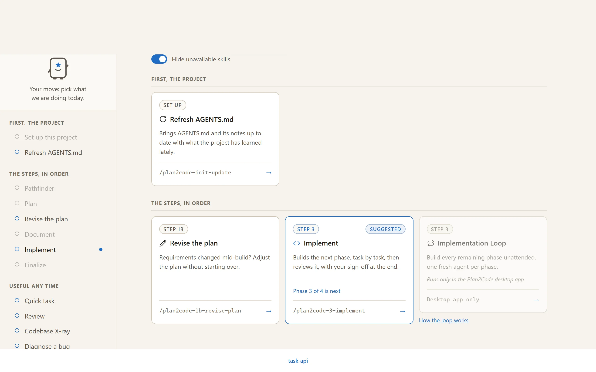
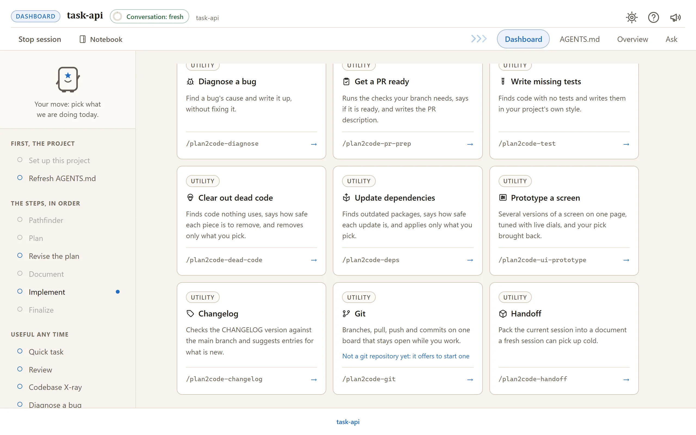
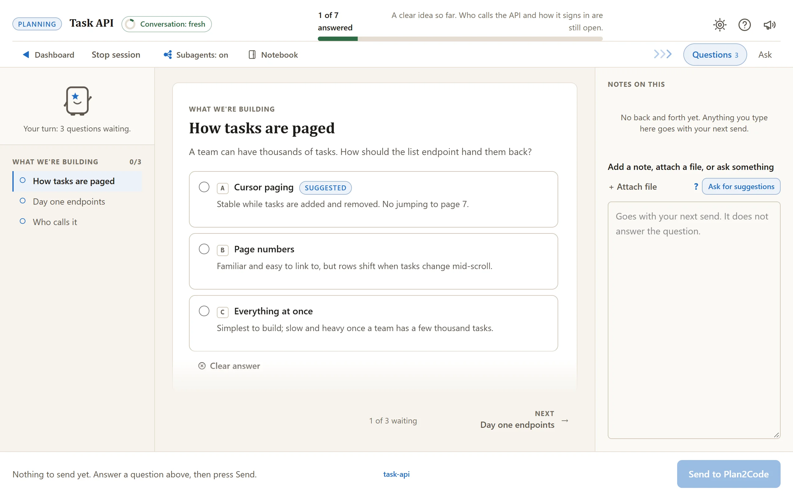
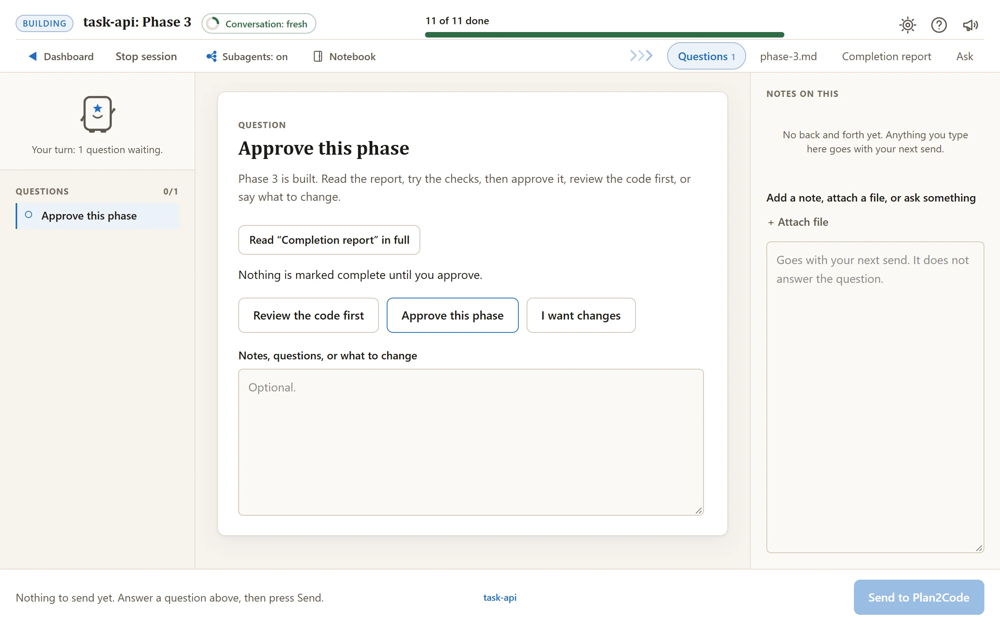
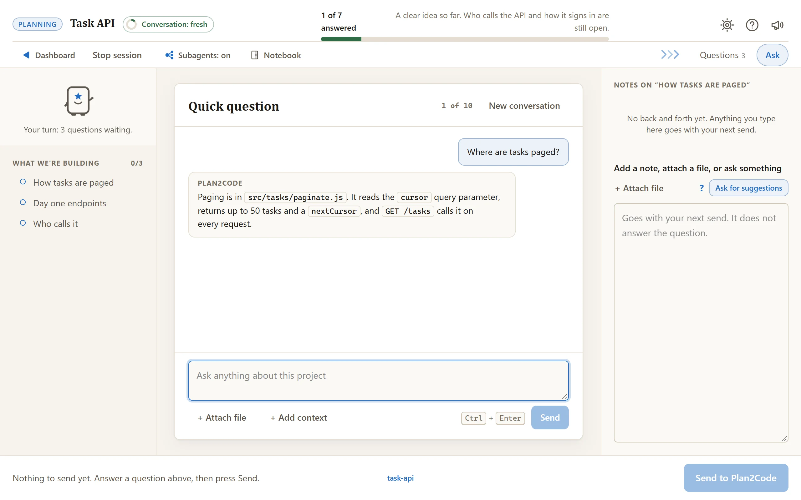
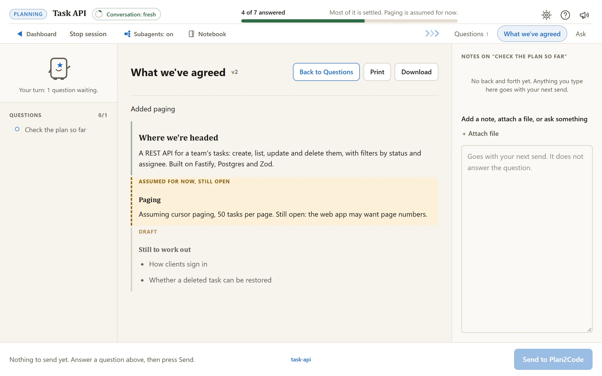
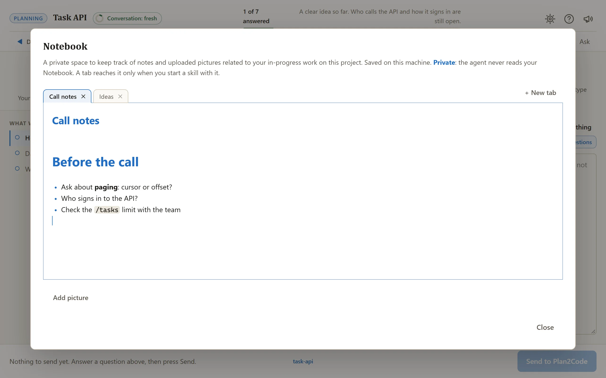
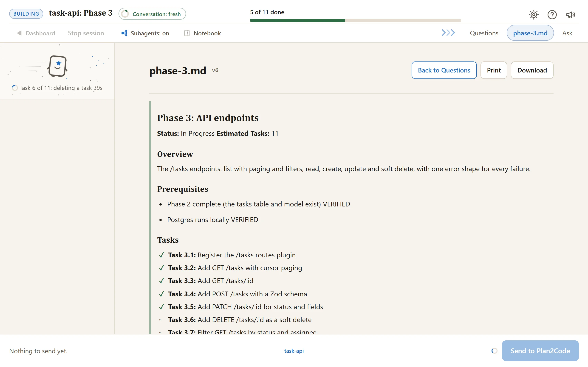
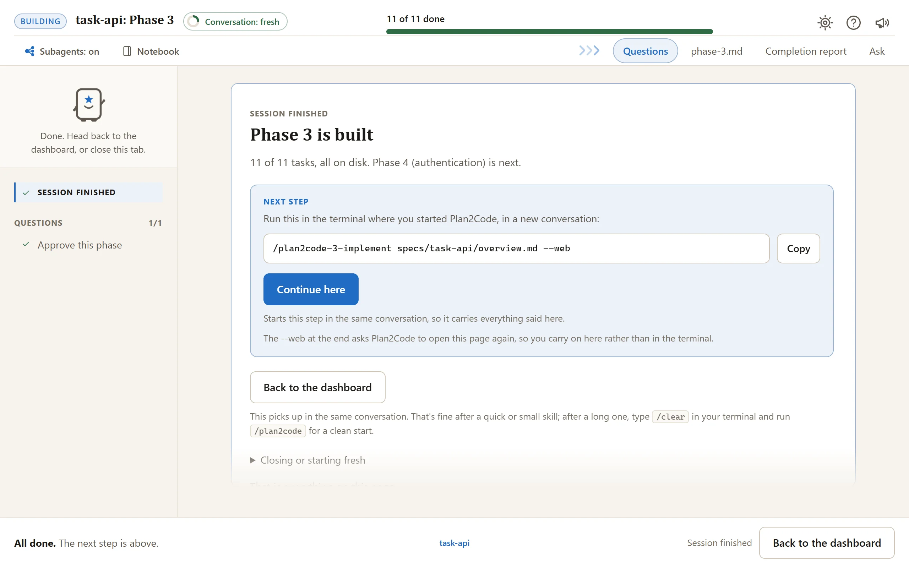

# The Web Console

## Contents

- [New here? A two-minute tour](#new-here-a-two-minute-tour)
- [Quick start](#quick-start)
- [What you get](#what-you-get)
- [Using it](#using-it): the dashboard, no agent found, your role, your workspace, subagents, your notebook, Activities, the session meter, building, review, ending a session, attachments, Ask, updates, keyboard
- [User Preferences](#user-preferences)
- [Troubleshooting](#troubleshooting)
- [Is it safe?](#is-it-safe)

## New here? A two-minute tour

**Launch it.** After installing, run `plan2code` in your project folder. It starts Claude Code or
Devin on the dashboard, and the page opens in your browser. In any other agent, run `/plan2code`
inside it, or add `--web` to a skill (`/plan2code-1-plan --web plan a lunch voting app`).

**What you see.**

- **The dashboard** has a card for every skill. The one it suggests next is flagged. Pick a card and
  that skill starts on the same page.
- **Questions** come laid out with the trade-offs next to each option and a progress bar on top.
  Nothing is sent until you press **Send**, and half-typed answers survive a closed tab.
- **Tabs** show the document taking shape, the build progress and, always last, **Ask**, where you can
  put a quick question to the running agent.
- **Sign-off** asks for your approval at the end of a phase. You can run the code review first from
  the same card, or press **Show me it working** to have the agent start the app and show you
  screenshots of the change right on the page.

**Where next.** [walkthrough.md](walkthrough.md) follows one feature from the first idea to the
last phase. The rest of this file is the reference: every card, button and rule. Prefer the terminal?
Run the same commands without `--web` and answer there; the files under `specs/` are identical.

---

The web console is the main way to use Plan2Code: a local page in your browser
where you pick a step, answer its questions, watch the documents and the build
take shape, and approve the work. Every skill runs on it, and `/plan2code` is
the front door: it opens a dashboard of all of them, and whichever you pick
starts right there on the same page.

It exists because the hardest part of adopting Plan2Code is not the engineering.
It is getting the person who actually knows what the product should do into the
room. Pathfinder and Planning are the two steps where that person matters most,
and they were the two steps that looked like a wall of terminal text.

## Quick start

1. Install Plan2Code (see [Install and start](../README.md#install-and-start) in the README).
2. Run `plan2code` in your project, or `/plan2code` inside your agent. The dashboard opens in your
   browser.
3. Pick a card. The same page becomes that step's session.
4. Answer on the page and press **Send to Plan2Code**.

Starting a step by its own command instead? Add `--web` (for example `/plan2code-1-plan --web`) and
it opens on the page without asking.

<picture>
  <source media="(prefers-color-scheme: dark)" srcset="../docs/screenshots/dashboard-dark.webp">
  
</picture>

Scroll down for the utilities. Outside a git repository the **Git** card says so and still offers to start one:

<picture>
  <source media="(prefers-color-scheme: dark)" srcset="../docs/screenshots/dashboard-utilities-dark.webp">
  
</picture>

---

## What you get

- **Every question laid out**, with the trade-offs next to each option, a progress bar ("4 of 9 settled") and Previous and Next under each card.
- **Help with the answer.** An *Autofill suggestion* button puts an example in the box for you to edit, and *Ask for suggestions* in the notes panel asks Plan2Code what it would pick and why. Some pick lists open with the suggestion already ticked; an empty pick is an answer too.
- **Settled answers read as answers**: what you chose, in words, with the rest locked. A question you have sent is held until Plan2Code answers it, and the page carries on working meanwhile.
- **Nothing is sent until you press Send**, and nothing gets lost: close the tab, reload, restart the machine, and your half-typed answers are still there.

<picture>
  <source media="(prefers-color-scheme: dark)" srcset="../docs/screenshots/question-dark.webp">
  
</picture>

- **The document taking shape**, in a tab, with the parts that are still guesses marked as guesses. A spec's **Overview**, **Map**, **Plan draft** and **Prototypes** tabs appear when the files exist: read-only, and read fresh from disk each time you open one.
- **A brief, on demand** (Pathfinder). *Write a brief*, choose how far back, and a plain-English report of what is decided, open and next opens in its own tab with Print and Save. It is the thing you take to a meeting.
- **It tells you when the other half stops listening.** The terminal and the page fail separately, so the page says so and what to do; answering anyway still works, because what you send is held on disk until something comes for it.
- **Whose turn it is, at a glance.** A chime plays when new questions arrive or a tab joins (a *Play sounds* switch and a box per moment are in User Preferences, with a menu of 19 sounds for seven of them). The tab icon's bar is dashed amber while Plan2Code works, solid green on your move and solid red when it has gone quiet or the connection is lost. After about 30 silent seconds, Planny asks whether it is still working or waiting on an approval in your terminal.
- **Yours to set up.** Light or dark and a highlight color, a **Card width** of Narrow (720px), Comfortable (880px, the default), Wide (1080px) or Ultra wide (1440px), and a role that puts the most useful starters first (see *Your role*). All remembered on your machine.
- **Files in your notes, and a notebook of your own.** Attach a screenshot or a document to any note or quick question (see *Attachments in notes and questions*), and keep a private notebook per folder (see *Your notebook*).
- **Where you are, at the bottom.** The footer names the folder and its git branch; click it to open the Workspace dialog (see *Your workspace*).
- **Help.** The **?** at the top right opens a Help dialog with 23 topics, one per tab, opening on the one for where you are. It is part of the page, so it reads fully even when the page has lost its program.
- Works offline, on your own machine only. No account, no install, no network.

An Implement phase ends on a sign-off card: read the completion report, then review the code first, approve the phase, or ask for changes. Implement + Review has already reviewed the code, so its card has no review button. Finalize always offers one last review of the whole feature after its checks, before the summary is written and the spec is archived.

<picture>
  <source media="(prefers-color-scheme: dark)" srcset="../docs/screenshots/signoff-dark.webp">
  
</picture>

The **Ask** tab is a chat beside the cards, for a quick question at any point. When a question is really a new task, the answer ends with a ready-to-paste prompt in a block with a Copy button.

<picture>
  <source media="(prefers-color-scheme: dark)" srcset="../docs/screenshots/ask-dark.webp">
  
</picture>

## Using it

The easy way in is the dashboard: type `/plan2code` in your agent, or run `plan2code` in your project. A page opens with every skill as a card (the setup pair, the pipeline in order, the utilities alongside), a note about what it made of your project, and a *Suggested* flag on the card it would pick. Click a card and the same page becomes that skill's console, already running.

- **Specs and their states.** The picker at the top chooses the spec. A diagnosed bug reads *Bug diagnosed* (Quick task suggested, Plan lit), then *Bug fixed* once Quick task has fixed it; a held-back upgrade from Update dependencies reads *Upgrade ready*, then *Upgrade done*. A finished one can be archived, or deleted from its chip.
- **Handoffs.** Handoffs this folder has not picked up follow the specs as dashed chips. Select one to preview it, then **Pick it up here**, **Read it all**, **Copy for a new conversation** or **Delete**. They live in `~/.plan2code/handoffs/`, written by *Stop with a handoff* (below) and by the Handoff skill.
- **Git and the utilities.** **Git** opens a board with three tabs (Changes, Branches, Sync) and asks before every push, publish and delete; outside a repository it offers to start one. **Codebase X-ray**, **Diagnose a bug** and **Update dependencies** are always available too.
- **Learning.** A row shows *Not set up*, *Off*, *On* or *Paused for you*; **Pause for me** pauses it for you alone. A banner offers **Review** while lessons are waiting. Kept lessons go to `.plan2code/lessons/` in the project; waiting lessons and your pause stay on this machine, and nothing is committed for you.
- **Planny wakes up.** A fresh dashboard starts with him asleep; click to wake him (**Skip** or Escape skips it, and reduced motion shows the awake dashboard at once).

Or start any step by its command (the full list is in the README's [Prefer the terminal?](../README.md#prefer-the-terminal) section), and add `--web` to open the console without being asked: `/plan2code-1-plan --web plan a lunch voting app`. Without it, the first question is "In your browser (suggested)" or "Here in the terminal". The page opens straight away at a `127.0.0.1` address, with a starting screen while the skill reads your project. You can switch to the terminal at any point: the files under `specs/` are the same either way.

While the page is open, the agent's messages in the terminal end with `→ Look at the web console` and, while it waits on you, say *Waiting on your answer in the web console*.

The link only works on your own machine, by design, so to work through a session together, share your screen. For the same reason an agent in a cloud VM, a container or over SSH stays in the terminal.

<picture>
  <source media="(prefers-color-scheme: dark)" srcset="../docs/screenshots/doc-dark.webp">
  
</picture>

### When no agent is found

The console does not always have an agent behind it. When `plan2code` finds no agent it can start
(no built-in and no working custom agent), it opens the console anyway on its **setup**
page: the one session with no agent attached, whose only job is getting you one. The desktop app
opens the same page in its window from a **Set up an agent** button.

Each built-in is listed with what Plan2Code found when it looked (the same lookup the `plan2code`
command and the app use, so all three agree):

- **Found**: installed and ready. **Start with this agent** picks it.
- **Found outside PATH**: installed, but not where `PATH` looks (it turned up on the saved
  Windows PATH, in npm's global folder or in its documented install folder). **Use it from here**
  saves that location, no `PATH` editing needed; the steps for doing it by hand are there too.
- **Not found**: not installed, or not anywhere Plan2Code looks. Its install commands for your
  system are listed, each with a Copy button, beside an **Install page** link.

**Check again** re-runs the lookup without restarting anything, so an agent you just installed
turns up. Under the list are five starter templates (GitHub Copilot CLI, OpenCode, Gemini CLI,
Pi, Cursor CLI): starting setups for agent CLIs Plan2Code does not ship, which fill in the same form as adding
an agent by hand and save as custom agents. The page's Help has a *Setting up an agent* topic, and
signing in to the agent itself is always your own step.

Pressing Start shows a "Starting <agent>..." pane while the new agent's session opens, then the
tab moves to it by itself. If the move never comes, a line after about two minutes points you at
the terminal and offers a way back to the list. Inside the app there is no Start: the app hears
that the page found an agent, closes the page and picks it on the launch card.

### Your role

The last control on *User Preferences*' Appearance tab (the gear button) is **Role**:
Engineer, Product lead / PM, Architect / tech lead, Designer (UX), QA / test
engineer, Engineering manager, or **Not set / none of these**, the default.
It only reorders things: the starter templates on an idea card and the starter
questions on the Ask tab. It never changes what a skill asks or does. It is
kept in `looks.json` with your colors, so it follows you into every session,
and **Reset this tab** on that tab sets it back to *Not set*.

Your first dashboard shows only the cards. Once you have started a skill,
and until you have chosen, one quiet line at the top reads *Two optional
extras: set your role, switch on Learning.* (just the role when Learning is
already set up), with a **Not now**. Choosing any role, *Not set* included, or
pressing *Not now* puts it away for good.

### Starter templates

The first "What's the idea?" box in Pathfinder, Plan and Quick task has a row
of starter templates above it: **Blank** first, then outlines to fill in (an
engineering spec, product requirements, a design decision, a bug
investigation, a refactor, a data migration, and so on), in the order your
role puts them. With a role chosen, the first one carries a *For your role*
pill. Pick one and the box fills with editable Markdown, one `## heading` per
answer with the answer on the lines under it, and the first `[blank]` is
selected so you can type straight over it. Brackets mark only the parts you
fill in; everything else is a default you can keep or edit. If you have
already typed something, a strip asks **Replace** or **Keep mine** first.
Only what is in the box is sent, exactly as if you had typed it.

The templates live in the page (`public/starters.js`), not in the prompts. A
skill only marks its fresh-idea card with `"templates": "idea"`, and `post`
refuses that flag on anything but a `text` card. A resumed map or plan asks
no idea question, so it shows no templates, and the terminal never has them.

### Leave for later (Pathfinder)

Pathfinder's scope question is **Leave for later** — *"Which of these features
are we leaving out this time?"* It is a tick-any list of 3–5 features someone
might expect, each ending with what leaving it out means ("Scheduled exports
(Leaving this out = someone runs each export by hand)"), with a recommended
set to tick in one go. The features you tick become the first lines of the
map's *Out of scope*. Every option names a feature, never a rule to keep, so a
tick always means "not this time".

### Skipping a question

**Skip this one**, on an optional question, now moves you straight on: the card
reads *Skipped* for a beat (about a quarter of a second) and the next open
question comes up. On the last one, focus goes to **Send to Plan2Code**
instead. A click or a key press in that beat cancels the move. **Do not skip**
on a skipped card brings it back.

### Your workspace

The folder label in the middle of the footer — `shop · main`, or
`shop + 2 folders · main` once you have added some (shorter on a narrow
window) — opens the **Workspace** dialog: the folders the agent uses as
context for this console session.

- **The folder you started in** is always first. It can be renamed and given a
  description, but not removed.
- **Add a folder** by pasting a path (`../shared-ui` counts from the folder
  you started in; `~` is your home folder) or with **Browse…**, which opens
  your system's own folder picker. Browse… is hidden when the page looks like
  it is being reached from another machine (SSH, a dev container, a
  Codespace). A path that is not a folder, one already in the list, and a name
  already taken are each refused with a message (a taken name comes with a
  **Use @name-2** button); a folder inside another one in the list is
  accepted, with a note.
- **Every folder has an `@name`** (lowercase letters, numbers and hyphens) and
  an optional one-line *What is it?*. Type `@` in the Ask box, a note or a
  typed answer and a list of names pops up; the agent reads `@shared-ui` as
  that folder.
- **What the agent does with them.** It is told the list when its session
  opens and each change once after that. Added folders are read-only
  reference: it reads them, reads each one's `AGENTS.md` (or `CLAUDE.md`)
  before first using it, and changes one only if you ask. Your harness may
  ask permission the first time it reads outside the project.
- **Marks.** *This folder no longer exists* when it is gone from disk; *The
  agent can't read this yet* when the agent reported a failed read (in Claude
  Code with a copyable `/add-dir <path>` to run); *Inside another folder in
  the list* for a nested one.

The workspace carries across skills you start from the dashboard and back, and
it is remembered for next time:

- **Saved on every change**, in `~/.plan2code/console/workspaces.json` (beside
  `looks.json`, never in the project, since the paths are your machine's),
  keyed by the folder you started in.
- **One list per spec.** *Start from scratch* on the dashboard shows the
  project's list. Picking a spec loads its own; the first time, it starts as a
  copy of the project's, and after that the two are separate. A spec created
  mid-run (Pathfinder, Plan) takes the list in force with it. The line under
  the dialog's title says whose list it is.
- **Forgotten on archive.** Finalize's Spec Cleanup step says it will forget
  the spec's list and runs `console.mjs forget --spec specs/<name>` after the
  move.

### Subagents

On most skills (all but the dashboard, Finalize, Changelog, Git and Handoff),
the agent can
hand independent pieces of work to subagents
while it keeps the conversation with you.

- **The button.** An icon in the top bar, after Stop session (and Write a
  brief on Pathfinder): one larger node linked to three smaller ones, lit in
  your highlight color while subagents are on. It shows only on those skills,
  and only when the skill's copy of the console can pass the setting on.
- **The dialog.** A click opens it; the button never switches anything by
  itself. **Use subagents** or **Work alone**, the instruction the agent follows
  (**Reset to default** puts the shipped one back), and how many subagents may
  run at once (1 to 20; your agent's own limit still applies). Under Subagents,
  **Subagent strength** sets how strong a model and how much effort subagents get:
  **Balanced** (the default), **Thrifty** (one step lighter; reviews never
  below standard), **Best** (strongest and high effort, except lookups) or
  **Match my session** (nothing set on subagents). **Save** sends
  it; the agent hears of it at its next check-in, as a setting, not as
  something you typed.
- **Saved per project and per skill**, on until switched off, in
  `~/.plan2code/console/subagents.json`. The next session of the same skill
  in the same folder starts the same way.
- **The Subagents tab.** With the first subagent the agent reports, a tab
  appears before Ask: one row per subagent with what it was asked and whether it
  is running, done or failed, plus a one-line result at the end. Rows change at
  the agent's check-ins, not live. *Working alone* means your agent has no way
  to start subagents here. Each row may carry one quiet line such as "Standard,
  medium effort" ("Session model" when the subagent runs on yours). The rules
  live in `helper-strength.md` and apply in terminal sessions too. The tab
  clears when you go back to the dashboard.
- **Pathfinder's research** always uses subagents, whatever the switch says, and
  they show in the tab too.

### Your notebook

The **Notebook** icon in the top bar, on the dashboard, every skill and the
finished screen, opens a large dialog with a scratch pad for the folder you are
working in.

<picture>
  <source media="(prefers-color-scheme: dark)" srcset="../docs/screenshots/notebook-dark.webp">
  
</picture>

- **Tabs.** A row of named tabs sits across the top, each with its own text and
  its own pictures. **+ New tab** asks for a name first (1 to 40 characters, no
  two the same in any case, up to 20 tabs), in a small dialog. There is no
  toolbar under the row: a double-click (or **F2**) on a tab renames it, the **x**
  beside its name deletes it (the **Delete** key does too), and tabs are moved
  only by dragging them. The tab you left open is the one you come back to.
  Delete opens a dialog that asks twice and takes the tab's text and pictures
  with it; with no tab left, the dialog asks you to make one. A notebook from before tabs opens
  as one tab called **Notes**.
- **Markdown, styled as you type.** The editor shows Markdown in place:
  headings grow, bullets draw, bold, code, quotes and links take their look, and
  the marks come back on the line you are on. The text itself stays plain
  Markdown (saved as the tab's `note.md`, up to 1 MB).
- **Pictures beside it.** Paste a screenshot, drop files on the dialog or press
  **Add picture**: each becomes a thumbnail in a strip under the text (up to 200
  per tab). Click one for a full-screen preview (arrow keys step through, Esc
  closes); its **X** asks before it deletes.
- **It saves itself**, about a second after you stop typing, when you close the
  dialog and before you switch tabs. If a tab's text cannot be saved, switching
  is refused ("Not saved yet, so staying on this tab") rather than losing it.
  If the connection drops, your text stays in the page and is retried, and the
  browser tab warns before you close it with something unsaved.
- **One per folder, kept between sessions.** Every session started in the same
  folder (each git worktree counts as its own) opens the same notebook, in
  `~/.plan2code/notepads/<folder-name>-<12 hex>/`: `meta.json` (which folder it
  belongs to), `tabs.json` (the tabs, their order and the last one open) and one
  folder per tab, `tabs/<id>/`, holding its `note.md` and `images/`. Two pages
  open on one folder share it, and the last save wins.
- **Private.** It never goes into your project, your session or anything the
  agent reads, so the agent never sees it, unless you send a tab (next
  bullet). It stays on this machine. A box filled from a tab is an ordinary
  draft from then on: like anything you type, its text is kept with the
  session's draft and its pictures with its uploads, unread until you send it.
- **Sent from the dashboard.** On a lit Pathfinder, Plan, Quick task or UI
  Prototype card with *Start fresh*, on a lit Diagnose card whatever is
  picked, and on a lit Revise plan card with a spec picked that has
  no plan change waiting, the confirm pane offers **Start with a note from your
  Notebook**. Turn it on and pick a tab: empty tabs are grayed, a tab you have
  sent shows a small **sent** badge, and a preview shows the whole tab, its text
  and its pictures. The first five pictures are ticked; at most five can be, so
  untick one to tick another. A tab over 50 KB gets a *Long tab* note so you can
  trim it first, and the pane's command line reads `+ note: <tab>`. Pressing
  **Start** is the consent, and nothing is put on the launch itself. The skill's
  first open text box marked `"fill": "note"` (the idea box, Diagnose's
  *What is wrong*, UI Prototype's *What to prototype*, or Revise plan's
  *What should change* box) then arrives filled, once, with the tab's text and
  the ticked pictures attached, and you can edit it before you press **Send**. A
  tab or picture deleted in between leaves the box empty (with a note) or skips
  the picture. Only sending that box hands the agent the text: **Send**, or
  **Stop** or **Back to the dashboard**, which take the answers you have ready
  with them (their dialog says so). Start alone, then going back before the box
  is sent, sends nothing and marks nothing. After it, the tab shows the **sent**
  badge and a muted *Sent to <Skill> · <Date>* line under its text.
- **Removed only when you say.** No automatic cleanup touches it. Once the
  newest file in a notebook is 30 days old or more, *User Preferences →
  System → Cleanup* offers it as one item named after its folder's full path
  (*Notebook for /home/sam/code/shop*),
  and deleting it removes the whole notebook, every tab's text and pictures.

### Activities

The **die** in the top bar opens **Activities**: thirteen small games to play while you wait, say through a long build (Snake, Mini golf, Light Trails, Bug Hunt, Sunset Drive, Stack Deploy, Bumper Ring, Rapids Run, Hot Potato, Crossing Rush, Bounce Road, Ghoul Rush and Flock Dash). A game pauses the moment it is your turn, and only you resume it. Best scores stay in `~/.plan2code/console/looks.json` on your machine and never reach the agent. User Preferences → Sounds & activities hides the die and the sounds. Every game, with its rules and controls, is in [the Activities guide](activities.md).

### Session meter

A small ring pill in the top bar — **Conversation: fresh** (green), **Conversation:
getting long** (yellow), **Conversation: time for a fresh one** (red) — counts the
work this console session has done. Click it for the count, a list of each
step that added points and what it added (for example *Quick task started +1*),
and a **What is this?** link to Help.

Each skill run adds points (`WEIGHTS` in `public/meter.js`): Plan, Document,
Review, Init and Init update 2; Revise plan, Quick task and Finalize 1; a
Pathfinder map 2 and each question its research subagents settle 1; a built phase by its size,
one point per 3 tasks it completed (rounded up), plus 1 for Implement + Review
(a flat 2, or 3, if the agent did not report a task count); Handoff and the dashboard 0.
A build counts while it runs: each task the progress bar ticks off adds to the
build's row (*Implement + Review: 9 tasks built so far*), Implement + Review's
review stage adds its 1 as it starts, and the approved phase takes the row over
with its final score, so the meter never waits for the sign-off to catch up.
On top of that, every 2 questions you answer on the page add 1 point to the
skill run you answered them in (`ANSWERS_PER_POINT`), so a long Pathfinder or a
Plan with many clarifying questions weighs more than a short one. A review run on the
page after a quick task or a phase sign-off counts as a Review too. Green is
under 5, yellow from 5, red from 10, and the ring is full at 15. At red the dashboard
also shows a banner: starting a **new console session** keeps the agent sharp
(resuming this one carries the count along). It is a rule of thumb, not a
reading of the agent's real context, and it never blocks anything.

### While something is being built

Implementation, Implement + Review and a Quick task spend most of their time
building rather than asking, so the page shows the build instead:

<picture>
  <source media="(prefers-color-scheme: dark)" srcset="../docs/screenshots/build-dark.webp">
  
</picture>

- **What it is doing right now**, beside Planny ("Task 5 of 9: the rate
  limiter"), and the progress bar counting tasks done. Tasks are counted
  within the phase, to match the bar — the phase is already named in the
  headline — so you never see "Task 4.2 of 6"; the page rewrites that form if
  an agent still sends it.
- **The phase file itself** (`phase-3.md`) in its own tab: the
  prerequisites and every task in full, each one ticking as it lands on
  disk.
- **Any question the build needs answered** (which phase, a spec conflict,
  failing tests) appears as an ordinary question, and the sign-off is a
  **Completion report** tab with an *Approve this phase* card.
- A long task is not mistaken for a stall. The build says how long it may go
  quiet, and the page only calls it stuck after that.

### Review before you approve

The *Approve this phase* card carries a **Review the code first** button beside
the approval. Press it and the same session runs a focused code review of
exactly the files the phase changed, before you are asked to approve anything.
The findings come back as a tab, and a *Which to fix* card lists every one with
its severity: tick the ones to fix (or use the *Critical and warnings* / *All
of them* quick picks), press Send, and it fixes and re-checks them before the
approval card comes back.

A quick task has no approval step, so its offer sits on the finished screen
instead: a large **Review it now** button above the next step, with **No
thanks, I am done** beside it. If the session has already closed, the button
turns into the `/plan2code-review` command to run in the terminal.

Implement + Review shows neither: it reviews every phase before sign-off
already.

### When a session ends

A finished session says so, and ends in one of three shapes:

<picture>
  <source media="(prefers-color-scheme: dark)" srcset="../docs/screenshots/finish-dark.webp">
  
</picture>

- **A next step.** What happened, and the exact command to run next (with a
  Copy button) — the next phase, Finalize, a commit.
- **All done.** Nothing is left to run, so there is no command to copy:
  *"All done, nothing left to run."* Init, Init update and Handoff end this
  way, and so do Review and Finalize when nothing landed that needs committing.
- **Stopped.** You pressed *Stop session*. The card names what was saved and
  gives the command that picks it up later. Nothing else is offered.

*Stop session* offers two ways to stop (on the dashboard, where nothing has
started, it is a plain Stop). **Stop with a handoff**, the suggested one,
saves your place as usual and also has the agent write a handoff: where the
work stands and the next task, kept in `~/.plan2code/handoffs/` rather than in
your project. The stopped card names the file, and the dashboard offers it as a
chip until it is picked up. **Just stop and save** saves your place and gives
the resume command, nothing more; where the step has nothing saved yet it reads
*Stop anyway*, under a warning about what is lost.

When the next step is another Plan2Code skill, the screen also has a
**Continue here** button beside it: one press starts that skill in the same
conversation, as a dashboard card would. It disappears once the session meter is
red, when a fresh conversation is the better choice. A finished Quick task or
Finalize that ends on a commit can also offer **Update CHANGELOG first**, beside
**Commit it now**: it opens Changelog right there, and Changelog's yes to
*Commit this now?* carries on to Git.

The first two also carry a **Back to the dashboard** button (beside the next
step, or as the main button under "All done"). Press it and the same page turns
back into the skill menu, in the same conversation, so the next skill starts
right there. The agent keeps listening for it for about ten minutes after the
session ends; after that, or once the session has closed, the button turns into
the `/plan2code` command instead. That command is on both of these screens
anyway, for starting the dashboard in a fresh conversation — the better choice
after a long skill, since a fresh conversation starts with a clean context.

The Implementation Loop's own end screen works the same way: finished or
stopped, its actions sit beside a **Back to the dashboard** button that opens
a fresh dashboard in the frame, no agent needed, and its status line marks it
as your move rather than leaving a stale "starting" line behind.

A stopped loop also offers **Ask a question**, first in the row. The app ended
its agent when the loop stopped, so the Ask tab says no agent is available;
the button wakes an ordinary agent on the same page, without starting the loop
or changing anything, and **Continue building** is still there afterwards; once
the agent is up, the button opens the Ask tab instead. **Back to the dashboard**
ends that agent too. The stop screen leads with a short reason, puts one line
under each button saying what it does, and highlights the one that fits the
stop: **Continue building** after a crash, a silence or your own stop, **Fix
together with an agent** after a failed check, a blocked task, a refused commit
or a question. The phases and uncommitted files sit under **Details**.

You don't have to finish first. On every skill but the dashboard itself, a
small **triangle** pointing left, in your highlight color, sits beside *Stop
session*. Press it, confirm, and the agent saves your place exactly as a stop
would, with any answers you have ready going along. Then the page turns into
the dashboard instead of showing a finish card. Pick the same skill again to
carry on, or pick another one. Like Stop, it only works on your turn, and where
nothing is saved yet (early in a plan) the confirm says what would be lost.

### Attachments in notes and questions

Any note, any quick question on the Ask tab, and the fresh-idea box on
Pathfinder, Plan and Quick task can carry files (on a card they travel with your
answer as a note attachment), three ways:

- the **+ Attach file** button beside the box (pick one or more files),
- **paste** a screenshot or a copied file straight into the box,
- **drag and drop** files onto the notes panel or the Ask composer.

Two kinds are allowed:

- **Images.** Each is shrunk and re-encoded in your browser (JPEG, 2000 px on
  the long edge at most, phone-photo rotation kept) and shows as a thumbnail.
- **Documents**: text, code and PDF (`.md`, `.txt`, `.json`, `.yaml`, `.csv`,
  `.log`, `.js`, `.ts`, `.py`, `.sql`, `.pdf` and the like), up to 10 MB each.
  They upload exactly as they are and show as a chip with the file type, name
  and size. The server checks the contents match the type (a PDF header, or
  UTF-8 text with no NUL bytes), and a document is never opened from the page.

Up to 5 attachments per note and 5 per question, images and documents counted
together. Anything else (`.docx`, a file over 10 MB, a dotfile such as `.env`)
picked or dropped is refused with a message naming the file; a paste only
picks up the files it can attach, and leaves any text to paste as usual. Each
file uploads straight away while you carry on typing, and sits in a tray with a
remove button; removing one deletes its file. A failed upload offers retry or
remove and holds back only that note, so the rest of your answers still send.

The files are stored with the session, in
`~/.plan2code/console/sessions/<id>/uploads/`, never in your project, under a
random name the server picks. When you send, each note is followed by one line
per attachment:

```
Note on Header row: Please keep the header row.
  Image: /home/sam/.plan2code/console/sessions/<id>/uploads/<uuid>.jpg (header.png)
  File: /home/sam/.plan2code/console/sessions/<id>/uploads/<uuid>.pdf (api-spec.pdf)
```

and the agent opens those paths with its own file reader. Uploads from sessions
untouched for 30 days are swept away the next time a session opens.

**Keeping the ones a spec cites.** When the agent is about to write a file
under `specs/<idea>/` that links to one of your note attachments (a plan, the
overview, a phase file, a Pathfinder question or the map), it first copies the
attachment into `specs/<idea>/attachments/` with `console.mjs keep` and links
the copy, so the spec still shows it after the session is swept. The copy is
named `<slug of your file name>-<8 characters of the upload id>.<ext>`, so
keeping the same upload twice reuses it. Attachments nothing cites stay in the
session, and quick-question attachments are never kept. `keep` is run by the
agent, in its own shell; the server itself still never writes into your
project (its one delete there is Cleanup's, below).

### Ask a quick question

The **Ask** tab, always the last tab, on the dashboard and in every skill,
opens a **Quick question** chat. Ask anything about the project's files, or
anything at all, without waiting for a card. The agent running the skill
answers at its next check-in (in a build, after the task it is on), and the
workflow carries on meanwhile. Asking never holds up a card send, and a card
send never holds up a question.

- **Context only when you add it.** A question starts with no context, so it
  reads as a general question. **+ Add context**, beside *+ Attach file*,
  lists the last 3 places you visited (question cards, document sections, a
  spec picked on the dashboard) plus *This spec*; pick one and an *About: …*
  chip sits above the box. × removes it, and it clears after the question is
  sent.
- **Starter questions.** An empty conversation offers a few questions to start
  from, chosen for the skill you are in and ordered by your role; the ones
  that need context appear once you have added some. Clicking one fills the
  box without sending it.
- **Pictures.** The same as notes: the button, paste, or drag and drop, up to 5
  per question.
- **Ten questions per conversation.** The `N of 10` counter is always in view.
  After the tenth is answered, **New conversation** starts a clean one.
  Switching skills through the dashboard keeps the conversation going.
- **Edits need your approval.** Ask for a change to a file and the agent
  replies with a summary and the list of files it would touch, with
  **Approve** and **Decline**. Nothing changes until you approve. Afterwards
  it lists what changed, with line counts, and nothing is committed unless you
  spell out a commit in your message. It never edits the running skill's own
  files under `specs/`, and a chat message never answers a card or moves the workflow on: that is what the cards are for.
- **When you cannot send.** Two different lines explain it: "That's 10
  questions in this conversation" means start a new one, and "No agent is
  connected right now" means the session has finished or the agent has gone
  quiet, so resume it to ask. Either way the conversation above stays
  readable.

A reply that lands while you are on another tab puts a dot on **Ask** and
chimes once (if sounds are on).

### When an update is out

When a newer Plan2Code release is out, the dashboard shows an **Update
available** banner at the top. In the desktop app, the top bar's **Update and
restart** does the whole update in one click and reopens the app; the banner's
dialog points at it first. Click it for the details: the version you
have, the new one (linked to its Releases page) and the command that updates
you, `plan2code update`, with a Copy button. It updates everything that was
installed (the skills, the `plan2code` command, the app and the status line; the
metrics and bot extras only from a git checkout), with
no menu, and never uninstalls anything. If the `plan2code` command is not
installed, the dialog also shows the install command,
`npx --allow-git=all git+https://github.com/jparkerweb/plan2code.git#release`, to run
instead. **×** hides the banner for this session; the next dashboard shows it
again until you update.

The `plan2code` command tells you too: before it starts your agent it prints
one line, `Plan2Code v<latest> is out (you have v<installed>). Run: plan2code update`.
It reads the same saved check, so it never waits on the network; when that
check is missing or old, it refreshes it in the background for next time.

The check uses your own git login to read the repo's release tags, once an
hour at most. If git cannot reach the repo (no git, no access, offline), you
simply see no banner, and nothing waits on it. The version in Help always
links to the Releases page.

### Keyboard

| Key | Does |
| --- | --- |
| `Ctrl` + `Enter` (`⌘` + `Enter` on a Mac) | Send |
| `Tab` / `Space` | Move between options and pick one |
| In the Ask box: `Enter` / `Ctrl` + `Enter` (`⌘` + `Enter`) | `Enter` is a new line; `Ctrl` + `Enter` sends the quick question, never the cards |
| `Esc` | Closes whichever dialog is open; on the dashboard, backs out of a pick |
| In Help: arrow keys, `Home`, `End` | Move between topics (the arrows wrap). `Ctrl` + `Enter` does nothing inside Help |
| In User Preferences: arrow keys, `Home`, `End` | Move between its four tabs (up and down in the side list, left and right in the strip on a narrow window) |

Every control is a real button, radio or checkbox, so screen readers and
keyboard-only navigation work.

## User Preferences

The gear button in the top bar opens **User Preferences**, always on its first tab. Its four tabs sit in a side list, or in a strip along the top on a window narrower than 720px, and the arrow keys, `Home` and `End` move between them:

| Tab | What it holds |
| --- | --- |
| **Appearance** | Theme, Card width, Highlight color and Role |
| **Agents & models** | The agents `plan2code` can start, and the models each one offers |
| **System** | Cleanup, and Desktop app (only inside the desktop app) |
| **Sounds & activities** | Sounds and Activities |

On Appearance and Sounds & activities each change saves the moment you make it, and a small **Saved** mark shows beside it. **Close** (or `Esc`) shuts the dialog. **Reset this tab** resets only the tab on screen, and offers **Undo** for a few seconds: Appearance's four settings (Role back to *Not set*), or every sound and the two Activities switches (Show Activities and Play activity sounds); Activities best scores stay. It is not shown on Agents & models or System, which have nothing to reset.

### Agents & models

Most people never need this tab: Plan2Code finds the agents installed on the machine and ships an up-to-date model list with every release. It opens on a roster of cards, one per agent, each showing whether its command was found on this machine, the model Thrifty, Balanced and Best use, and how many models it has. Opening a card puts that agent's form in a drawer over the roster, with two tabs: **Models & strengths** and **Launch** (a built-in's Launch tab only reads, because Plan2Code ships and updates its command). **Add agent** opens a chooser: the same starter templates the setup page has (GitHub Copilot CLI, OpenCode, Gemini CLI, Pi), each saying whether its command is installed here, or a **Custom agent**. Picking a template opens the new-agent form prefilled rather than saving anything behind your back; a template whose command an agent already uses is shown as *Already added*. Nothing on this tab saves as you type: each form has its own **Save** and **Discard**, and shows an **Unsaved** badge while it holds a change. Leaving a form with an unsaved change (another tab, **Close** on the drawer or a click outside it, **Close** on the dialog, `Esc`) asks first: save it, discard it, or keep editing. `Esc` backs out of the chooser, then the drawer, before it closes Preferences. Saving one agent never sends another's half-typed edit.

**Models.** The `plan2code` launcher's model menu comes from `models.json`, which every install overwrites with the authors' curated list. Each built-in agent's form (Claude, Devin, Codex) shows that list under *Comes with Plan2Code*, and below it **Models you added**, each a model id and the name shown in the menu, for a model that came out before Plan2Code was updated. Additions are kept in `~/.plan2code/models.json` and survive updates, unless the curated list now includes them; **Remove** takes one out. Restart `plan2code` to see a change. You can always run `plan2code --model <id>`, or switch model inside your agent before running a skill. Devin ids ending `-xhigh` or `-max` are refused. Maintainers refresh the curated list, and the shipped agent list's install data, with the repo-local `/plan2code-launcher-update` skill, which shows a diff and changes only what they approve.

**Strengths in the loop.** On the *Models & strengths* tab, an **In the loop** box shows the model **Thrifty**, **Balanced** and **Best** use for that agent (and an effort, for agents that take one), and tapping a word on a model in the list below it makes that model the pick, one per word. Rows you have not changed show as shipped, tagged *default*; a changed row has **Reset**. The Implementation Loop's **Strength per phase** setting reads these three words to start each phase, its retry and its subagents on the model you chose (see the Implementation Loop in the desktop app's guide). Saved with the agent's form in `~/.plan2code/models.json`.

**Agents.** An agent you add is an agent CLI Plan2Code did not find on its own, which the `plan2code` command and the desktop app can then start. Each one has a name, the command to run (a bare name looked up on `PATH`, or a full path), and optional fields:

- **Start prompt**: `/plan2code` by default. Leave it blank to start the agent with nothing typed.
- **Models**: a list to offer, each an id and an optional label.
- On the **Launch** tab, under the **Command-line arguments** fold:
  - **Arguments**: one per row. `{prompt}` is replaced by the start prompt (for example `--message={prompt}`); with no `{prompt}` anywhere, the prompt is added last.
  - **Bypass arguments**: added when permission checks are off.
  - **Model arguments**: added when a model is chosen, with `{model}` replaced (`--model` and `{model}` by default).

**Test** beside the command shows where it is found, or "Not found on PATH", and never runs it. Saving a duplicate name, a blank command or a built-in id marks the field and writes nothing. **Delete agent** asks once more on the form before it removes one. The list is plain text in `~/.plan2code/agents.json`, shared by the `plan2code` command and the desktop app; this page is the only thing that writes it, and a broken file or entry is skipped with a warning shown on the tab, never a crash. If the file holds something the page could not read, saving asks first (**Save anyway**). `/plan2code` works only in agents that load the installed Plan2Code skills.

### System

**Cleanup** lists what Plan2Code does not need in `~/.plan2code/`, with sizes, before anything is deleted (**Find files to clean up**, then tick what to delete and press **Delete N items**: sessions, named by skill, title and age, and strays start ticked, Notebooks and old completed specs start unticked); what it offers and what always stays is under *Or clean up on demand* below.

**Desktop app** appears only when the page is open inside the desktop app. Its switch, **Show on the taskbar when Plan2Code needs me** (on by default), controls the app's taskbar signal: on Windows a green dot on your move and a red one when it needs attention, plus one short burst of flashes when the window is not focused (the button stays lit until you look); on macOS a red `!` dock badge when it needs attention and one bounce; on Linux a badge where your desktop supports it. Turning it off clears the dot and stops flashes. The choice is kept by the app in its own `~/.plan2code/app.json`.

---

## Troubleshooting

| What happened | What to do |
| --- | --- |
| You closed the tab | Open the link again. Everything is where you left it. After about two minutes with no tab open the link stops working: ask the agent to resume the session for a new one. |
| The link stopped working | Tell the agent. It restarts the session and gives you a new link. |
| Your agent session died while you were mid-answer | Press Send anyway. Your answers are written to disk and are never discarded, including when the session is restarted. The next session picks them up. |
| The page says Plan2Code is not running | It has not checked in for a few minutes. Look at the terminal: it may have finished its turn, hit an error, or be waiting on you there. If it is idle, type `continue` in the terminal and it picks your answers up (in the desktop app, the **continue** or **Reconnect to agent** button in the sidebar, beside Send on the Ask tab, and on a saved launch types it for you). Answering here still works, and what you send is held for it. |
| You are not sure anything is connected | The **?** at the top right opens Help. Its *What this page is* tab says what keeps the page alive and whether both halves are talking at that moment, and *When something looks stuck* covers what to check. |
| You would rather use the terminal after all | Say so. Nothing is lost. |

---

## Is it safe?

The console is a local server on `127.0.0.1`, bound to your own machine, that reads files in your project and never writes to it. Its state lives in your home folder, and every request needs a per-session token. The full model, with every route, is in [the internals guide](web-console-internals.md#security).

---

More: [the Activities guide](activities.md) · [how it works, routes and security](web-console-internals.md) · [the .readme index](README.md)
