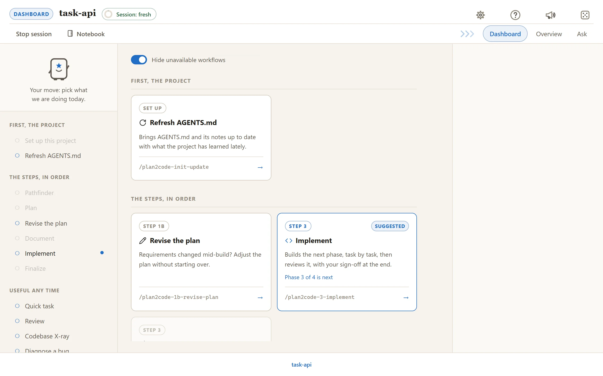
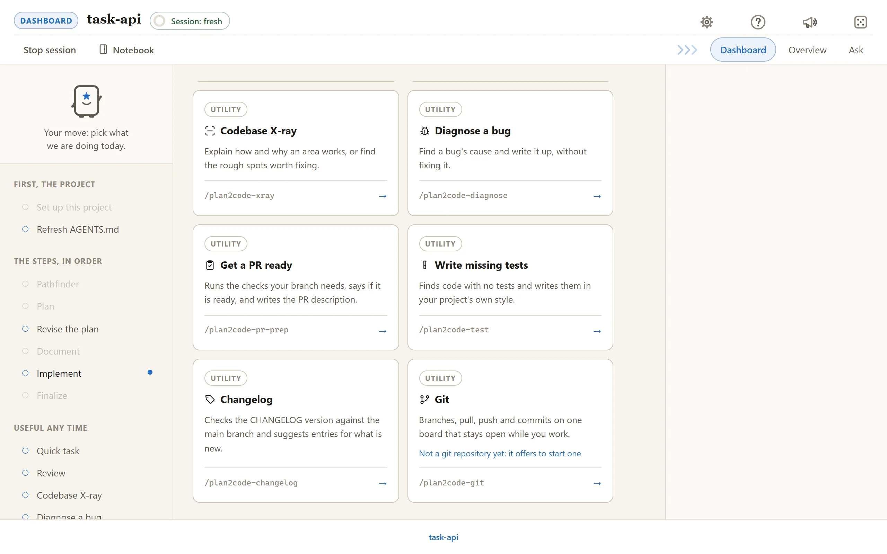
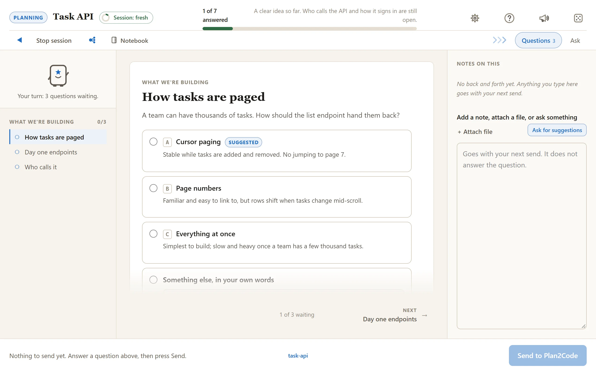
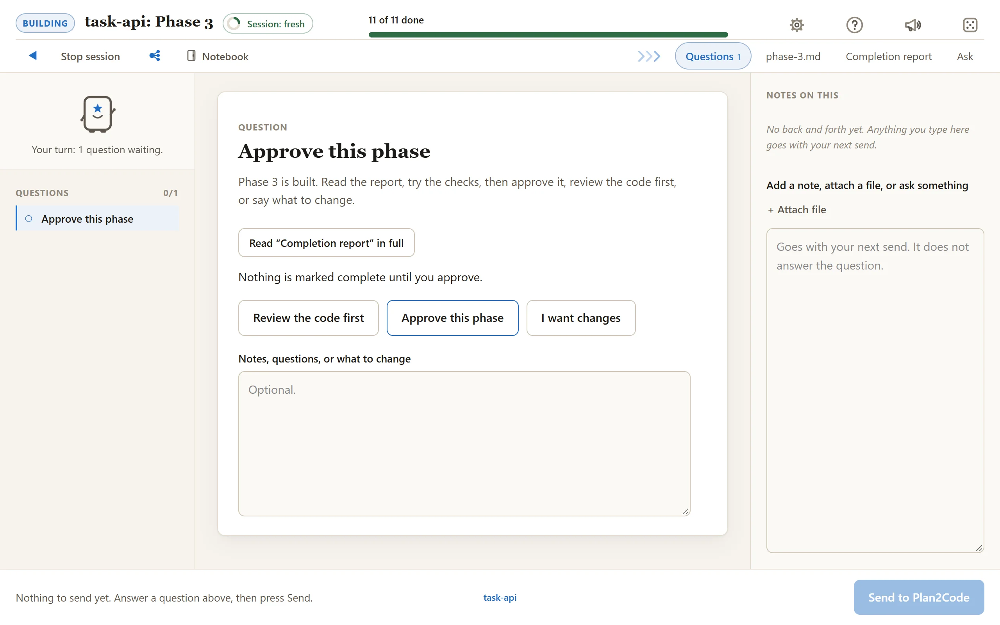
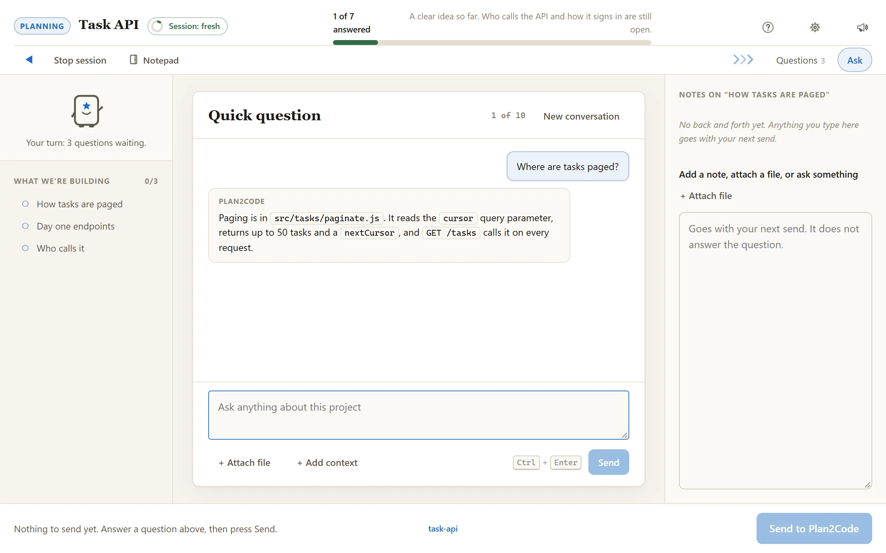

# The Web Console

## New here? A two-minute tour

**Launch it.** After installing, run `plan2code` in your project folder. It starts Claude Code or
Devin on the dashboard, and the page opens in your browser. In any other agent, run `/plan2code`
inside it, or add `--web` to a skill (`/plan2code-1-plan --web plan a lunch voting app`).

**What you see.**

- **The dashboard** has a card for every skill. The one it suggests next is flagged. Pick a card and
  that skill starts on the same page.
- **Questions** come laid out with the trade-offs next to each option and a progress bar on top.
  Nothing is sent until you press **Send**, and half-typed answers survive a closed tab.
- **Tabs** show the document taking shape, the build progress and, always last, **Ask**, where you can
  put a quick question to the running agent.
- **Sign-off** asks for your approval at the end of a phase. You can run the code review first from
  the same card, or press **Show me it working** to have the agent start the app and show you
  screenshots of the change right on the page.

**Where next.** [walkthrough.md](walkthrough.md) follows one feature from the first idea to the
last phase. The rest of this file is the reference: every card, button and rule. Prefer the terminal?
Run the same commands without `--web` and answer there; the files under `specs/` are identical.

---

The web console is the main way to use Plan2Code: a local page in your browser
where you pick a step, answer its questions, watch the documents and the build
take shape, and approve the work. Every skill runs on it, and `/plan2code` is
the front door: it opens a dashboard of all of them, and whichever you pick
starts right there on the same page.

It exists because the hardest part of adopting Plan2Code is not the engineering.
It is getting the person who actually knows what the product should do into the
room. Pathfinder and Planning are the two steps where that person matters most,
and they were the two steps that looked like a wall of terminal text.

## Quick start

1. Install Plan2Code (see [Install and start](../README.md#install-and-start) in the README).
2. Run `plan2code` in your project, or `/plan2code` inside your agent. The dashboard opens in your
   browser.
3. Pick a card. The same page becomes that step's session.
4. Answer on the page and press **Send to Plan2Code**.

Starting a step by its own command instead? Add `--web` (for example `/plan2code-1-plan --web`) and
it opens on the page without asking.

<picture>
  <source media="(prefers-color-scheme: dark)" srcset="../docs/screenshots/dashboard-dark.webp">
  
</picture>

Scroll down for the utilities. Outside a git repository the **Git** card says so and still offers to start one:

<picture>
  <source media="(prefers-color-scheme: dark)" srcset="../docs/screenshots/dashboard-utilities-dark.webp">
  
</picture>

---

## What you get

- **Every question laid out**, with the trade-offs written next to each option
  instead of scrolling past in your history.

<picture>
  <source media="(prefers-color-scheme: dark)" srcset="../docs/screenshots/question-dark.webp">
  
</picture>

- **A progress bar.** "4 of 9 settled" answers the first thing anybody asks.
- **Previous and Next under each card**, walking the questions still waiting, so
  the list on the left is somewhere to jump from rather than the only way round.
- **An example you can accept.** Where a question comes with one, an *Autofill
  suggestion* button puts it in the box as a real answer for you to edit. It
  disappears as soon as you have typed anything of your own.
- **Answers you have settled read as answers**, not as a form you might still be
  able to change: what you chose, stated in words, with everything else locked.
- **A question you have sent is held** until Plan2Code answers it, showing
  what you sent. The rest of the page carries on working, so you can read ahead
  or answer the next question while you wait.
- **The document taking shape**, in a tab, with the parts that are still guesses
  clearly marked as guesses.
- **A brief, on demand** (Pathfinder). Press *Write a brief*, choose how far back,
  and what comes back is a plain-English report of what has been decided, what is
  still open and what happens next, in its own tab with Print and Save buttons.
  It is the thing you take to a meeting.
- **Nothing is sent until you press Send.** Everything before that is local and
  reversible, so nobody has to worry about committing to something by accident.
- **Nothing gets lost.** Close the tab, reload, restart your machine: your
  half-typed answers are still there. Once you press Send, what you sent is
  held until Plan2Code actually collects it, so it cannot be written over.
- **It tells you when the other half stops listening.** The terminal and this
  page are two programs that fail separately, and a page that sat there saying
  "one moment" forever was the worst way to find that out. Now it says so, and
  says what to do: answering anyway still works, because what you send is held
  on disk until something comes for it.
- **Starters picked for your role.** Tell *User Preferences* what you do
  (engineer, product lead, architect, designer, QA, engineering manager) and
  the starter templates on an idea card and the starter questions on the Ask
  tab put the most useful ones first. It changes the order, never the
  questions a skill asks (see *Your role* below).
- **Light or dark, and a highlight color you pick.** The gear button at the
  top right opens *User Preferences* on its Appearance tab, which holds these
  and your role. It follows
  your system by default; set it to one or the other if
  you would rather it stayed put. Remembered on your machine, so it carries
  over to every session.
- **A card as wide as you want it.** The same tab has a *Card width*
  setting — **Narrow** (720px), **Comfortable** (880px, the default) or
  **Wide** (1080px) — that widens the question card, the Previous / Next pager
  and the document tabs together. The dashboard keeps its own layout, and on a
  small window the column simply fits the window. Remembered with the colors,
  so it follows you into every session.
- **Text that uses the card.** A question's text runs the full width of the
  card rather than stopping in a narrow column, and the answer box you are
  typing in grows to fill the card's free height: the box of a text question,
  the *Something else* box once you pick it, or the note under a verdict,
  yes/no or recap once it shows. Other boxes stay small. Drag the handle to
  make it taller; it never shrinks below the space it was given, and on a short
  window the card scrolls instead of squeezing the box under 160px.
- **Send tells you it is ready.** While there is something to send, the Send
  button pulses gently; it goes still when there is nothing to send.
- **Each tab remembers where you were.** Scroll halfway down a document,
  jump to the questions, come back: you are where you left off. The same goes
  for a long question card. It lasts as long as the tab is open.
- **The spec's overview, one click away.** When the session is working on a
  spec that has an `overview.md`, an **Overview** tab shows it — read-only,
  and read fresh from disk each time you open the tab, so an edit shows up
  straight away. No file, no tab. On the dashboard it follows the spec picked
  at the top, and disappears for *start from scratch*. A picked spec that is
  not documented yet shows its **Map** (`pathfinder/map.md`) and its
  **Plan draft** (the live `PLAN-DRAFT-*.md`) as tabs instead, each when it
  exists.
- **Where you are, at the bottom.** The footer names the folder the session
  was launched from and its git branch (`plan2code · feature/…`), muted in
  the middle. Click it to open the Workspace dialog (see *Your workspace*).
  Outside a git repo it shows only the folder.
- **A chime when it's your turn.** The page plays a sound when new questions
  arrive, when a new tab (a document, the overview) joins the strip, and when
  the session opens or closes, so you can look away without missing your cue.
  Starting a skill from the dashboard plays its own sound too. The same panel
  has a *Play sounds* switch for all of them, and a box per moment (Planny
  snoring, Planny waking up, starting a skill, session opens, skill is ready,
  session ends, new questions, a reply on Ask, a new tab), so you can keep only
  the ones you want. Ticking a box plays its sound; everything is remembered
  like the colors.
- **Files in your notes.** Show instead of describe: attach a screenshot, a
  photo or a document to any note or quick question (see *Attachments in notes
  and questions* below).
- **A notebook of your own.** One per project folder, in named tabs, for
  jottings and screenshots that are yours, not the agent's (see *Your notebook*
  below).
- **A nudge when it might be waiting on you.** Your agent may stop in the
  terminal to ask permission for something, and the page cannot see that. So
  the dashboard and every starting screen carry a one-line tip about hands-off
  modes (`auto` mode in Claude Code, `smart` mode in Devin) that can cut down
  on those stops, though they may still need your attention, and when the agent
  has been working and silent for about 30 seconds, Planny's line asks
  *"Still working, or waiting on an approval in your terminal?"* — well before
  the two-minute *"Still working on it"* line.
- **The tab icon says whose turn it is.** A bar along the bottom of Planny's
  favicon follows the line beside him: dashed amber while Plan2Code is
  working or picking up your answers, solid green when it is your move, solid
  red when it has gone quiet or the connection is lost (busy is dashed so the
  states differ by pattern, not only color). A finished session stays green
  while it still offers a button to press (back to the dashboard, a review),
  turns red if that press was never collected, and goes back to the plain
  icon once nothing is left, so a console left in a background tab can be
  checked at a glance.
- **Help.** The **?** at the top right opens a Help dialog with 21 topics,
  one per tab down the left (across the top on a narrow window), opening on
  the one for where you are. It is part of the page itself, so it still reads
  fully when the page has lost its program.
- Works offline, on your own machine only. No account, no install, no network.

An Implement phase ends on a sign-off card: read the completion report, then
review the code first, approve the phase, or ask for changes. Implement +
review has already reviewed the code, so its card has no review button.
Finalize always offers one last review of the whole feature after its checks,
before the summary is written and the spec is archived: pick the findings to
fix, or skip it, and anything left open lands in the summary.

<picture>
  <source media="(prefers-color-scheme: dark)" srcset="../docs/screenshots/signoff-dark.webp">
  
</picture>

The **Ask** tab is a chat beside the cards, for a quick question at any point.
When a question is really a new task, the answer ends with a ready-to-paste
prompt in a block with a Copy button, to take into a new conversation.

<picture>
  <source media="(prefers-color-scheme: dark)" srcset="../docs/screenshots/ask-dark.webp">
  
</picture>

## Using it

The easy way in is the dashboard:

```
/plan2code
```

A page opens with every skill laid out as cards — the setup pair, the pipeline
in order, and the utilities alongside — with a note about what it made of your
project (no AGENTS.md yet, a spec waiting on Phase 2) and a *Suggested* flag on
the card it would pick. **Git** is among the utilities, always available: it opens
the git board, three tabs — Changes, Branches and Sync — that open on the
likely next step (Help's *The git board* topic walks through it), and asks
before every push, publish and delete. In a folder that is not a git
repository its card says *Not a git repository yet: it offers to start one*,
and clicking it still works. **Codebase X-ray** is always available too: it
explains how and why an area works, or ranks its rough spots into
`specs/<name>/ARCHITECTURE-BRIEF-<date>.md`, and never changes code.
**Diagnose a bug** sits beside it, also always
available: it finds a bug's cause and writes it up as
`specs/<bug-name>/DIAGNOSIS-<date>.md` without fixing it. Pick such a spec in
the picker and it reads *Bug diagnosed*: Quick Task (suggested) and Plan light
up, while Document, Implement, Implement + Review and Finalize stay grayed. Once
Quick Task has fixed it, the folder reads *Bug fixed*: Quick Task offers to
archive it to `specs--completed/`, and until then the picker never opens on it
and hides it while *Hide unavailable workflows* is on. Its chip has a visible
**Delete** button in place of the hover ✕ other specs carry, and one confirm
removes the folder (any other spec also asks you to type its name). Click a card and Planny
flies while it gets ready;
a few seconds later the same page is that skill's console, already running. No
command names to remember. Pathfinder, Plan, Quick Task and Revise plan can also
start from one of your [Notebook](#your-notebook) tabs: see *Sent from the
dashboard* there.

Handoffs this checkout has not picked up yet follow the specs in the picker as
dashed **Handoff** chips, each with its title and age. Select one and the skill
cards give way to a preview: when it was written, its spec, the skill it came
from and its Next task. **Pick it up here** carries on in that skill and spec
in this same session (Quick Task takes over, and says so, when the skill or
spec is gone), and the chip is gone from the next dashboard. **Read it all**
opens the whole document, **Copy for a new conversation** copies a one-line
prompt that points a fresh conversation at the file, and **Delete** removes it
for good after one confirm. Handoffs from *Stop with a handoff* (below) and
from the Handoff skill land in the same place, `~/.plan2code/handoffs/`.

A freshly opened dashboard starts with Planny asleep in the middle of the page.
Click to wake him: he snores once while he gets a gentle shake side to side,
then about five seconds of him powering on to a boot-up sound (arms lifting
off his sides, his star opening, a hop and a cheer) before he glides into his spot at
the top and the menu rises in. (Browsers stay silent until your first click,
so the snoring usually starts with it; with *Sounds* off, the same wake-up
plays without audio.)
It plays only on a fresh `/plan2code`: not on a reload, not when you come
back with **Back to the dashboard**, and not after a launch. To skip it — from
the asleep screen or mid-animation — press the muted **Skip** button at the
bottom right or hit Escape; either goes straight to the dashboard, silent.
With reduced motion switched on in your system settings you get the awake
dashboard at once.

Or start any step directly by its command (the full list is in the README's
[Prefer the terminal?](../README.md#prefer-the-terminal) section).

The first thing it asks is how you would like to work:

> **How would you like to work through this?**
>
> - **In your browser** (suggested)
> - **Here in the terminal**

Pick the browser and a page opens at a `127.0.0.1` address, straight away:
opening the page is the first thing the skill does, before it reads your
project, so for the first few seconds you see a starting screen naming the step
("Starting Pathfinder") while it gets its bearings — for the core steps, with
Planny acting that step out. The questions replace it the
moment they are ready. Answer what is there, press **Send to Plan2Code**, and
it carries on. You can switch back to the
terminal at any point by saying so: the files under `specs/` are the same either
way, and neither side owns them.

While the page is open, the agent's messages in the terminal end with a
pointer back to it — `→ Look at the web console: http://127.0.0.1:…` — and
while it is waiting on you it says so in those words: *Waiting on your answer
in the web console*. Glance at the terminal, and it always tells you where to
look.

Know you want the page already? Pass `--web` with the command —
`/plan2code-1-plan --web plan a lunch voting app` — and it opens the console
without asking. The flag is dropped before the rest of the argument is read, so
it never becomes part of the request.

Sharing the link with a colleague on another machine will not work, and that is
deliberate. It is bound to your own machine only. To work through a session
together, share your screen.

For the same reason, the web console is only offered when the agent is running
on your own machine. An agent working in a cloud VM, a container or over SSH
stays in the terminal: a `127.0.0.1` link from somewhere else is a link you
cannot open.

### When no agent is found

The console does not always have an agent behind it. When `plan2code` finds no agent it can start
(no built-in and no working custom agent), it opens the console anyway on its **setup**
page: the one session with no agent attached, whose only job is getting you one. The desktop app
opens the same page in its window from a **Set up an agent** button.

Each built-in is listed with what Plan2Code found when it looked (the same lookup the `plan2code`
command and the app use, so all three agree):

- **Found**: installed and ready. **Start with this agent** picks it.
- **Found outside PATH**: installed, but not where `PATH` looks (it turned up on the saved
  Windows PATH, in npm's global folder or in its documented install folder). **Use it from here**
  saves that location, no `PATH` editing needed; the steps for doing it by hand are there too.
- **Not found**: not installed, or not anywhere Plan2Code looks. Its install commands for your
  system are listed, each with a Copy button, beside an **Install page** link.

**Check again** re-runs the lookup without restarting anything, so an agent you just installed
turns up. Under the list are four starter templates (GitHub Copilot CLI, OpenCode, Gemini CLI,
Pi): starting setups for agent CLIs Plan2Code does not ship, which fill in the same form as adding
an agent by hand and save as custom agents. The page's Help has a *Setting up an agent* topic, and
signing in to the agent itself is always your own step.

Pressing Start shows a "Starting <agent>..." pane while the new agent's session opens, then the
tab moves to it by itself. If the move never comes, a line after about two minutes points you at
the terminal and offers a way back to the list. Inside the app there is no Start: the app hears
that the page found an agent, closes the page and picks it on the launch card.

### Your role

The last control on *User Preferences*' Appearance tab (the gear button) is **Role**:
Engineer, Product lead / PM, Architect / tech lead, Designer (UX), QA / test
engineer, Engineering manager, or **Not set / none of these**, the default.
It only reorders things: the starter templates on an idea card and the starter
questions on the Ask tab. It never changes what a skill asks or does. It is
kept in `looks.json` with your colors, so it follows you into every session,
and **Back to default** on that tab sets it back to *Not set*.

Until you have chosen, the dashboard shows a one-line banner at the top —
*Pick your role to get starter templates ordered for you.* — with **Set up
preferences** and **Not now**. Choosing any role, *Not set* included, or
pressing *Not now* puts it away for good.

### Starter templates

The first "What's the idea?" box in Pathfinder, Plan and Quick Task has a row
of starter templates above it: **Blank** first, then outlines to fill in (an
engineering spec, product requirements, a design decision, a bug
investigation, a refactor, a data migration, and so on), in the order your
role puts them. With a role chosen, the first one carries a *For your role*
pill. Pick one and the box fills with editable Markdown, one `## heading` per
answer with the answer on the lines under it, and the first `[blank]` is
selected so you can type straight over it. Brackets mark only the parts you
fill in; everything else is a default you can keep or edit. If you have
already typed something, a strip asks **Replace** or **Keep mine** first.
Only what is in the box is sent, exactly as if you had typed it.

The templates live in the page (`public/starters.js`), not in the prompts. A
skill only marks its fresh-idea card with `"templates": "idea"`, and `post`
refuses that flag on anything but a `text` card. A resumed map or plan asks
no idea question, so it shows no templates, and the terminal never has them.

### Leave for later (Pathfinder)

Pathfinder's scope question is **Leave for later** — *"Which of these features
are we leaving out this time?"* It is a tick-any list of 3–5 features someone
might expect, each ending with what leaving it out means ("Scheduled exports
(Leaving this out = someone runs each export by hand)"), with a recommended
set to tick in one go. The features you tick become the first lines of the
map's *Out of scope*. Every option names a feature, never a rule to keep, so a
tick always means "not this time".

### Skipping a question

**Skip this one**, on an optional question, now moves you straight on: the card
reads *Skipped* for a beat (about a quarter of a second) and the next open
question comes up. On the last one, focus goes to **Send to Plan2Code**
instead. A click or a key press in that beat cancels the move. **Do not skip**
on a skipped card brings it back.

### Your workspace

The folder label in the middle of the footer — `shop · main`, or
`shop + 2 folders · main` once you have added some (shorter on a narrow
window) — opens the **Workspace** dialog: the folders the agent uses as
context for this console session.

- **The folder you started in** is always first. It can be renamed and given a
  description, but not removed.
- **Add a folder** by pasting a path (`../shared-ui` counts from the folder
  you started in; `~` is your home folder) or with **Browse…**, which opens
  your system's own folder picker. Browse… is hidden when the page looks like
  it is being reached from another machine (SSH, a dev container, a
  Codespace). A path that is not a folder, one already in the list, and a name
  already taken are each refused with a message (a taken name comes with a
  **Use @name-2** button); a folder inside another one in the list is
  accepted, with a note.
- **Every folder has an `@name`** (lowercase letters, numbers and hyphens) and
  an optional one-line *What is it?*. Type `@` in the Ask box, a note or a
  typed answer and a list of names pops up; the agent reads `@shared-ui` as
  that folder.
- **What the agent does with them.** It is told the list when its session
  opens and each change once after that. Added folders are read-only
  reference: it reads them, reads each one's `AGENTS.md` (or `CLAUDE.md`)
  before first using it, and changes one only if you ask. Your harness may
  ask permission the first time it reads outside the project.
- **Marks.** *This folder no longer exists* when it is gone from disk; *The
  agent can't read this yet* when the agent reported a failed read (in Claude
  Code with a copyable `/add-dir <path>` to run); *Inside another folder in
  the list* for a nested one.

The workspace carries across skills you start from the dashboard and back, and
it is remembered for next time:

- **Saved on every change**, in `~/.plan2code/console/workspaces.json` (beside
  `looks.json`, never in the project, since the paths are your machine's),
  keyed by the folder you started in.
- **One list per spec.** *Start from scratch* on the dashboard shows the
  project's list. Picking a spec loads its own; the first time, it starts as a
  copy of the project's, and after that the two are separate. A spec created
  mid-run (Pathfinder, Plan) takes the list in force with it. The line under
  the dialog's title says whose list it is.
- **Forgotten on archive.** Finalize's Spec Cleanup step says it will forget
  the spec's list and runs `console.mjs forget --spec specs/<name>` after the
  move.

### Subagents

On most skills (all but the dashboard, Finalize, Changelog, Git and Handoff),
the agent can
hand independent pieces of work to helpers
(subagents) while it keeps the conversation with you.

- **The button.** An icon in the top bar, after Stop session (and Write a
  brief on Pathfinder): one larger node linked to three smaller ones, lit in
  your highlight color while helpers are on. It shows only on those skills,
  and only when the skill's copy of the console can pass the setting on.
- **The dialog.** A click opens it; the button never switches anything by
  itself. **Use helpers** or **Work alone**, the instruction the agent follows
  (**Reset to default** puts the shipped one back), and how many helpers may
  run at once (1 to 20; your agent's own limit still applies). Under Helpers,
  **Helper strength** sets how strong a model and how much effort helpers get:
  **Balanced** (the default), **Thrifty** (one step lighter; reviews never
  below standard), **Best** (strongest and high effort, except lookups) or
  **Match my session** (nothing set on helpers). **Save** sends
  it; the agent hears of it at its next check-in, as a setting, not as
  something you typed.
- **Saved per project and per skill**, on until switched off, in
  `~/.plan2code/console/subagents.json`. The next session of the same skill
  in the same folder starts the same way.
- **The Subagents tab.** With the first helper the agent reports, a tab
  appears before Ask: one row per helper with what it was asked and whether it
  is running, done or failed, plus a one-line result at the end. Rows change at
  the agent's check-ins, not live. *Working alone* means your agent has no way
  to start helpers here. Each row may carry one quiet line such as "Standard,
  medium effort" ("Session model" when the helper runs on yours). The rules
  live in `helper-strength.md` and apply in terminal sessions too. The tab
  clears when you go back to the dashboard.
- **Pathfinder's research** always uses helpers, whatever the switch says, and
  they show in the tab too.

### Your notebook

The **Notebook** icon in the top bar, on the dashboard, every skill and the
finished screen, opens a large dialog with a scratch pad for the folder you are
working in.

- **Tabs.** A row of named tabs sits across the top, each with its own text and
  its own pictures. **+ New tab** asks for a name first (1 to 40 characters, no
  two the same in any case, up to 20 tabs), in a small dialog. There is no
  toolbar under the row: a double-click (or **F2**) on a tab renames it, the **x**
  beside its name deletes it (the **Delete** key does too), and tabs are moved
  only by dragging them. The tab you left open is the one you come back to.
  Delete opens a dialog that asks twice and takes the tab's text and pictures
  with it; with no tab left, the dialog asks you to make one. A notebook from before tabs opens
  as one tab called **Notes**.
- **Markdown, styled as you type.** The editor shows Markdown in place:
  headings grow, bullets draw, bold, code, quotes and links take their look, and
  the marks come back on the line you are on. The text itself stays plain
  Markdown (saved as the tab's `note.md`, up to 1 MB).
- **Pictures beside it.** Paste a screenshot, drop files on the dialog or press
  **Add image**: each becomes a thumbnail in a strip under the text (up to 200
  per tab). Click one for a full-screen preview (arrow keys step through, Esc
  closes); its **X** asks before it deletes.
- **It saves itself**, about a second after you stop typing, when you close the
  dialog and before you switch tabs. If a tab's text cannot be saved, switching
  is refused ("Not saved yet, so staying on this tab") rather than losing it.
  If the connection drops, your text stays in the page and is retried, and the
  browser tab warns before you close it with something unsaved.
- **One per folder, kept between sessions.** Every session started in the same
  folder (each git worktree counts as its own) opens the same notebook, in
  `~/.plan2code/notepads/<folder-name>-<12 hex>/`: `meta.json` (which folder it
  belongs to), `tabs.json` (the tabs, their order and the last one open) and one
  folder per tab, `tabs/<id>/`, holding its `note.md` and `images/`. Two pages
  open on one folder share it, and the last save wins.
- **Private.** It never goes into your project, your session or anything the
  agent reads, so the agent never sees it, unless you send a tab (next
  bullet). It stays on this machine. A box filled from a tab is an ordinary
  draft from then on: like anything you type, its text is kept with the
  session's draft and its pictures with its uploads, unread until you send it.
- **Sent from the dashboard.** On a lit Pathfinder, Plan or Quick Task card
  with *Start fresh*, and on a lit Revise plan card with a spec picked that has
  no plan change waiting, the confirm pane offers **Start with a note from your
  Notebook**. Turn it on and pick a tab: empty tabs are grayed, a tab you have
  sent shows a small **sent** badge, and a preview shows the whole tab, its text
  and its pictures. The first five pictures are ticked; at most five can be, so
  untick one to tick another. A tab over 50 KB gets a *Long tab* note so you can
  trim it first, and the pane's command line reads `+ note: <tab>`. Pressing
  **Start** is the consent, and nothing is put on the launch itself. The skill's
  first open text box marked `"fill": "note"` (the idea box, or Revise plan's
  *What should change* box) then arrives filled, once, with the tab's text and
  the ticked pictures attached, and you can edit it before you press **Send**. A
  tab or picture deleted in between leaves the box empty (with a note) or skips
  the picture. Only sending that box hands the agent the text: **Send**, or
  **Stop** or **Back to the dashboard**, which take the answers you have ready
  with them (their dialog says so). Start alone, then going back before the box
  is sent, sends nothing and marks nothing. After it, the tab shows the **sent**
  badge and a muted *Sent to <Skill> · <Date>* line under its text.
- **Removed only when you say.** No automatic cleanup touches it. Once the
  newest file in a notebook is 30 days old or more, *User Preferences →
  System → Cleanup* offers it as one item named after its folder's full path
  (*Notebook for /home/sam/code/shop*),
  and deleting it removes the whole notebook, every tab's text and pictures.

### Activities

The **die** in the top bar, right of the megaphone, opens **Activities**: small
games to play while you wait, say through a long build. Twelve ship today,
**Snake**, **Mini golf**, **Light Trails**, **Bug Hunt**, **Sunset Drive**, **Stack Deploy**, **Bumper Ring**, **Rapids Run**, **Hot Potato**, **Crossing Rush**, **Bounce Road** and **Ghoul Rush**. The window opens on a
**picker**: a card per game with a small cover scene, a line about it, its best
score, and a **Last played** tag on the one you played last, which also has the
focus. Click a card (or walk the cards with the arrows and press space or
Enter) to open its game, and **All games** at the bottom left goes back to the
picker. One game plays at a time: going back keeps a round paused on its card
(**Round paused, score 14**), reopening the window goes straight back into a
paused round, and picking a different game ends it. While a game is on screen,
the header shows its best, such as **Activities · Snake best: 12**, or
**Snake: no best yet**.

Every game has its own soundscape, all made in the browser with no audio
files: engines that rev and shift gears with your speed, outboard motors,
rivers, wind, light-cycle drones and the moans of nearby monsters run for as long as
the moment lasts, and crashes, splashes, explosions, pickups, combos, bosses,
new bests and game over each get a sound of their own. A game can play
chiptune music too, made the same way, which builds as play heats up (Sunset
Drive has a song for each road, Snake a different one at every level, dealt from ten at
the start of a round so none repeats, Light Trails a different dark grid-electro track in
every arena, dealt from fourteen the same way and fuller once the riders go, and Ghoul Rush a track for each room, played at
one steady level and fuller in a boss fight): turn on **Play game music** in **User Preferences → Sounds &
activities** (it starts off). **Play game sounds** there turns the games'
sounds (the 3, 2, 1 and the new-best burst included) and their music on or
off and leaves the page's own cues alone; the **Play sounds** switch above it
silences all of it, and a paused or closed game goes quiet at once. A game
with music has its own **Music** slider beside **Full screen**, which sets that
game's music volume and is remembered per game (Snake, Light Trails and Sunset Drive start at 70,
Ghoul Rush at 65).

- **Snake** speeds up as it grows: 120 ms a step at its starting three cells,
  4 ms quicker for each cell beyond, never under 60 ms, and 3% quicker again
  for each level. Every 5 foods is a new level, which opens with Slow-mo on
  for its full 7 seconds (Slow-mo eases back to the usual pace over its last
  2.5 seconds, so its end is never a jolt), and the first few each bring
  something new: **Rocks** at level 2 (a cell flashes before it turns to
  stone, and never right ahead of the head), **Mystery boxes** at 3,
  **Portals** at 4, **Comets** at 5 (into the head is a crash, through the
  body cuts the tail there), **Chaos** at 6, where surprises also happen on
  their own, and **Ice** at 7, where a turn slides on for two steps before it
  takes (a frosty arrow off the head shows the turn coming; the ice melts at
  level 8). Each level serves its own fruit (an apple, then cherries, an
  orange, grapes, a banana, a strawberry, watermelon, a peach and, at level 9,
  a glinting golden apple) on its own scenery: a plain garden, then a meadow,
  a desert, a lagoon, a starry night, a carnival, ice, a volcano and gold,
  each a faint tint and a scatter of small marks over the usual board. The
  last food of every odd level from 3 on is a **boss fruit**: four cells big
  and crowned, it takes three bites (a point a level each, and the head must
  leave it between bites), and the last bite scores the food plus 5 points a
  level. From level 2 a **runaway fruit** on two little feet sometimes turns
  up in place of a power-up: once you are within three cells it hops up to two
  cells away, rests two steps between hops and tires after seven, so corner it
  or wear it out for 6 points a level before it runs off after 12 seconds. Food eaten within 2.6 seconds of the last builds a
  combo (x2 up to x5). Power-ups turn up every few seconds and fade if left: **Shield**
  (takes one crash: wraps through a wall, smashes a rock), **Slow-mo**, **Magnet** (food slides toward you),
  **Ghost** (walls wrap) and **Scissors** (half the tail, a point per cell
  cut). A mystery box holds one of nine surprises: Jackpot, Gold rush, Earthquake,
  Meteor shower, Lights out, Disco fever (triple
  points), Big snack, Incoming! (a comet) and Treasure. Passing your best
  mid-round plays a fanfare. A power-up, surprise or level banner opens on
  the half of the board away from the snake's head, and fades almost clear
  while the head is under it or heading into it, so it never hides what you
  are about to hit. The start and end screens show how many of the 22
  power-ups, surprises, levels and specials you have ever found, and what to look for
  next.
- **Mini golf** is six themed courses of eighteen hand-made, thoroughly silly
  holes, seen from above. Its card opens a **course dashboard**: a card per
  course with a picture of one of its holes, its line, its holes and par, and
  your best round on it (each course keeps its own), walked by the arrows like
  the picker, with **All courses** to get back. Once a round is over, space
  or a click goes back to the dashboard to pick the next course. **Dino Valley** has tar pits,
  geysers, raptors, a stomping T-rex and a volcano finale; **Candy Carnival**
  has gumdrops, gummy bears, licorice belts, a soda whirlpool and a chocolate
  fountain; **Cosmic Glow** is black-light glow golf in space, with black holes
  that pull a putt in, repulsor planets, wormholes, UFOs and airlocks; and
  **Frosty Peaks** glides on ice past penguins, a yeti, icicle gates and a
  frozen waterfall. Two hazards are theirs: ice, where the ball barely slows,
  and gravity wells, which pull it in or push it away. Pirate Cove and the
  Caves of Doom are eighteen holes each too, and their first holes are these.
  **Pirate Cove** floats in a shark sea: Walk the Plank,
  Shipwreck Cove, Cannon Alley, Treasure Beach, Kraken's Lagoon, Ghost Ship,
  The Ship's Wheel, Skull Island and, at the end, Captain's Plunder, with barrels,
  cannonballs, a rolling powder keg, a scuttling crab, a kraken's tentacle and a
  skull you putt through. The **Caves of Doom** are dark but for
  the ball's own light and whatever glows: Into the Dark, Stalagmite Forest,
  Lava Lake, Mine Cart Madness, Crystal Pinball, The Bottomless Pit, Glowworm
  Grotto, Crusher Corridor and The Dragon's Hoard, with glowing pools, lava, a
  bottomless pit, a bobbing fireball, runaway mine carts, stone crushers that
  slam shut in turn, portals and a sleeping dragon. Each hole opens with a quip,
  and splashes, bonks and tunnels pop up a word or two. Play is quick and
  arcade style: the aim follows the mouse (or hold left or right to turn it,
  slowly at first, then faster), and it points back at the cup each time the
  ball stops, staying there until the mouse moves a few pixels, so a click
  without a move putts along the arrow you see. A click or space starts the power meter beside the ball; a second
  sets the power. The needle crawls near the bottom, so soft putts are easy,
  and races near the top: the gold **MAX** band just under full putts 1.15
  times as hard, and the red band past it is an overswing that shanks the ball
  off line at reduced power. A ring round the waiting ball is the shot clock:
  after 6 seconds the meter starts by itself, and a meter left for three trips
  dribbles the ball a few inches. Hold space or the mouse button while the ball
  rolls to play it three times as fast. Par is set per hole (59 for the
  round), the ball is picked up after 8 strokes, and the round shows its +/-
  par. A scorecard (front nine and back nine) shows between holes; space, a
  click or 1.5 seconds moves on.
- **Power-ups.** A glowing pad the ball rolls over is held for your next putt
  only (the pill at the bottom right says which): a **Lucky Doubloon** makes the
  putt free (a hole still scores at least 1), a **Cannonball** fires it 1.6
  times as hard, a **Ghost Ball** floats over water, sand, bumpers and movers
  (but sinks if it stops on water), a **Parrot Magnet** bends it toward the cup,
  a **Rubber Duck** keeps its full speed off walls, a **Treasure Map** makes the
  cup huge, and a **Spyglass** draws where the putt will roll while the meter
  runs, following the needle. One
  is held at a time, a new pad replaces it, and a held one carries over to the
  next hole.
- **Light Trails** is a race to be the last rider moving. You, with Planny's
  star eye, and one to three rivals each leave a glowing wall behind; a wall, a
  trail (yours too), a crystal or another rider's head is out, and a rival's
  trail goes once it has faded. You get a split second of grace: about to
  ride into something, you hold in place for 150 ms first, and a turn pressed
  then rides out of it (the rivals get none). Arrows steer and space spends a **boost**
  charge for 1.4 seconds of speed (two charges a heat, up to three). A round
  is a run of heats through nine arenas, each with its own scenery: Neon Grid,
  Sunset Strip, Crystal Field, Warp Zone, Storm Front, Carnival, Glacier,
  Volcano and the Golden Arena. Winning a heat moves you to the next arena; a
  crash costs one of your three lives and runs the heat again, and you and the
  last rival out at once is a draw that costs nothing. Each arena brings
  something: a second rival and **power-up pads** at 2 (**Boost**, a charge;
  **Phase**, ride through trails for 3 seconds; **Eraser**, wipes the trails
  around you; **Slow-mo**, the rivals crawl; coins; and from arena 4 a
  **1UP**), **crystals** at 3, a third rival and a pair of **portals** at 4,
  **closing walls** at 5 (from 10 seconds in, the outer ring turns to stone
  every 3.5 seconds, flashing red first), and a second pair of portals at 6.
  The rivals ride sharper each arena, and grab a pad if they get there first.
  Points come for riding (a point a level every 6 cells), for each rival out
  while you still ride (10 a level, 5 more when it hit your trail), coins and
  each heat won (25 a level). The start and end screens show the furthest
  arena you have reached and the next one waiting.
- **Bug Hunt** is an arcade shooter. Planny's ship slides along the bottom
  (left and right move it, up and down a little too) and fires while space is
  held. Each wave of bugs swoops in from the sides into a formation that sways
  across the top, and every couple of seconds one or more break off and dive
  at you; a bug that misses flies back in from the top. A bomb or a bug that
  reaches the ship costs one of three lives, and the ship comes back after a
  second, blinking and safe for a moment more. The first waves each bring a new
  bug: the everyday **Bug** (wave 1), the **Beetle** (2, two shots, and it
  splits into two bugs that dive on their own), the **Race condition** (3,
  zigzags as it dives), the **Exception** (4, throws at you), the **Null
  pointer** (6, shots pass through it while it fades) and the **Firewall** (7,
  five shots, never dives). Every fifth wave is a boss with a health bar: the
  **Memory Leak** (grows while you wait and sprays drops), the **Spaghetti
  Monster** (shrugs off every shot until its four meatball tentacles are shot
  off) and the **Heisenbug** (blurs, then turns up somewhere else, and cannot
  be hit while it blurs), then round again with more health. Squashed bugs
  drop coins and, now and then, a power-up: **Spread shot**, **Rapid fire**,
  **Shield** (takes a hit, up to two), **Slow-mo** (the bugs and their bombs at
  half speed), **Magnet** (coins come to you), **Refactor** (clears every bomb
  and squashes the everyday bugs on screen) and, from wave 4, a **1UP**. Kills
  within 1.2 seconds of each other build a combo up to x5. A wave cleared
  scores 50 points a wave, and 100 more a wave without a hit; a boss is 500
  points each time round. The board is Snake's checkerboard scrolling past,
  with bits of code drifting by, and new scenery every five waves: the
  Codebase, Legacy Code, Production and the Cloud. The start and end screens
  show how many of the 16 bugs, bosses and power-ups you have found.
- **Sunset Drive** is a road racer against the clock, seen from behind
  Planny's convertible on a road drawn a segment at a time, with bends,
  hills and scenery scrolling past. Hold up to drive (five seconds to a top
  speed of 150 mph), down to brake, left and right to steer; bends push the
  car to their outside, and off the road it slows to a quarter of top speed.
  Space burns a **nitro** can for 2.5 seconds of a higher top speed (two to
  start, up to three). A round starts with 40 seconds on the clock, shown big
  in the top middle (in the last ten seconds it blinks red and swells on
  every tick), and each
  stage ends at a **checkpoint** that adds time (31.5 seconds
  at the first, a second and a half less each stage, never under 18) and
  1,000 points a stage. Just before it the road **splits** around a median:
  the side you keep to as it begins picks the next road (the board above the
  road names both, the gentler on the left, and a postcard of each road
  shows in the top corner on its side as the fork is called), and the
  median is a wall that holds you to your side. Six roads, each with its own
  sky, scenery, bends, hills and traffic, and its own points bonus: **Sunset
  Coast** (x1, where every round starts), **Canyon Road** and **Maple
  Valley** (x1.2), **Snowcap Pass** (x1.4), **Neon City** (x1.5, the
  heaviest traffic) and **Starlight Highway** (x1.8). Catching up with a car
  drops you below its speed, and hitting a palm, cactus, rock or other prop
  on the shoulder all but stops you. Points come for every stretch of road
  driven (times the road's bonus, and 10% more a stage), coins (100), a
  **close call** passing a car within a lane at speed (50) and each
  checkpoint; **clocks** on the road add 5 seconds. Under 10 seconds the
  clock beeps each second, and at none the car coasts to a stop and the
  round is over. Spinning **?** boxes on the road hold **power-ups**, queued
  up to three (a box past that pays 250 points): while one is held, space
  fires the oldest instead of a nitro can, and timed ones run side by side,
  one fired again while it runs adding its time. **Rocket Hop** (1.6
  seconds) leaps over traffic and the shoulder, **Ghost Car** (5 seconds)
  drives through cars and props, **Coin Magnet** (6 seconds) pulls in every
  item across the road, **Monster Truck** (5 seconds) flings the cars it
  hits into the sky (150 points each) and flattens props, and **Coin Storm**
  turns the traffic ahead into coins at once. The start and end screens show
  how many of the six roads you have found.
- **Stack Deploy** is a one-button tower stacker. A block slides back and
  forth above the tower, and space, up or a click on the board drops it where
  it is drawn: the part over the block below stays, the overhang is sliced
  off and tumbles away, and the next block is that much narrower. A block
  that misses the tower ends the round, and the camera pulls back to show the
  whole tower once. A drop within 3% of the block's width of exact (or the
  distance it slides in 18 ms, whichever is more, but never more than half
  the block's width) is a **Perfect**: it snaps
  on with nothing sliced, the drop's thunk climbs a scale with each perfect in
  a row, and every third in a row grows the block back by 8% of the base's
  width, never past it. Points: 1 a floor, a perfect 2 more times the run (up
  to x5), and a perfect on a **gold** block (from floor 15, about one floor in
  twelve) 10 more and twice the growth. The slide speeds up 2% a floor from
  floor 10, and floors bring twists: from 20 blocks come from either side and
  some turn back partway, from 30 **lag spikes** freeze a block for 150 ms
  before it jumps on, from 40 **wind** eases a block in and out as it swings,
  from 70 blocks rush through the middle, and from 90 everything is faster.
  The tower changes style as it climbs (server racks, office floors from 25,
  glass towers from 50, rockets from 75) under a sky that goes from day to
  dusk, night and space, and a dashed line marks the highest floor you have
  ever reached, which the start screen names with the next style to reach.
- **Bumper Ring** is sumo in bumper cars on a round platform over the void,
  seen from above. Held arrows push your car that way (two at once push on
  the diagonal), momentum carries it, and cars bounce off each other: the one
  closing faster rams and wins the exchange, and two cars leaning on each
  other are a pushing match the stronger push wins. Space **dashes**, a burst
  the way you push that also makes the car heavier for a moment (two charges
  a heat, one back every six seconds, up to three). A car whose center goes
  past the edge falls (the last few units hold it back a little, so a push
  back in can save it), and the last car on the ring wins the heat. Rivals
  let go and rev before they dash, which is your moment to step aside; a
  rival that misses near the edge may fly off on its own. A round runs
  through nine arenas: **Training Mat** (the Bully), **The Ring** (a heavy
  Turtle that holds the middle, and power pads), **Bumper Alley** (the Sniper,
  who lines you up against the edge, and bumpers), **Ice Rink**, **Turntable**
  (the ring turns, and the Scrapper hunts whoever is nearest the edge),
  **Swiss Cheese** (holes that flash, then open), **Magnet Rink** (the middle
  pulls, then pushes), **Hall of Mirrors** (the Mirror copies your moves a
  beat later, and the ring turns square and back, its corners flashing before
  they go) and the **Grand Final**; past it, Final 2, Final 3 and on, each a
  little sharper. Each arena keeps what the earlier ones brought. A win moves
  you on; a fall costs one of three lives and runs the heat again, and you
  and the last rival off together is a draw. After 12 seconds the ring
  shrinks 3 units at a time (the band flashes red first) down to a floor, and
  a heat still going after that goes to **sudden death** until two cars no
  longer fit. Pads (from arena 2): **Heavy**, **Spring** (the next car you hit
  goes flying), **Charge** (a dash), **Shield** (bounce back off the edge
  once), **Grow**, **Ghost** (pass through cars) and **Slick** (oil behind
  you); rivals can take them too. Points, each times the arena: 10 for a
  knockout (the last car to touch the one that fell within two seconds gets
  it, and your hit carried through another car counts as yours, as does a
  rival you rammed into another), with knockouts within 3.5 seconds of each
  other building a combo of up to x5 and
  two within a second both counting twice; 25 for a heat won, 15 more if you
  never teetered at the edge; a point a second alive; and 5 for a rival that
  falls chasing you untouched. The start screen names the furthest arena you
  have reached, and the end screen says when you went further.
- **Rapids Run** is a fast vertical scroller on a winding river: Planny
  pilots a jet-skimmer up a river that scrolls down the board, its banks
  narrowing and splitting around islands. The arrows steer, held up speeds up
  (twice the points for distance, and less time to react), held down slows
  and held space fires. The battery drains all the while, a little faster at
  full speed: run over a green charge buoy to top it up, or shoot it for 10
  points if you can spare the charge. A bank, an island, a foe, a bolt or a
  flat battery costs one of three lives, and you start the stretch again
  from the last dam with a full battery (once a mini-boss's basin is reached,
  from the basin's mouth instead, and a dam already blasted stays open). Each stretch, about 20 to 35
  seconds of river, ends at a dam across it: shoot it open to pass (it takes
  more shots each stretch, so slow down for it). Eight stretches, **Willow
  Run**, **Reed Bend**, **Stone Gate**, **Mill Basin**, **Fog Narrows**,
  **Heron Forks**, **Copper Gorge** and **Old Lock**, then Night Water,
  Night Water 2 and on, quicker. Patrol skiffs drift from bank to bank and bob mines sit
  still from the start; gull drones swoop across, over land and all, from
  Reed Bend, bank sentries shoot back from Stone Gate, whirlpools tug you
  toward their eye from Fog Narrows and darters swerve into your lane from
  Heron Forks. Every fourth dam a mini-boss holds the basin before it, the
  river stopped and your battery held while you fight: **the Dredger** (a
  fan of bolts), **Ironclad** (rings of bolts, then one at you) and **Old
  Leviathan** (a stream that sweeps). Crates hold **Spread shot**, a
  **Shield** (one crash of any kind but a flat battery), a **Magnet** (charge
  buoys come to you) and a **Surge** (a full battery). Points: 1 for every 5
  units of river, 2 at full speed; 5 for every quarter second you skim a
  bank at speed (10 at full speed); 20 to 60 for each foe, times your combo
  (sinks within 1.6 seconds of each other, up to x5); 100 times the dam's
  number for each dam blasted (once each), and 50 times it more for a
  stretch with no life lost; and 400 for each of the first three
  mini-bosses, 800 each the next time around and so on, each of which also
  gives a life back. The
  score shows big at the end, and the start and end screens show the
  furthest dam you have blasted.
- **Hot Potato** is arena tag with a fizzing bomb: a merge conflict, its
  `<<<<<<<` markers showing. Held arrows run (light momentum, quick to start
  and stop), and whoever holds the bomb runs 1.12 times as fast and passes it
  on by touching a runner who holds none. The one just handed it cannot pass
  it for 0.6 seconds (it flashes white), and while three or more are left
  nobody can hand it straight back to the one who just passed it for 3
  seconds (a white ring at their feet shows who is safe). A pass never
  leaves its new holder less than 1.4 seconds of fuse (the 0.6 it cannot
  pass in, and 0.8 to reach someone): a fuse handed over lower is topped up
  to that, on a rival's pass too, once a fuse for each runner. Space dashes: a lunge while you hold it, a dodge while you do not
  (two charges, one back every 4 seconds). The fuse starts at 12 seconds,
  ticking quicker as it burns, and each fuse after it in a match is 1.5
  seconds shorter, down to 5; whoever holds the bomb at zero is blown out,
  and after a moment the bomb lights again on a survivor picked at random. A
  match's first fuse never starts on you. The last one standing wins the match
  and moves on a venue; blown up, you lose one of three lives and the match
  runs again. Nine venues: **Break Room** (the Sprinter, fast but turning
  wide, the Hider, who lurks behind cover and is slow in the open, and the
  Trickster, who feints before it dashes), **Open Plan** (pickups),
  **Server Room** (long rows of racks, and the Pal, who sticks by you),
  **Rooftop** (no wall at the bottom: off it is out, and a holder that goes
  over takes the bomb with it), **Ice Machine** (slippery patches, and the
  Clingy, who hangs just behind the holder), **Conveyor Hall** (belts),
  **Blackout** (you see only round yourself, the bombs and the pickups),
  **Two Bombs** (two fuses at once, never more than one bomb for every two
  runners left) and the **Finale** (shorter fuses, 10 seconds down to 4, ice,
  belts and two bombs); past it, Finale 2, Finale 3 and on, each a little
  sharper. Rivals get sharper and quicker as you go, crouch before a lunge
  (your moment to dodge), and may dodge yours. Pickups (from venue 2, one at
  a time): **Freeze** (every fuse stops for 2 seconds), **Sneakers** (1.3
  times as fast for 3 seconds), **Extra Fuse** (2 seconds more on every fuse)
  and **Swap** (trade places with a random runner; a holder keeps the bomb).
  Points: 10 times the venue for every fuse that ends on someone else (blown
  up, or off the roof with it), 2 for each pass you make, 15 more for a hot
  pass (under a second left) times your streak of hot passes in a row (up to
  x5; a pass that is not hot ends it, and so does a life lost), and 50 times
  the venue for a match won. The start and end screens show the furthest
  venue you have reached.
- **Crossing Rush** is a lane-crossing race: Planny and two rival hoppers
  hop up a strip of lanes eleven cells wide and 30 to 40 rows tall (the view
  follows you, and a race bar beside it shows everyone's height), a cell a
  hop (an arrow a hop, 0.12 seconds, with one more press queued). Roads of
  cars, vans and trucks; rivers of logs and turtles, which you stand on and
  ride (the water, or riding off the edge, is a send-back); train tracks
  whose lane flashes red with a bell for 1.2 seconds before a train fills it;
  and grass rows with bushes and rocks you cannot hop into. A car, a train or
  the water sends you back to the last grass row in a spin, never out, where
  you stand dazed for 2 seconds (stars round your head) before you may hop
  again; rivals sent back are dazed the same. First to the top wins the heat and
  moves on a zone; second or third costs one of three lives and runs the
  same heat again (same lanes), except that in zones 1 and 2 second place
  still gets through. Nine zones, each bringing something new: **Side
  Street** (roads, the Hopper, who waits for a clear gap, and the Daredevil,
  who takes the tight ones), **Riverside** (logs), **Rail Yard** (trains),
  **Turtle Bay** (turtles that dive now and then; the divers wear a red
  mark), **Highway** (trucks, lanes that speed up and slow down, and the
  Bruiser, quick and pushy through tight gaps), **Night Market** (a dusk,
  every lane still in view, brightened by headlights, lanterns and a glow
  round each hopper),
  **Rapids** (rivers that turn round, with arrows that blink first, and the
  Tagalong, who follows a row behind you, then races you to the top), **Ice
  Road** (icy lanes that slide you a cell further) and **Rush Hour**
  (everything, tighter gaps); past it, Rush Hour 2, 3 and on, quicker each
  time. Rivals get sharper as you go: they look further ahead and wait less
  after each hop. Pickups (four to six a heat, on the grass): a **Coin** scores
  10 points at once, and a **Spring**, **Shield** or **Horn** goes on your
  stack, shown in the pills as the next one space uses and how many wait
  behind it. Space uses the oldest: **Spring** leaps two cells the way you
  face, over whatever is in between (it stays on the stack when that cell is
  shut), **Shield** lets cars and trains pass through you for 3 seconds, and
  **Horn** stops the nearest road for 1.5 seconds, for everyone. Pressed
  mid-hop, it goes off as you land. The stack empties at every new heat, and
  a rival uses a pickup the moment it lands on it. Points: 1 for each row
  higher than you had got in the heat, 50 times the zone for a heat won,
  times your streak of clean wins (a win where you were never sent back adds
  one, up to x3; any other win, a second place or a lost heat ends it), plus
  3 for each row the runner-up still had to go, 5 for a close call (a car or a train
  through the cell you just left within a tenth of a second) and 10 for a
  coin. Planny's star is your highlight color, and a rival whose color sits
  too close to it wears a spare one. The start and end screens show the
  furthest zone you have reached.
- **Bounce Road** is a fast scrolling road seen from above: Planny races a
  springy toy car up a road laid across a giant's house and yard, with
  rival toy cars on it that mean to stop him. Hold up to drive, down to brake
  (a toy car never quite stops), the arrows to steer (a little less in the
  air) and space to jump, once a press; a jump needs a little speed and goes
  further the faster you are, and a ramp launches you on its own. Bump a
  rival sideways and it slides: one that leaves the road within 1.5 seconds
  of your bump is yours. Land on one and it is flattened while you bounce up
  again; land on another before your wheels touch the road and the **bounce
  chain** climbs, up to x8. Every stunt in quick succession (a crush, a
  bump-off, a hole, train, ball or barrier jumped, a ramp's big air, a close
  shave past a rival, a boost strip) steps the **combo**, which multiplies
  the points once more every third stunt in a row, up to x4, and runs out
  after 2.6 seconds without one. Water or a hole under your wheels, a crash
  (a flowerbed or a toy block nose first, a train, a truck's back) or
  anything landing on you (a ring on the road shows where) costs one of three
  lives, and you go back a little before the spot, with room to get up to
  speed. Ten stages of 25 to 45 seconds each, every one bringing something
  new: **Chalk Lane** (cracks, boost strips, cones), **Hose Creek** (broken
  bridges, a sprinkler, the Frog), **Kitchen Floor** (oil slicks, a rolling
  orange, the Sneak, who drops cones), **Flowerbed Fork** (splits, ramps,
  falling flowerpots, the Nudge), **Sandbox Run** (road that crumbles behind
  you, the Hauler, the Bruiser), **Toy Room** (a toy train crossing, toy-block
  chicanes, the Racer), **Garden Pond** (swaying bridges, drawbridges, the
  Cop), **Rooftop Gutter** (gusts), **Night Lights** (everything, in the dark)
  and **Monster Mash**, where the Monster truck hops at you and must be
  stomped five times; then the road goes round again from Kitchen Floor,
  quicker and meaner. The rivals get keener every stage: they block your
  line, brake in front of you, swerve from under your landings, hop the gaps
  and keep the pack close. Every hole has a warning sign and a straight
  run-up, and can be cleared at 80% of the top speed. Power-ups lie on the
  road from Hose Creek: **Spring**, **Bubble** (one free save), **Nitro** and
  **Mega wheels** (bigger and heavier: flatten whatever you touch). Points
  come from new road, rivals flattened (each kind its own, times the chain)
  and bumped off, jumps, big air, close shaves, stars and boost strips (times
  the combo), the Monster (2,000 for beating it), and each stage line (100
  times the stage, a bonus for beating its par time, and with no life lost
  250 more and a life back, up to five). Planny's car is your highlight
  color, and a rival whose color sits too close to it wears a spare one. The
  start and end screens show the furthest stage you have reached.
- **Ghoul Rush** is a fast, dark run-and-gun through a haunted house:
  Planny sprints left to right through a mansion a room at a time, the view
  scrolling with him. The house is pitch dark: you see what his glow, his
  flashlight's cone, the candles, the moonlight and the muzzle flash light,
  plus the eyes of whatever is waiting in the dark, and now and then
  lightning lights the whole room for a moment. Hold left or right to run,
  press up to jump (let go early for a short hop), down to drop through a
  shelf or, on the ground, to duck (a crow, bat, gargoyle or other swooper
  passes over your head if you are down before it reaches you), and hold space to fire his flashlight blaster the way he faces, ten
  bolts a second; a bolt tilts toward a monster ahead near his height (and
  toward a hovering wraith anywhere the tilt reaches). The blaster heats up
  as it fires: about three seconds go at the full rate, then each bolt waits
  longer, down to one a second (holding fire or hammering space heats it the
  same). A **LIGHT** gauge at the right of the HUD shows it: the bar fills
  as the blaster heats and empties as it cools, notched where the bolts
  start to slow, pale, then amber near the notch, then red and **HOT** past
  it. Let
  go of fire and, after a fifth of a second, it cools, the hottest blaster
  in about two seconds. Rapid fire's bolts add no heat and ignore it. **Tap
  space twice** to use a **secondary weapon** you have picked up, shown by
  a glowing icon and count beside the LIGHT gauge and by the same icon over
  Planny's head; keep holding after the second
  tap and the bolts carry on. The first tap still fires a bolt, feathering
  the blaster never throws anything, and hammering space spends one at
  most. The weapon you picked up last comes out first, you keep the rest
  from room to room and through a lost life, and no weapon ever hurts you.
  **Dynamite** (a wide blast on a short fuse), the **Iron Stake** (goes
  through a whole line) and the **Bottle Rocket** (three at once: one
  ahead, one that climbs and curves down onto the nearest monster above or
  ahead, one behind, each going off in a blast with a trail of colored
  sparks) turn up anywhere. Each stage has one of its own:
  the Manor's **Billiard Ball** (rolls along the floor), the East Wing's
  **Cast-Iron Skillet** (three pans circle you, then spiral off screen, each one-shotting what it touches and breaking on it), the
  Graveyard's **Grave Salt** (burns the floor, even what is still buried),
  the Grounds' **Hedge Sickle** (out and back, hitting on both passes), the
  Chapel's **Tuning Fork** (a ring that cracks stone and strikes organ
  pipes), the Sanatorium's **Flash Powder** (dazes what is near and shows
  what hides), the Village's **Silver Bear Trap** (five a use: two behind, one at your feet and two ahead, each
  snapping on the first thing to step in it) and the Mine's Dynamite, by the
  bundle. A boss can take only so much from them (about a third of its
  health at full force, then next to nothing), so they help a lot without
  winning the fight, and one at half health drops its stage's weapon if your
  bag is empty. Each room's door opens
  once you grab its key, often up on a shelf. A run starts in **the Long
  Hall**, an easy walk with only zombies, then goes **stage** by stage:
  three rooms, a bonus ride, then a boss (a big **BOSS FIGHT** card shows the
  boss, its name and a menacing line first, and the fight waits for a key press), and beating it opens the door. Out of the hall
  and out of each boss's room you **choose the next stage** from two
  (one, once a single stage is left) never played that run, each card
  showing the stage with its boss standing in it: left and right pick one
  out, space or up goes in. Clear six stages and the run takes you back to
  **Marrow Manor** for the finale, a fight against **the house itself**: on its
  front lawn, shoot out every lit window, the only part of it that can be hurt,
  while it throws its roof, its carpet and its fence at you, and calls down
  lightning and sends crows out of its door the moment you climb the oak. Kill it and you
  **escape**, a win. Each stage cleared makes the next quicker and tougher. Every other room keeps a **horde**
  pouring in from the edges of the view, mostly ahead, so standing still is
  never safe. **Zombies** shamble out of doors in the wall and sprint once
  you are close, **crawlers** drag themselves up through loose boards,
  **bats** swoop in level passes at your chest, **ghosts** drift through
  walls and can only be hit (or hurt you) while solid, **skeletons** throw
  bones you can shoot down, **hellhounds** crouch growling, then lunge in a
  low arc a jump clears, **widows** hang from the ceiling and drop on you as
  you pass under, **wraiths** hover ahead, shriek and dive at where you were
  (keep moving, or shoot them first), and **bloaters** lob acid that leaves
  burning puddles and burst into more acid when they die. Now and then a
  zombie comes as a **runner** (fast, down in one bolt) or a **glutton**
  (slow, 15 bolts to kill, a stomp only bruises it, and it never leaps or
  climbs), and a widow or a hellhound as a **huntsman**, a big spider on the
  floor that crouches and springs at you as high as you are. A shot to the head
  or a stomp from above doubles a kill, and each kill within 1.2 seconds of
  the last steps the chain, which multiplies kills up to x10. The rooms bring
  pits, one-way shelves, crumbling boards and falling chandeliers that crush
  whatever is below (a monster crushed counts double). Five stages so
  far: **the Manor**, the **Foyer**, the **Portrait Gallery**, the **Library**, the **Grand Banister**
  (a **bonus round**: you slide down the grand staircase's banister for about a minute,
  jumping vases, candlesticks and the breaks in the rail, ducking hanging portrait
  frames and chandeliers on a pendulum (brake or lean to time them), shooting ghostly
  butlers and cobwebs, and jumping with DOWN held to dive onto the brass under-rail
  where the track splits; five hearts of your own, as in the other bonus rounds),
  the **Ballroom**
  (the **Rotting Gourd**, a giant rotten pumpkin that picks one of three
  moves at random, never one three times running: a hop to where you stood,
  its shadow showing where, that shakes loose gourdlings; a spit of two
  acid globs after a shake; or a quake straight up and down that sends a
  shockwave along the floor both ways). Its arena is stacked with balconies
  in three tiers: up on one over its head it only spits at you, never hops,
  a corner always leaves a pocket its hop cannot land on, and its gourdlings
  jump up onto balconies after you and run off their ends to follow you
  down), **the East Wing**, the
  **Kitchen**, the **Conservatory**, the **Attic** and the **Crypt** (**Old
  Rattlebones**, who throws volleys of five bones, slams shockwaves along
  the floor you jump and throws his own skull like a boomerang, level at your
  chest and back again, so jump it going and coming; headless meanwhile, he
  has no weak spot, but a bolt to the flying skull does triple. His skull on
  his shoulders takes double. At half his hp he shakes, his eyes flare and he
  fights faster: his slams come in a double, he hurls bones up that come down
  around you on shadows, and he raises up to two skeletons out of the floor),
  and **the Graveyard**, out
  under the night sky: the **Lychgate**, **Open Graves**, **Mausoleum Row**
  and **Angel's Rest**; between the Row and Angel's Rest is a **bonus round**,
  **the Midnight Hearse**: you hijack a runaway hearse and tear down the
  cemetery road for about a minute, switching between the road and the grass
  verge at the lane gates to get round fallen oaks and hedge walls, jumping
  open graves and headstones, ducking branches and the lychgate arch and
  shooting grasping hands and crows, with the lamp kept lit by lanterns on the
  road (a hit throws a coffin out ahead, and the ghoul that sits up in it is
  worth shooting). Its monsters are its own: **grasping hands** that lie
  unseen under the dirt, burst up as you pass and creep along under the
  ground after you; **mourners** whose wail slows you to half speed for a
  moment if you are close; **grave robbers** who dig in and come up behind
  you; **rotters**, zombies whose legs keep walking after you if you shoot
  them down at the body (a headshot or a stomp finishes them); **carrion
  crows** that wait on the headstones and dive at you; and rotters climbing
  out of open graves. Its boss is **Mother Mourning**, a giant weeping angel:
  while she weeps she is stone (your bolts glance off) and flings headstones,
  then she turns and watches, and only then can she be hurt, but anything
  but standing still while she watches brings a stone fist down where you
  are, its shadow first. She does not stay where she was: each time she turns
  back to watch she has blinked a few steps nearer, in a puff of stone dust.
  At half her health she spreads her wings: a shorter weep, two headstones at
  a time, a shockwave each way as each weep begins, and while she watches a
  stone fist also falls near you now and then, moving or not.
  A fourth stage, **the Grounds**, is the gardens under the night sky: the
  **Hedge Maze**, the **Topiary Garden**, the **Gazebo** and the
  **Groundskeeper's Yard**. Its monsters: **topiary beasts**, hedges clipped
  into animals that stand frozen while you face them and charge the moment
  your back is turned (so you can only shoot one while it is still);
  **rootlings**, a crack that runs along under the lawn after you, stops
  to warn, then bursts up as a solid root that hurts until it sinks again;
  **lantern moths**, which come in flocks of three and flutter at you,
  quicker in the dark and straighter still while you hold the Lantern; and
  **mulch crawlers**, which wait in a leaf pile and burst out as you come
  near. Its power-up is the **Hedge shears** (10 seconds, found only here):
  one bolt cuts down a topiary beast or a rootling outright. Its boss is
  **the Groundskeeper**. Jump his scythe as its low wave sweeps along the
  floor, but when he raises it high (a pale band hangs in the air in front
  of him) stay on the ground and let the high sweep pass over you; shoot the
  lantern at his belt while it flares open (it takes triple damage, but only
  then, and only briefly: after the scythe and again when the mower stalls);
  jump or stand clear of the fire he lobs where you stand, which burns the
  floor for a few seconds. At half his health he climbs onto a rusted mower:
  when he revs, get up high on a shelf before he charges across the
  arena (the charges come a little oftener), then shoot the lantern while he
  is stalled against the far wall. On the mower he lobs a second fire where
  you are heading, and each time the lantern opens a few lantern moths
  flutter in toward it.
  A fifth stage, **the Chapel**, is indoors again, candlelit stone and
  stained glass: the **Nave**, the **Bell Tower**, the **Organ Loft** and
  **the Choir**. Its monsters: **gargoyles**, stone on their ledges (your
  shots glance off and a stomp does nothing) until you pass under one, when
  it shakes loose, dives at your chest and flies back to turn to stone
  again; **choir ghosts**, which drift at you and sing now and then, and
  while they sing every monster near them moves faster, so kill them first;
  **censer monks**, who walk at you, swing their censers and leave clouds of
  harmless smoke that hide what is inside; and **bell bats**, asleep in the
  bells until the bell tolls. The **bell toll** is the stage's twist: in the
  tower and the choir the bell swings in view, then tolls, and for one
  second everything freezes, you included (a bolt already flying still
  hits), while a flock of bats bursts from every bell in view. Its power-up
  is **Holy Water** (10 seconds, found only here): your bolts splash,
  hurting every monster close to what they hit, hurting ghosts twice as much
  and breaking a stone gargoyle even on its ledge. Its boss is **the
  Choirmaster**, at his organ. Silence the four pipes to open him: each pipe
  takes a handful of bolts, a sounding pipe spews a ghost now and then, and
  while any pipe sounds he cannot be hurt. Once all four are silent, shoot
  him, but not for long: after four more columns of notes, fresh pipes drop
  in from the roof and you must silence them again. Between those he raises
  his baton and a column of notes flies at you along the lines of a staff
  with one gap in it: mind the gap in each column and be at its height (the
  floor or one of the boards) as it passes. Each column has its own speed,
  some far faster than others (a hot edge and a long tail) and some slower (a
  cold edge and a short tail). At half his health the hymn quickens: the
  notes fly faster and now and then a second column follows close behind.
  Between the Organ Loft and the Choir is a
  **bonus round**, **Holy Roller**: an endless-runner seen from behind. You
  surf a runaway church pew down the nave's aisle toward the altar, in three
  lanes, faster and faster for about a minute, with stone pillars, stained
  glass and pews rushing past in candlelight. LEFT and RIGHT change lane (a
  press at the edge bumps the wall), UP jumps, DOWN slides (in the air it
  fast-falls), and holding space shoots straight down your lane. Switch lane
  around the pillars, confessionals and crosswise pews; jump the kneelers,
  candle stands, flagstone cracks and open crypt hatches; slide under the
  swinging censers, hanging banners and fallen beams; shoot the gargoyles
  that drop from the arches (two bolts) or shoot a bell rope to ring its bell
  and stun the gargoyles ahead. Rows of golden wax souls run along the lanes
  (arcs over jumps, lines through slides) and build a combo, and a halo
  pulls the souls beside you in for a few seconds. Taking most of the souls
  is worth a Lucky Die. It plays for five hearts of its own, so a hit costs a
  heart, never a life, and shoves you into a safe lane; lose all five and the
  round ends with nothing and the run goes on to the Choir; reach the end and
  you earn three to nine Lucky Dice.
  A sixth stage, **Blackmoor Sanatorium**, is a derelict asylum of cracked
  green tile: **Admissions**, the **Hydrotherapy Baths**, the **Surgical
  Theater** and **the Night Ward**. Its monsters: **orderlies**, huge and
  slow, which reach for you when you come close (jump clear while they wind
  up), grab you and throw you a long way back (the throw costs no life, but
  mind where you land); **gurneys**, solid enough to stand on while parked,
  which rattle and roll at you when you come along their floor and hurt only
  while rolling; **flickers**, gaunt patients you can neither see nor hit
  while the lamps are lit, which lunge at you in the dark; and **specimen
  bloaters**, which lob jars that shatter into puddles of formaldehyde. The
  **flicker** is the stage's twist: in the baths and the theater the lamps
  stutter, then go out for a moment, and in that blackout you see little
  beyond your own glow. It has two power-ups found only here (10 seconds
  each): **Smelling Salts** (you break an orderly's grab at once, and keep a
  wide glow through a blackout, in which flickers show and take double
  damage) and the **Bone Saw** (your bolts pierce every monster in a line,
  and a gurney breaks in one hit). Its boss is **the Night Matron**. Stay out
  of her lantern's beam as it sweeps the ward: a moment in it costs a life,
  so hide behind a medicine cabinet or climb above it. Between sweeps she
  throws fans of syringes, and cracks of light in a wall warn of a long arm
  about to reach across the room at your height. At half her health the ward
  goes dark, her lantern the only light, her arms come from both walls at
  once and her fans of syringes grow.
  A seventh stage, **Hollow End Village**, is out under the night sky again
  (all but its inn): **Main Street**, **the Crooked Inn**, **the Town
  Square** and **the Village Green**. The **moonrise** is the stage's twist:
  in each room the moon climbs the sky, and when it is full every villager
  in view turns into a fast, leaping wolf-man and the moonhounds grow, so
  clear the villagers before the moon is up. Its monsters: the **torch mob**,
  villagers who come in threes and lob torches that leave fire on the
  ground; **hanged men**, swaying on their ropes until you pass under, when
  they drop to head height and haul back up; **shutter ghouls**, which rattle
  their shutters as you come near, then lunge out of the window (shoot them
  while they are out); and **moonhounds**, which leap at you like
  hellhounds. Its power-up is **Wolfsbane** (10 seconds, found only here):
  wolf-men and moonhounds shy away from you, and your bolts do them and the
  Beast double damage. Its boss is **the Beast of Hollow End**, a werewolf.
  It bounds onto the walls at either end of the green and clings there a
  moment, the time to shoot it for double damage, then pounces where you
  stand (watch the shadow on the grass); up close it swipes, and its howl
  calls moonhounds. At half its health the moon comes full: it waits less,
  pounces twice in a row, and its howl calls grown hounds. Between the
  Square and the Green is a **bonus round**, **Torch Mob**: you steal a hay
  wagon and race out of Hollow End down the cobbled road and over the old
  stone bridge, about a minute and ten seconds, with the village chasing you.
  Jump the barrels, crates, ditches and spooked horses, duck the washing
  lines and inn signs (down also brakes the wagon), and shoot or dodge the
  pitchforks and torches the villagers hurl from windows and roofs (a torch
  that lands sets the hay alight). The **mob** behind you closes in when you
  brake, get hit or burn, and falls back on clean stretches and when you
  shoot their torches; if it catches the wagon it costs a heart, and the
  collapsed bridge must be jumped off its ramp. Keeping the mob far behind
  is worth a Lucky Die. It plays for five hearts of its own and pays three
  to nine Lucky Dice.
  An eighth stage, **the Deep Seam Mine**, goes underground, where every room
  is always dark: **the Mine Shaft** (ride the cage lifts up and down),
  **the Flooded Tunnels** (knee-deep water slows you and your steps splash),
  **the Collapse**, **the Runaway Cart** and **the Mother Seam**. **Rockfall** is the stage's
  twist: dust trickling from the ceiling warns of a rock about to drop, which
  crushes whatever is under it, you included. Its monsters: **Knocker imps**,
  small and quick, whose touch steals your light (your glow shrinks to a
  sliver for a few seconds, but no life is lost; shoot the imp to get it
  back); **canary ghosts**, harmless to touch, but their scream brings three
  rocks down around you, so shoot them first; **dead miners**, who burst out
  of the walls with their helmet lamps still lit and swing a pickaxe up
  close; and **blind crawlers**, which hunt by sound: stand still without
  firing for a moment and they lose you. It has two power-ups found only
  here: the **Hard Hat** (worn on your head until it is used, like the
  Garlic shield: one rock bounces off it, or an imp knocks it off instead of
  stealing your light) and bundles of **Dynamite** (three sticks here,
  thrown with a double tap like any secondary weapon). Its boss is **the
  Tommyknocker**, a miner-giant with a sledgehammer. He knocks on the rock
  to bring the ceiling down, sweeps his hammer low along the floor (jump
  it), and puts out the lights: in the dark an imp carries his lantern as a
  decoy, so follow the knocking instead, and when he bursts out of the floor
  he is dazed for a moment and takes double damage. At half his health the
  dark lasts longer, his knocks come quicker and imps join in.
  **The Runaway Cart** is a ride, not a walk: Planny rides a mine cart down a
  roller coaster of track over the chasm and the cart does the moving. It
  rolls on its own, quicker down a slope and slower up one; right leans
  forward, left brakes, up jumps (left and right steer in the air) and down
  ducks. Jump the gaps, the heaps of rubble and the crates (or shoot a crate
  twice), duck the low beams, pick the right line where the track splits, and
  do not brake for long: a boulder rolls up behind (and once it surges, hold
  right to stay ahead of it). It is a **bonus round**: a long, fast ride (about
  a minute) played for five hearts of its own, so a hit, a fall off the track
  or a flattening costs a bonus heart, never a life, and you come back at the
  last checkpoint. Lose all five and the round ends with nothing and the run
  goes on to the Seam; get to the buffer stop and the door opens, and you earn
  Lucky Dice (three at least, up to nine for hearts left, obstacles passed
  untouched, crates broken and monsters shot, and not braking much).
  A ninth stage, **the Midnight Carnival**, is a fairground at night:
  **the Midway** (booths and counters to hop along), **the Hall of Mirrors**
  (indoors), **the Funhouse** (its floors are conveyor belts that carry you
  along while you stand on them, slower than you can run) and **the Big Top**.
  Its monsters: **grinners**, clowns that honk out a balloon that drifts at
  you at chest height (shoot it or it pops by itself, and it leaves a puddle
  of acid for a couple of seconds; one on you costs a life, and ducking lets it
  float over); **marionettes**, which hang just over your head and drop when
  you pass under them (a bolt over its head, on the string, kills one at once,
  else it takes four hits); **Mirror You**, which steps out of a mirror,
  copies your moves the other way half a second late, and fires a bolt for
  every bolt you fire (its bolts and yours cancel when they meet, so fire and
  then move); **strongmen**, slow and huge, who lob barbells in an arc (a
  stomp hurts one); and **circus hounds**, which crouch while a hoop of fire
  flares and then leap, coming down where you stand (a ducked Planny is
  passed over). It has two things found only here: **Cotton Candy** (10
  seconds of sticky bolts that slow what they hit) and the **Custard Pie**
  (thrown with a double tap in an arc, it splats and leaves everything near
  stunned for three seconds; a pied Mirror You copies nothing meanwhile). Its
  boss is **the Ringmaster**, on a gantry high over the ring, working a
  giant puppet that hangs on three strings and stalks you round the ring: it
  leaps to where you stood (watch the shadow, then jump the shockwaves),
  charges along the floor to the wall (jump it) and stomps. Shoot the strings,
  not the puppet: they follow it and slant as it moves, and from a trapeze
  board or in a jump a bolt that crosses a string cuts into it, and
  when all three are cut the puppet collapses and the Ringmaster is left
  open on the floor for four seconds, the only time he can be hurt. Then he
  climbs back and ties the strings again. Now and then he cracks his whip
  along the floor at chest height (duck it, or jump it). At half his health the
  cages in the wings open and hounds come out, and the strings take more hits.
  Between the Funhouse and the Big Top is a second **bonus round**, **the Dark
  Ride**: a side-view shooting gallery on rails where Planny sits in a ghost-train
  car and twelve rooms of animatronics go wrong (a wax museum, a torture chamber
  with the Executioner, a carousel, a hall of mirrors where only the solid ghoul
  is real, a tunnel of love with the Black Swan, the Widow's nest, a lift hill, a
  burning big top, a fake Exit, the Dark and the Barker), about a minute and a
  half. Its title screen waits for a key or a click, and tips you to use the
  mouse and to duck by moving your aim below the dashed line. Nothing walks: the **arrows** move an aiming reticle (it speeds up the longer
  you hold), **Space** fires (hold to keep firing), and with the **mouse** you
  move to aim and click or hold to fire. Pull the reticle down into the car,
  below the dashed line, and Planny ducks (he cannot fire while ducked): the
  answer to swinging blades, falling chandeliers and the big swings. Shoot
  what lights up, chains and webs, and never the green-heart guests or a
  mirror's reflections; a shot that just misses still finds a target close
  to the reticle (never a guest). You have five hearts of your own and a
  hit leaves you safe for a couple of seconds; killing a mini-boss gives one
  back. Lose all five and the bonus ends with no dice and the run goes on to the
  Big Top, its lives untouched; reach the end alive and you earn five to nine
  Lucky Dice by how well you did (the dice pop out in a cascade).
  A tenth and last stage, **the Frozen Lake**, is a frozen lake at night under
  falling snow: **the Ice Fishing Huts** (open ice with holes in it), **the
  Snowbound Lodge** (indoors, a hall the roof fell into), **the Black Ice**
  (the longest room, ice nearly everywhere) and **the Widow's Web**. Between
  the Black Ice and the Widow is a third **bonus round**, **the Coffin Sled**.
  Two rules are its own and work in any room that sets them. **Ice** is
  slippery: on it Planny's run eases up and eases off, so he slides a dozen
  units past where you let go, a jump keeps the speed you had, and he stops
  dead at the ice's edge. **Thin ice** is a tile that shows a crack when you
  stand on it, breaks a moment later (the floor is a gap, and if you are on it
  a life is lost: "went through the ice") and freezes again after a few
  seconds; step off in time and it heals. Its monsters: **under-ice hands**,
  which trail you beneath the ice, crack a thin tile under you or burst up and
  grab (shoot or stomp one); **snow shades**, which you see only by their
  footprints until one winds up or a bolt of yours passes near it, so shoot at
  the prints; **frozen ghouls**, zombies that slide on ice and shatter when
  they die into three shards (two run along the floor, jump them, and one flies
  at head height, duck it); and **ice wraiths**, whose dive freezes you for
  most of a second if it passes close (one dives at a time). Two things are
  found only here: **Hot Cocoa** (10 seconds of no sliding, no freezing and
  thin ice that cracks at half the speed) and the **Road Flare** (thrown with
  a double tap in an arc, it lands and burns a patch for four seconds: it burns
  what walks in without leaving drops, melts a Frozen Ghoul at once with no
  shards, lights up a shade, and never hurts you). Its boss is **the Frost
  Widow**, who hangs from the roof, drops to the floor and walks at you
  behind a veil of ice that guards her. Kick or shoot the burning barrels at
  her to melt the veil (a flare does it too); then, with her low, any shot
  hurts and the heart takes triple while her mouth is open. A blizzard now and
  then pushes you away from her (a barrel in between breaks the wind), ice
  spikes rise from the floor where you stand (the line cracks first; a board
  of 18 is over them), her web slows you while you are in it, and at half her
  health the barrels are set out again and ice wraiths join in. **The Coffin
  Sled** is a ride down a long frozen cemetery hill on a coffin lid, about a
  minute and a half: the sled speeds up on the downs and slows on the ups on
  its own, so you only jump (cracks in the ice, headstones, snowdrifts, hands),
  duck (low branches and tombstone arches) and shoot (icicles, popping ghouls
  and hands). It plays for five hearts of its own, so a hit costs a heart,
  never a life, and a fall into a crack puts you back on the ice ahead. Lose
  all five and the round ends with nothing and the run goes on to the Widow;
  reach the snowbank and you earn three to nine Lucky Dice (hearts left,
  obstacles passed untouched, things shot and souls and Cocoa taken).
  **Gallows Bog** is a stage of three walked rooms (the Sunken Boardwalk,
  Cypress Hollow and the Stilt House), a bonus round and the Drowning Pool.
  Its own rule is **mud**: on a span of it Planny sinks the longer he stands,
  the run sags to a crawl and a jump to a low hop over about two and a half
  seconds. Dry floor, the air, a board over the mud or **Stilt Boots** (ten
  seconds, found only here) let go of it, and the sink drains away. Its monsters: the **lurker**,
  two eyes at the waterline that nothing touches or shoots until you come
  within nine units, then it snaps out at you and sinks back; the **leech
  swarm**, which drifts at you through the wet and latches for one heart, drops
  off and cannot latch again for a moment (a hit breaks it up); the
  **will-o'-wisp**, whose light draws every monster within ten units of it
  toward you at a fifth more speed until a shot puts it out (it stays dim for
  six seconds, glows where it will return and then burns again); and the **bog
  body**, which climbs out of the mud harmless and then shambles. The **Harpoon**
  is the stage's own weapon (a double tap): it pierces everything in its line
  and is the one shot that reaches a lurker's eyes under the water. **The
  Drowned Lantern** is the first bonus round that is not a ride: a top-down game
  on one screen, an island of mossy hummocks and plank walks round Old Mother
  Bog's pool, which you cross with a lantern to light five wisp shrines (stand
  on a shrine's stone for two seconds) and then run back to the boat you came
  in. The arrows walk; Space flares the lantern, a ring of light that bursts
  every wisp in it and scatters the leeches, at the price of some oil and a bang
  the Lurker hears from anywhere. The oil burns down and the light shrinks with
  it; each shrine lit fills it again. Each hunter plays by one rule, shown over
  it the first time it comes near: the **Bog Lurker** hears steps on the planks
  (the moss is silent), swims to where it last heard you, then lines up a red
  lane through that spot and dashes down it (it strikes where it heard you, so
  step off the lane); a **wisp** circles each unlit shrine and rushes a lantern
  that comes near it (a flare pops it); the **leeches** follow you at the edge of
  your light and never come in, until the oil runs out; the **bog bodies** bubble
  beside the planks and grab only someone who stands still next to them. Old
  Mother Bog's eyes open a little with every shrine; from the third her hand's
  shadow finds you now and then (it follows, stops, reddens and slams: keep
  moving), and the fifth raises her out of the pool for the run to the boat,
  her slams coming one after another while the Lurker cowers. Like the other
  bonus rounds it plays for five hearts of its own (with a 90 second clock) and
  ends with three to nine Lucky Dice (hearts left, hunters that never caught
  you, wisps popped and close calls, and never letting the flame gutter). The boss is **Old
  Mother Bog**, who keeps her distance along the planks: she sends a low wave
  of mud to jump, or spits from her cauldron to leave a muck patch that burns
  for three seconds (it shows where it will land first). Late in each rest her
  cauldron opens, and a shot into it counts triple. At half her health she goes
  under, bubbles show where she will come up near you, and she fights on with
  shorter waits and a second patch aimed ahead of your feet.
  Not every room is dark: each time you enter one it is dark three times in
  five and otherwise lit, dim but seen whole (the same for the same run's
  seed). The Long Hall, where every run starts, is always lit until you take
  its key, and then the lights go out for the rest of the room. In a dark
  room only half as many monsters come in from the edge
  behind you. Power-ups lie in the rooms and now and then drop from
  a kill: **Spread shot** and **Rapid fire** (eight seconds each), a **Garlic
  shield** (shrugs off one hit and sees off what touched you; lose a life
  within 12 seconds of coming in and you come back already holding one), a
  **1UP**, a **Lucky die** (a white die, dropped by a kill as often as a
  1UP and never lying in a room; every run starts with three, up to nine are kept for the whole run, shown
  as a **DICE** pill, and a ninth more is points; when you would lose a life,
  by any cause but the endless-lives code, the game asks **Use a Lucky Die?**
  (arrows choose Yes or No, Space answers, a click works too; a press in the
  first moment is ignored so the key you were holding cannot answer). Yes rolls
  one die on the field (the rest are kept); No keeps every die and loses the
  life as usual. A 4, 5 or 6 brings you back where you fell, or after a pit on the
  last ground you stood on, with no life lost and the room as it was: a 5 adds
  a heart, a 6 a heart and a Garlic shield, and in an ordinary room every
  monster in view blows apart for its points (in a boss's room nothing does).
  A 3 or lower loses the life as usual: a 3 brings you back with Rapid fire and
  a Garlic shield, a 2 with Bottle Rockets and a Garlic shield, and a 1 only
  laughs at you, "Better Luck Next Time"; on your last heart a 2, 3 or 4 instead pays one heart, and you respawn with it as usual; every run starts with 3 dice), a
  **Lantern** (15 seconds of the dark pulled far back, found only in a dark
  room; in a lit one another power-up lies in its place), **Bat wings** (12
  seconds of one flap in the air per jump, for a second jump; fall down a pit
  with them on and they carry you back to the ground you fell from, costing no
  life or die, and are used up), a **Church
  bell** (4 seconds where every monster but a boss stands still and none
  comes, ending at the door) and an **Hourglass** (20 more seconds on the
  clock). Every room but a boss's has a **clock** (70 to 80 seconds, its
  last ten ticking out loud); at none it costs a life and the room starts
  over with a full clock. Two or more zombies, runners, crawlers or
  gourdlings bunched under you climb over each other to reach you, arms
  raised (land on the arms and they hurt you; only the head between them
  takes a stomp), so a shelf over a
  crowd is never a safe place to wait. The horde never ends, so its kills
  (and those of the dead that come once the bonus is gone) are worth 80% of
  the last one in the room, down to a tenth, and drop nothing: farming them
  by the door pays next to nothing. A walker at the edge of a pit or a
  drop (or a wall up to 8 high, for a zombie, runner or crawler) stops a
  moment to think about it (a "?" over it), then leaps (or climbs): across
  up to 10 units to floor at its own height, further down to a lower floor,
  or straight down off a ledge; a wider pit or floor higher than a step
  still stops it. High over each room's key
  shelf (but a boss's) float **crystals** (250 points each) and in some
  rooms **Silver bolts** (10 seconds of bolts that go on through every
  monster they hit, found nowhere else): out of reach of one jump from
  anywhere, but a jump and a **Bat wings** flap from the key shelf takes
  them, and each such room has Bat wings on the way.
  Points: 100 a zombie, 75 a crawler, 50 a bat, 150 a ghost or a hellhound,
  120 a widow, 200 a skeleton or a wraith, 250 a bloater and 40 a gourdling,
  all times the chain, 25 a bone or glob of acid shot down, 10 a soul and 50
  a power-up; through a door, 300 times the room number, the time bonus left
  (1500, dropping 50 a second; once it runs out, zombies come in from the
  edges every second and a half) and 500 more with no life lost; 2000 for
  the Gourd and 2500 for Rattlebones (90 hp), a quarter more for each stage
  already cleared, with a life back up to nine. A hit or a fall costs one of seven lives and puts you back at the
  room's start (in a boss fight, the arena's, the boss's hp kept), safe for
  a moment, and on your last life the edges of the view pulse red. The start
  and end screens show the most stages you have cleared in a run. When a
  room starts again after a loss (a hit, a fall or the clock), a random
  power-up shimmers a few steps ahead of Planny on every restart until you
  clear the room (never a 1UP, and not in the bonus rides).
- **It never hides your turn.** A new question, a sign-off or a finish pauses
  the game at once and shows a banner with **Go to it**, which closes the window
  on that question, and **Unpause game**. While that banner is up, only
  **Unpause game** plays on, so a key or click you were already making cannot
  wave the banner away unread. Hiding the page or clicking away from it pauses
  the game too, and nothing resumes by itself. Otherwise (after **Go to it**, or
  once you close and reopen the window) any game key (arrows, W/A/S/D, space,
  P, Enter) or, in Mini golf or Stack Deploy, a click on the board plays on,
  and the banner stays down until the next new question or finish.
- **Lives at a glance.** A game with lives shows them as a solid pink pill
  with a heart per life, and its banners fade almost clear while you, or
  whatever is coming at you, are under them.
- **Endless lives.** In any game with lives, type up, down, up, down, left,
  right, left, right, B, A, space on the board: the lives pill turns to
  "♥ x∞" and no life is lost until the round starts over (R, or a new round)
  or you leave the game for the picker or close the window.
- **Stage select (Ghoul Rush).** Type up, down, up, down, left, right, left,
  right, S on Ghoul Rush's board for a practice round that opens on its stage
  select: up and down pick a stage, left and right one of its rooms (the last
  is the boss's), space goes straight in. A practice run keeps no best score
  and no record, and starts with a full stock of that stage's weapon and the
  common ones. Endless lives typed before it carry over; typed after, they
  last for the run as usual.
- **A countdown first.** Every game counts down 3, 2, 1 before a round starts
  and before it plays on after a pause, so nothing moves before you are ready.
  P or Esc during the count pauses again.
- **Keys.** Arrows or W/A/S/D steer, space starts and plays (and boosts in
  Light Trails, fires while held in Bug Hunt, burns nitro in Sunset Drive,
  where held up drives and held down brakes, drops the block in Stack Deploy, dashes in Bumper Ring, where held arrows push, fires while held in Rapids Run, where held up speeds up and held down slows, dashes in Hot Potato, where held arrows run, uses the oldest pickup in Crossing Rush, where an arrow hops once a press, jumps once a press in Bounce Road, where held up drives and held down brakes, and fires while held in Ghoul Rush, where held arrows run, up jumps once a press and down drops through a shelf), P pauses, R starts the round over (from the 3, 2, 1), F (or **Full screen** under the board) gives the game the whole screen and F or Esc puts it back, and Esc closes the window with the game paused. In full screen the board takes the whole screen, as big as its shape allows, with black bars where the shape leaves room, and a panel (the game's name, the score line, the game's **Music** slider for a game with music, Exit full screen) is laid over it: docked in the side bar when that bar is at least 220 px wide, in the bottom bar on a tall screen when that is at least 110 px tall, and otherwise floating in the top right corner (Sunset Drive's 16:9 board on a 16:9 screen), where it shrinks to the score line in the bottom right corner while a round plays and the pointer is still. The board never gives up room for the panel. The pointer hides after two still seconds. In the desktop app the page asks the app (`activities-full`) to lay the console over its bar and terminal and put the window in full screen, since the app's frame allows the page no full screen of its own. A question, a sign-off or a finish takes a full-screen game back to the window's own size as it pauses it. A page with no mouse or trackpad
  (touch only) shows "Activities need a keyboard." in place of the board.
- **Best scores** show beside the score while you play and after each round.
  Snake, Light Trails, Bug Hunt, Sunset Drive, Stack Deploy, Bumper Ring, Rapids Run, Hot Potato, Crossing Rush, Bounce Road and Ghoul Rush keep their highest score. Mini golf keeps its lowest
  full round on each course, every course on its own, and a half-played round never counts. **Reset best scores** clears them after a
  second click to confirm.
  The line under the board is a pair of colored chips, Score and Best, with a
  meter between them filling toward the best (for a game where the highest
  wins). Reaching the best makes its chip glow; passing it turns the line into
  a rainbow with a NEW BEST tag and a burst of sparks, once a round. A round
  that beats a saved best ends with **New best!** on the end screen, and Mini
  golf, which only knows at the end, fires its sparks then. Reduced motion keeps
  the colors and drops the movement.
- **Private.** Best scores, Snake's surprises found, Light Trails' furthest arena, Bug Hunt's finds, Sunset Drive's roads found, Stack Deploy's highest floor, Bumper Ring's furthest arena, Rapids Run's furthest dam, Hot Potato's furthest venue, Crossing Rush's furthest zone, Bounce Road's furthest stage, the most Ghoul Rush stages cleared in a run, the last pick and the **Show Activities** switch
  (User Preferences → Sounds & activities, which hides the die everywhere) are saved in
  `~/.plan2code/console/looks.json`. Nothing about Activities reaches the agent
  or the session.

### Session meter

A small ring pill in the top bar — **Session: fresh** (green), **Session:
getting long** (yellow), **Session: time for a fresh start** (red) — counts the
work this console session has done. Click it for the count, a list of each
step that added points and what it added (for example *Quick task started +1*),
and a **What is this?** link to Help.

Each skill run adds points (`WEIGHTS` in `public/meter.js`): Plan, Document,
Review, Init and Init update 2; Revise plan, Quick task and Finalize 1; a
Pathfinder map 2 and each question its research subagents settle 1; a built phase by its size,
one point per 3 tasks it completed (rounded up), plus 1 for Implement + Review
(a flat 2, or 3, if the agent did not report a task count); Handoff and the dashboard 0.
A build counts while it runs: each task the progress bar ticks off adds to the
build's row (*Implement + Review: 9 tasks built so far*), Implement + Review's
review stage adds its 1 as it starts, and the approved phase takes the row over
with its final score, so the meter never waits for the sign-off to catch up.
On top of that, every 2 questions you answer on the page add 1 point to the
skill run you answered them in (`ANSWERS_PER_POINT`), so a long Pathfinder or a
Plan with many clarifying questions weighs more than a short one. A review run on the
page after a quick task or a phase sign-off counts as a Review too. Green is
under 5, yellow from 5, red from 10, and the ring is full at 15. At red the dashboard
also shows a banner: starting a **new console session** keeps the agent sharp
(resuming this one carries the count along). It is a rule of thumb, not a
reading of the agent's real context, and it never blocks anything.

### While something is being built

Implementation, Implement + Review and a Quick Task spend most of their time
building rather than asking, so the page shows the build instead:

- **What it is doing right now**, beside Planny ("Task 5 of 9: the rate
  limiter"), and the progress bar counting tasks done. Tasks are counted
  within the phase, to match the bar — the phase is already named in the
  headline — so you never see "Task 4.2 of 6"; the page rewrites that form if
  an agent still sends it.
- **The phase file itself** (`phase-3.md`) in its own tab: the
  prerequisites and every task in full, each one ticking as it lands on
  disk.
- **Any question the build needs answered** (which phase, a spec conflict,
  failing tests) appears as an ordinary question, and the sign-off is a
  **Completion report** tab with an *Approve this phase* card.
- A long task is not mistaken for a stall. The build says how long it may go
  quiet, and the page only calls it stuck after that.

### Review before you approve

The *Approve this phase* card carries a **Review the code first** button beside
the approval. Press it and the same session runs a focused code review of
exactly the files the phase changed, before you are asked to approve anything.
The findings come back as a tab, and a *Which to fix* card lists every one with
its severity: tick the ones to fix (or use the *Critical and warnings* / *All
of them* quick picks), press Send, and it fixes and re-checks them before the
approval card comes back.

A quick task has no approval step, so its offer sits on the finished screen
instead: a large **Review it now** button above the next step, with **No
thanks, I am done** beside it. If the session has already closed, the button
turns into the `/plan2code-review` command to run in the terminal.

Implement + Review shows neither: it reviews every phase before sign-off
already.

### When a session ends

A finished session says so, and ends in one of three shapes:

- **A next step.** What happened, and the exact command to run next (with a
  Copy button) — the next phase, Finalize, a commit.
- **All done.** Nothing is left to run, so there is no command to copy:
  *"All done, nothing left to run."* Init, Init update and Handoff end this
  way, and so do Review and Finalize when nothing landed that needs committing.
- **Paused.** You pressed *Stop session*. The card names what was saved and
  gives the command that picks it up later. Nothing else is offered.

*Stop session* offers two ways to stop (on the dashboard, where nothing has
started, it is a plain Stop). **Stop with a handoff**, the suggested one,
saves your place as usual and also has the agent write a handoff: where the
work stands and the next task, kept in `~/.plan2code/handoffs/` rather than in
your project. The paused card names the file, and the dashboard offers it as a
chip until it is picked up. **Just stop and save** saves your place and gives
the resume command, nothing more; where the step has nothing saved yet it reads
*Stop anyway*, under a warning about what is lost.

When the next step is another Plan2Code skill, the screen also has a
**Continue here** button beside it: one press starts that skill in the same
conversation, as a dashboard card would. It disappears once the session meter is
red, when a fresh conversation is the better choice. A finished Quick Task or
Finalize that ends on a commit can also offer **Update CHANGELOG first**, beside
**Commit it now**: it opens Changelog right there, and Changelog's yes to
*Commit this now?* carries on to Git.

The first two also carry a **Back to the dashboard** button (beside the next
step, or as the main button under "All done"). Press it and the same page turns
back into the skill menu, in the same conversation, so the next skill starts
right there. The agent keeps listening for it for about ten minutes after the
session ends; after that, or once the session has closed, the button turns into
the `/plan2code` command instead. That command is on both of these screens
anyway, for starting the dashboard in a fresh conversation — the better choice
after a long skill, since a fresh conversation starts with a clean context.

The Implementation Loop's own end screen works the same way: finished or
stopped, its actions sit beside a **Back to the dashboard** button that opens
a fresh dashboard in the frame, no agent needed, and its status line marks it
as your move rather than leaving a stale "starting" line behind.

You don't have to finish first. On every skill but the dashboard itself, a
small **triangle** pointing left, in your highlight color, sits beside *Stop
session*. Press it, confirm, and the agent saves your place exactly as a stop
would, with any answers you have ready going along. Then the page turns into
the dashboard instead of showing a finish card. Pick the same skill again to
carry on, or pick another one. Like Stop, it only works on your turn, and where
nothing is saved yet (early in a plan) the confirm says what would be lost.

### Attachments in notes and questions

Any note, any quick question on the Ask tab, and the fresh-idea box on
Pathfinder, Plan and Quick Task can carry files (on a card they travel with your
answer as a note attachment), three ways:

- the **+ Attach file** button beside the box (pick one or more files),
- **paste** a screenshot or a copied file straight into the box,
- **drag and drop** files onto the notes panel or the Ask composer.

Two kinds are allowed:

- **Images.** Each is shrunk and re-encoded in your browser (JPEG, 2000 px on
  the long edge at most, phone-photo rotation kept) and shows as a thumbnail.
- **Documents**: text, code and PDF (`.md`, `.txt`, `.json`, `.yaml`, `.csv`,
  `.log`, `.js`, `.ts`, `.py`, `.sql`, `.pdf` and the like), up to 10 MB each.
  They upload exactly as they are and show as a chip with the file type, name
  and size. The server checks the contents match the type (a PDF header, or
  UTF-8 text with no NUL bytes), and a document is never opened from the page.

Up to 5 attachments per note and 5 per question, images and documents counted
together. Anything else (`.docx`, a file over 10 MB, a dotfile such as `.env`)
picked or dropped is refused with a message naming the file; a paste only
picks up the files it can attach, and leaves any text to paste as usual. Each
file uploads straight away while you carry on typing, and sits in a tray with a
remove button; removing one deletes its file. A failed upload offers retry or
remove and holds back only that note, so the rest of your answers still send.

The files are stored with the session, in
`~/.plan2code/console/sessions/<id>/uploads/`, never in your project, under a
random name the server picks. When you send, each note is followed by one line
per attachment:

```
Note on Header row: Please keep the header row.
  Image: /home/sam/.plan2code/console/sessions/<id>/uploads/<uuid>.jpg (header.png)
  File: /home/sam/.plan2code/console/sessions/<id>/uploads/<uuid>.pdf (api-spec.pdf)
```

and the agent opens those paths with its own file reader. Uploads from sessions
untouched for 30 days are swept away the next time a session opens.

**Keeping the ones a spec cites.** When the agent is about to write a file
under `specs/<idea>/` that links to one of your note attachments (a plan, the
overview, a phase file, a Pathfinder question or the map), it first copies the
attachment into `specs/<idea>/attachments/` with `console.mjs keep` and links
the copy, so the spec still shows it after the session is swept. The copy is
named `<slug of your file name>-<8 characters of the upload id>.<ext>`, so
keeping the same upload twice reuses it. Attachments nothing cites stay in the
session, and quick-question attachments are never kept. `keep` is run by the
agent, in its own shell; the server itself still never writes into your
project.

### Ask a quick question

The **Ask** tab, always the last tab, on the dashboard and in every skill,
opens a **Quick question** chat. Ask anything about the project's files, or
anything at all, without waiting for a card. The agent running the skill
answers at its next check-in (in a build, after the task it is on), and the
workflow carries on meanwhile. Asking never holds up a card send, and a card
send never holds up a question.

- **Context only when you add it.** A question starts with no context, so it
  reads as a general question. **+ Add context**, beside *+ Attach file*,
  lists the last 3 places you visited (question cards, document sections, a
  spec picked on the dashboard) plus *This spec*; pick one and an *About: …*
  chip sits above the box. × removes it, and it clears after the question is
  sent.
- **Starter questions.** An empty conversation offers a few questions to start
  from, chosen for the skill you are in and ordered by your role; the ones
  that need context appear once you have added some. Clicking one fills the
  box without sending it.
- **Pictures.** The same as notes: the button, paste, or drag and drop, up to 5
  per question.
- **Ten questions per conversation.** The `N of 10` counter is always in view.
  After the tenth is answered, **New conversation** starts a clean one.
  Switching skills through the dashboard keeps the conversation going.
- **Edits need your approval.** Ask for a change to a file and the agent
  replies with a summary and the list of files it would touch, with
  **Approve** and **Decline**. Nothing changes until you approve. Afterwards
  it lists what changed, with line counts, and nothing is committed unless you
  spell out a commit in your message. It never edits the running skill's own
  files under `specs/`, and a chat message never answers a card or moves the workflow on: that is what the cards are for.
- **When you cannot send.** Two different lines explain it: "That's 10
  questions in this conversation" means start a new one, and "No agent is
  connected right now" means the session has finished or the agent has gone
  quiet, so resume it to ask. Either way the conversation above stays
  readable.

A reply that lands while you are on another tab puts a dot on **Ask** and
chimes once (if sounds are on).

### When an update is out

When a newer Plan2Code release is out, the dashboard shows an **UPDATE
AVAILABLE** banner at the top. Click it for the details: the version you
have, the new one (linked to its Releases page) and the command that updates
you, `plan2code update`, with a Copy button. It updates everything that was
installed (the skills, the `plan2code` command and any extras you added), with
no menu, and never uninstalls anything. If the `plan2code` command is not
installed, the dialog also shows the install command,
`npx --allow-git=all git+https://github.com/jparkerweb/plan2code.git`, to run
instead. **×** hides the banner for this session; the next dashboard shows it
again until you update.

The `plan2code` command tells you too: before it starts your agent it prints
one line, `Plan2Code v<latest> is out (you have v<installed>). Run: plan2code update`.
It reads the same saved check, so it never waits on the network; when that
check is missing or old, it refreshes it in the background for next time.

The check uses your own git login to read the repo's release tags, once an
hour at most. If git cannot reach the repo (no git, no access, offline), you
simply see no banner, and nothing waits on it. The version in Help always
links to the Releases page.

### Keyboard

| Key | Does |
| --- | --- |
| `Ctrl` + `Enter` (`⌘` + `Enter` on a Mac) | Send |
| `Tab` / `Space` | Move between options and pick one |
| In the Ask box: `Enter` / `Ctrl` + `Enter` (`⌘` + `Enter`) | `Enter` is a new line; `Ctrl` + `Enter` sends the quick question, never the cards |
| `Esc` | Closes whichever dialog is open; on the dashboard, backs out of a pick |
| In Help: arrow keys, `Home`, `End` | Move between topics (the arrows wrap). `Ctrl` + `Enter` does nothing inside Help |
| In User Preferences: arrow keys, `Home`, `End` | Move between its four tabs (up and down in the side list, left and right in the strip on a narrow window) |

Every control is a real button, radio or checkbox, so screen readers and
keyboard-only navigation work.

## User Preferences

The gear button in the top bar opens **User Preferences**, always on its first tab. Its four tabs sit in a side list, or in a strip along the top on a window narrower than 720px, and the arrow keys, `Home` and `End` move between them:

| Tab | What it holds |
| --- | --- |
| **Appearance** | Theme, Card width, Highlight color and Role |
| **Agents & models** | The agents `plan2code` can start, and the models each one offers |
| **System** | Cleanup, and Desktop app (only inside the desktop app) |
| **Sounds & activities** | Sounds and Activities |

On Appearance and Sounds & activities each change saves the moment you make it, and a small **Saved** mark shows beside it. **Close** (or `Esc`) shuts the dialog. **Back to default** resets only the tab on screen: Appearance's four settings (Role back to *Not set*), or every sound and the two Activities switches (Show Activities and Play game sounds); Activities best scores stay. It is not shown on Agents & models or System, which have nothing to reset.

### Agents & models

Most people never need this tab: Plan2Code finds the agents installed on the machine and ships an up-to-date model list with every release. It opens on a list of agents on the left, one row per agent with its models and whether its command was found on this machine. Picking a row opens that agent's form in the pane beside it, and **Add agent** a blank one. Under the list, **Or start from a template** offers the same starter templates the setup page has (GitHub Copilot CLI, OpenCode, Gemini CLI, Pi): picking one shows its note and **Use this template**, which opens the new-agent form prefilled rather than saving anything behind your back. Nothing on this tab saves as you type: each form has its own **Save** and **Discard**, and shows an **Unsaved** badge while it holds a change. Leaving a form with an unsaved change (another tab, picking another agent, **Close**, `Esc`) asks first: save it, discard it, or keep editing. Saving one agent never sends another's half-typed edit.

**Models.** The `plan2code` launcher's model menu comes from `models.json`, which every install overwrites with the authors' curated list. Each built-in agent's form (Claude, Devin, Codex) shows that list under *Comes with Plan2Code*, and below it **Models you added**, each a model id and the name shown in the menu, for a model that came out before Plan2Code was updated. Additions are kept in `~/.plan2code/models.json` and survive updates, unless the curated list now includes them; **Remove** takes one out. Restart `plan2code` to see a change. You can always run `plan2code --model <id>`, or switch model inside your agent before running a skill. Devin ids ending `-xhigh` or `-max` are refused. Maintainers refresh the curated list, and the shipped agent list's install data, with the repo-local `/plan2code-launcher-update` skill, which shows a diff and changes only what they approve.

**Agents.** An agent you add is an agent CLI Plan2Code did not find on its own, which the `plan2code` command and the desktop app can then start. Each one has a name, the command to run (a bare name looked up on `PATH`, or a full path), and optional fields:

- **Start prompt**: `/plan2code` by default. Leave it blank to start the agent with nothing typed.
- **Models**: a list to offer, each an id and an optional label.
- Under the **Command-line arguments** fold:
  - **Arguments**: one per row. `{prompt}` is replaced by the start prompt (for example `--message={prompt}`); with no `{prompt}` anywhere, the prompt is added last.
  - **Bypass arguments**: added when permission checks are off.
  - **Model arguments**: added when a model is chosen, with `{model}` replaced (`--model` and `{model}` by default).

**Test** beside the command shows where it is found, or "Not found on PATH", and never runs it. Saving a duplicate name, a blank command or a built-in id marks the field and writes nothing. **Delete agent** asks once more on the form before it removes one. The list is plain text in `~/.plan2code/agents.json`, shared by the `plan2code` command and the desktop app; this page is the only thing that writes it, and a broken file or entry is skipped with a warning shown on the tab, never a crash. If the file holds something the page could not read, saving asks first (**Save anyway**). `/plan2code` works only in agents that load the installed Plan2Code skills.

### System

**Cleanup** lists what Plan2Code does not need in `~/.plan2code/`, with sizes, before anything is deleted (**Find files to clean up**, then **Delete these**); what it offers and what always stays is under *Or clean up on demand* below.

**Desktop app** appears only when the page is open inside the desktop app. Its switch, **Show on the taskbar when Plan2Code needs me** (on by default), controls the app's taskbar signal: on Windows a green dot on your move and a red one when it needs attention, plus one short burst of flashes when the window is not focused (the button stays lit until you look); on macOS a red `!` dock badge when it needs attention and one bounce; on Linux a badge where your desktop supports it. Turning it off clears the dot and stops flashes. The choice is kept by the app in its own `~/.plan2code/app.json`.

---

## Troubleshooting

| What happened | What to do |
| --- | --- |
| You closed the tab | Open the link again. Everything is where you left it. After about two minutes with no tab open the link stops working: ask the agent to resume the session for a new one. |
| The link stopped working | Tell the agent. It restarts the session and gives you a new link. |
| Your agent session died while you were mid-answer | Press Send anyway. Your answers are written to disk and are never discarded, including when the session is restarted. The next session picks them up. |
| The page says Plan2Code is not running | It has not checked in for a few minutes. Look at the terminal: it may have finished its turn, hit an error, or be waiting on you there. If it is idle, type `continue` in the terminal and it picks your answers up. Answering here still works, and what you send is held for it. |
| You are not sure anything is connected | The **?** at the top right opens Help. Its *What this page is* tab says what keeps the page alive and whether both halves are talking at that moment, and *When something looks stuck* covers what to check. |
| You would rather use the terminal after all | Say so. Nothing is lost. |

---

## How it works

Nothing is installed. The skills ship a small zero-dependency Node server
(`references/web-console/`), and the workflow step starts it when you say yes.

```
agent                          server (detached)              your browser
  |                                  |                             |
  |-- open (binds the port, starts ->|                             |
  |   the server AND the browser) ---|---------------------------->|
  |<-- http://127.0.0.1:PORT/s/TOK/  |<---- the page, first state -|
  |                                  |      already inside it      |
  |-- post the first questions ----->|---- pushed to the page ---->|
  |-- wait --seconds 240 ----------->|                             |
  |   (returns every 4 minutes with  |                             |
  |    progress, then waits again)   |<---- you press Send --------|
  |<-- your answers -----------------|                             |
```

The server runs detached rather than as a background task of the agent, because
agent background tasks get killed at various timeouts, and that would take your
half-finished answers with them.

**It is built to show you something fast.** A browser takes most of a second to
turn up after it is asked, so `open` binds the page's port itself and sends the
browser there before the server has even finished starting; the server takes
the port over a moment later, and the browser's request waits for it rather
than being refused. The page arrives with the session already inside it, so it
draws the real screen without asking for anything first, in your own theme and
colors from the first frame. On a Windows laptop the page is in front of you in
roughly the time the browser itself takes to open.

**It stays up while the page is open.** The page pings it every few seconds, so
the idle clock never runs down while you are there. Close the tab and it shuts
itself down about two minutes later; it stops after four hours regardless, and
the agent stops it outright when the session ends.

**The setup session hands its tab to the agent it finds.** A `setup` session is
agent-less: nothing reads its sends, so the page's agent-silence and question
rules are switched off and only the idle deadline ends it. The `plan2code`
launcher started the session and polls it for a pick; **Start with this agent**
posts an `__start` action the launcher collects, and it spawns that agent with
two environment variables, `PLAN2CODE_SETUP_ANNOUNCE` (the setup server's
address) and `PLAN2CODE_SETUP_TOKEN` (a per-session token). The new agent's own
`open` then POSTs its sign-in URL to `POST /handover` on the setup server
instead of opening a browser; the token guards the route, the setup page gets a
`move` event on its `/events` stream carrying the URL, and the tab follows it
onto the new session. Inside the desktop app none of this runs: `open` finds no
setup variables (the launcher scrubs the app ones from the setup console it
starts), the page tells the app `agent-found` instead, and the app closes the
setup page and picks the agent itself.

That also means **the server routinely outlives the agent**. It is the agent, not
the server, that reads your answers, and the two fail separately. The page tells
the two apart: the **?** button at the top right opens Help, whose *What this
page is* tab says which halves are talking right now (and *When something
looks stuck* covers what to check), and Planny stops looking busy once
nothing is listening rather than spinning at you indefinitely.

**State lives in three places**, and none of them is your repository (the one
exception being the note attachments the agent keeps for a spec, above):

| Where | What | Survives |
| --- | --- | --- |
| `~/.plan2code/console/sessions/<id>/` | the questions, your draft, your answers | 30 days after the session was last touched |
| `~/.plan2code/console/sessions/<id>/workspace.json`, `ledger.ndjson`, `workspace-cursor.json` | the workspace's folders (paths, names, descriptions — never their contents), the session meter's events, and how far the agent has been told of workspace changes. Kept beside the session, so they outlive every dashboard hop | with the session |
| `~/.plan2code/console/sessions/<id>/uploads/` | images and documents attached to notes and quick questions | 30 days after the session was last touched |
| `~/.plan2code/handoffs/<id>.md`, `<id>.json` | each handoff's document, and which checkout, spec and skill it belongs to and whether it was picked up (`handoffs.mjs` is their one owner) | 30 days after it was last touched, picked up or not |
| `~/.plan2code/notepads/<folder-name>-<12 hex>/` | your notebook for one folder: `meta.json`, `tabs.json` and, per tab, `tabs/<id>/note.md` and `tabs/<id>/images/` (`notepads.mjs` is their one owner; the agent never reads them, except a tab you send) | until you delete it through Cleanup, which offers it once its newest file is 30 days old |
| `~/.plan2code/console/looks.json` | your role, theme, colors, sounds and card width, the Show Activities and Play game sounds switches (`hideActivities`, `activitySounds`), the last activity picked (`lastActivity`), best scores (flat `activityBest<Id>` keys: `activityBestSnake`, one per Mini golf course from `activityBestGolfPirate` to `activityBestGolfFrost`, `activityBestTrails`, `activityBestBugs`, `activityBestDrive`, `activityBestStack`, `activityBestBumper`, `activityBestRapids`, `activityBestFuse`, `activityBestHop`, `activityBestBounce`, `activityBestGhoul`) and each game's memo (`activityMemo<Id>`: Snake's surprises found, Light Trails' furthest arena, Bug Hunt's bugs, bosses and power-ups found, Sunset Drive's roads found, Stack Deploy's highest floor, Bumper Ring's furthest arena, Rapids Run's furthest dam, Hot Potato's furthest venue, Crossing Rush's furthest zone, Bounce Road's furthest stage, Ghoul Rush's most stages cleared in a run) | always |
| `~/.plan2code/console/subagents.json` | your Subagents switch, instruction and limit, per project folder and skill | always |
| `~/.plan2code/console/sessions/<id>/subagents-setting.json`, `subagents-cursor.json` | this session's copy of the switch, and how far the agent has been told of it | with the session |
| `~/.plan2code/agents.json` | your custom agent CLIs (User Preferences → Agents & models), read by the `plan2code` command and the desktop app | always |
| your system temp directory | the port, process id and session token | until reboot |

Each of the workspace and meter files has exactly one writer: the server owns
`workspace.json` (the page changes it only through the `/workspace` routes
under Security), and `console.mjs` owns `ledger.ndjson` and
`workspace-cursor.json`. The meter's count is never stored; it is folded from
the ledger every time (`public/meter.js`), so a repeated `post` never counts
twice. The logic lives in small pure modules the tests import directly —
`public/workspace.js` (names, the footer label, the change lines the agent
reads), `public/meter.js` and `public/mentions.js` (the `@name` popover) — and
**Browse…** runs the per-OS picker in `picker.mjs`, copied from the
`plan2code` launcher and kept in step with it by a test.

**Old sessions clean themselves up.** Each time a session opens, whole session
folders nobody has touched for 30 days are deleted — questions, drafts,
answers, uploads and all, paused or not — along with stray scratch files
(`.json` / `.mjs`) left at the top of `~/.plan2code/console/` for as long, and
handoffs in `~/.plan2code/handoffs/` untouched for as long, both files each.
Your `looks.json` and the `console-dir` pointer are never touched, and neither
is the session being opened. Nothing of value goes with them: the page is
never the record, `specs/` in your project is.

**Or clean up on demand.** *User Preferences → System → Cleanup* → **Find files to
clean up** lists, with sizes, everything in `~/.plan2code/` that is not
needed: sessions untouched for 30 days (never the one you are in), anything at
the top of `~/.plan2code/console/` other than `sessions/`, `runtime/`,
`looks.json`, `workspaces.json`, `loop-setup.json`, `loop-reports.json`,
`subagents.json`, `pr-hosts.json`, `console-dir` and `update-check.json`, and
anything at the top of `~/.plan2code/` other than `console/`, `bin/`,
`launcher.json`, `install.json` (what you installed, which `plan2code update`
reads), `models.json`, `handoffs/` (old handoffs go by age, above),
`notepads/`, `app/` and `app.json` (the desktop app and its settings) and
`agents.json` (your custom agents). Each notebook whose newest file is 30 days old or
more is listed as one item, *Notebook for* its folder, and goes whole; no
automatic sweep ever removes one. It also lists each
folder in the project's `specs--completed/` whose newest file is more than 30
days old: archived specs Finalize moved there. Deleting one is permanent:
`specs--completed/` is usually gitignored, so git can't restore it. A stray is listed once
it has sat untouched for an hour, so a lock or temp file another session is
writing right now is never caught. **Delete these** removes
that list and nothing else. A console running from another home
(`PLAN2CODE_CONSOLE_HOME`) only ever looks inside that home.

---

## Security

It is a local dev server that reads files in your project (never writing to it)
and keeps its own state in your home folder, so it is built to be boring about
this:

- Bound to `127.0.0.1` only, never `0.0.0.0`. Not reachable from your network.
- A `Host` header allow-list, which is what stops a website you happen to be
  visiting from talking to it through a DNS rebinding trick.
- A 128-bit token in the link, swapped for an `HttpOnly; SameSite=Strict` cookie
  on first load so it leaves your address bar, your history and any screenshot.
- A strict Content Security Policy with no inline script allowed.
- Markdown written by the agent is turned into page elements directly and never
  into an HTML string, so a document that quotes a hostile README cannot run
  anything. It shows up as text, which is what it is.
- Uploads are named by the server (`<uuid>.jpg`, or `<uuid>.<ext>` with the
  extension taken from the allow-list, via `crypto.randomUUID()`), never by the
  file name you sent, and live only under the session's own `uploads/`. The
  server checks the bytes: a JPEG header for images (4 MB cap), and for
  documents a `%PDF-` header or strict UTF-8 with no NUL byte (10 MB cap).
  Documents are served back only under a fixed type (`application/pdf`, or
  `text/plain` for text and code) with `nosniff` (and `sandbox` on text), so
  the Sent box can link them. A send may only point at
  uploads inside that session's `uploads/`, images in `images` and documents
  in `files`.

### Routes

The upload routes, the send, the overview and handoff reads, the workspace and the notebook. Like every page route, they are on `127.0.0.1`
behind the session cookie, and the ones that write also check the request's
origin.

| Route | Does |
| --- | --- |
| `POST /upload` | Raw bytes, original name in `x-p2c-name`. `Content-Type: image/jpeg`: writes `uploads/<uuid>.jpg` and answers `{ ok, id, kind: "image", path, url, name, size }`; not a JPEG → 415, over 4 MB → 413. `Content-Type: application/octet-stream`: a document, its extension from the name's allow-listed extension; writes `uploads/<uuid>.<ext>` and answers `{ ok, id, kind: "file", path, name, size }` with no `url`; not an allowed extension or contents that do not match → 415 `type`, over 10 MB → 413. Any other content type → 415. |
| `GET /uploads/<id>.<ext>` | Serves an upload: an image as `image/jpeg` (the thumbnail after a reload), a document as `application/pdf` or `text/plain; charset=utf-8` with `nosniff` and, on text, `Content-Security-Policy: sandbox`. Only `<uuid>.<allowed ext>` names under `uploads/`; anything else is 404. |
| `DELETE /uploads/<id>.<ext>` | Deletes an image or document removed before sending. 204, or 404 if it is not there. |
| `POST /submit` | The Send. A note may carry `images` and `files`, each `[{ path, name }]`: at most 5 together, images in `images` and documents in `files`, every path inside this session's `uploads/`, otherwise 400. |
| `POST /chat` | A Quick question `{ text, about?, images?, files?, conversation }`, or `{ reset: true, conversation }` for New conversation. Appended to the session's `chat.ndjson`. 400 `too-long` (over 4,000 characters), `image`, `file` or `bad`; 409 `offline`, `stale` or `limit` (10 per conversation). Never refused because a card send is still uncollected. |
| `POST /chat/decision` | Approve or Decline on an edit the agent proposed: `{ re, decision, text?, conversation }`. Once per proposal; does not count toward the 10. |
| `GET /overview?spec=specs/<name>[&file=map\|draft]` | The Overview tab's read of `<spec>/overview.md` (or, with `file=`, the Map tab's `pathfinder/map.md` or the Plan draft tab's live `PLAN-DRAFT-*.md`), as `text/markdown` with `cache-control: no-store` and the file's spec-relative name, URL-encoded, in `x-spec-file`. A missing file is a 204. On the dashboard `spec` must be one of the scanned specs; elsewhere the session's own spec is used. The file's real path must stay inside the project, so `../`, absolute paths and symlinks pointing out all get the same 204 as a missing file, as does an unscanned `spec` or an unknown `file`. |
| `GET /handoff?id=<id>` | *Read it all*: the handoff's `.md` from `~/.plan2code/handoffs/`, as `text/markdown` with `cache-control: no-store`. A dashboard only, and only an id its own scan listed: a used, unknown or malformed id is 404. |
| `GET /workspace` | The Workspace dialog's list: folders, `missing`, `remote` and the agent's folder `issues`. `?check=1` re-checks every folder on disk first. |
| `POST /workspace/add` | `{ path, name?, description? }`. The path is resolved against the folder the session started in (`~` expanded) and must be a folder: 400 `not-a-folder`, `duplicate` (with its `name`; compared case-insensitively on Windows and macOS), `bad-name`, or `name-taken` with a `suggest`. Answers the new entry, `nested: true` when it sits inside another folder in the list. |
| `POST /workspace/edit` | `{ id, name?, description? }`. Renames or re-describes one folder: 400 `bad-name` / `name-taken`, 404 `unknown`. |
| `POST /workspace/remove` | `{ id }`. 400 `original` for the folder the session started in, 404 `unknown`. |
| `POST /workspace/browse` | Opens the system folder picker and answers `{ path }` or `{ cancelled: true }`; never adds anything itself. 409 `busy` while one is open, 404 `no-picker` when the session looks remote or no picker exists. |
| `GET /notepad[?tab=<id>]` | The notepad for the folder this session runs in: `{ tabs: [{ id, name, sent? }], last, tab: { id, text, savedAt, images: [{ id, url, thumb }] } | null }`, with the tab's `text`, `savedAt` and `images` repeated at the top. Without `tab` it answers the last one used; 404 `no-such-tab` for an id it does not have. A notepad in the first shape answers one virtual tab, Notes. Reading never creates or moves a file. |
| `POST /notepad/text?tab=<id>` | `{ text }`. Saves that tab's `note.md` and answers `{ ok, savedAt }`; 400 `bad`, 404 `no-such-tab`, 413 `too-long` (over 1 MB). |
| `POST /notepad/image?tab=<id>` | Raw `image/jpeg` (the page re-encodes every picture first). Writes the tab's `images/<uuid>.jpg` and answers `{ ok, id, url }`; 415 `not-jpeg`, 413 `too-large` (over 4 MB), 409 `too-many` (200 pictures in the tab). |
| `POST /notepad/thumb?id=<uuid>&tab=<id>` | Raw `image/jpeg`: that picture's thumbnail. 404 `not-found` or `no-such-tab`, 415 `not-jpeg`, 413 `too-large`. |
| `POST /notepad/image/delete?tab=<id>` | `{ id }`. Deletes a picture and its thumbnail; 404 `not-found` or `no-such-tab`. |
| `POST /notepad/tab` | `{ name }`. Makes a tab, which becomes the last one used, and answers `{ ok, id, name }`; 400 `bad-name`, 409 `duplicate-name` (any case) or `too-many-tabs` (20). |
| `POST /notepad/tab/rename` | `{ id, name }`. Answers `{ ok, id, name }`; 400 `bad-name`, 404 `no-such-tab`, 409 `duplicate-name`. |
| `POST /notepad/tab/delete` | `{ id }`. Removes the tab from the index, then its folder (text and pictures); 404 `no-such-tab`. |
| `POST /notepad/tab/order` | `{ order: [id] }`, every current id exactly once; 400 `bad` otherwise. |
| `POST /notepad/tab/last` | `{ id }`. Remembers the open tab; 404 `no-such-tab`. |
| `POST /notepad/tab/sent` | `{ id, workflow, spec? }`. Records that the tab was sent (`workflow` one of `pathfinder`, `plan`, `quick-task`, `revise-plan`; `spec` like `specs/<name>`) as `sent: { workflow, spec?, at }` on its `tabs.json` entry, shown back in `GET /notepad`'s `tabs`. The page posts it only after the Send that carried the filled box; 400 `bad-sent`, 404 `no-such-tab`. |
| `GET /notepad/images/<tab>/<uuid>.jpg`, `<uuid>.thumb.jpg` | Serves a picture or its thumbnail as `image/jpeg`, only by a tab id and a UUID name, a regular file (never a link) whose real path stays inside `~/.plan2code/notepads/`; anything else is 404. |
| `POST /subagents` | `{ on, instruction, max }` (`instruction: null` for the shipped default). Saves the switch for this project and skill and answers `{ ok, setting }`; 400 `not-offered` on a skill without the switch, `bad`, `too-long` (over 2,000 characters) or `max` (outside 1 to 20). |
| `GET /agents` | The agents view's data: your custom agents and the shipped built-ins and templates, each entry merged with its lookup result `{ state, path, where, folder }`: `state` is `found` (on PATH), `outside` (saved Windows PATH, npm's global folder or an install folder) or `missing`, and `where` says which search found it. Built-ins carry their `install` lines for the server's OS only. |
| `POST /agents` | `{ agents, replace? }`. Saves the custom-agent list to `~/.plan2code/agents.json`, validated first (400 `{ error, index, field }`); 409 while the file holds entries `GET /agents` could not read, unless `replace: true`. |
| `POST /agents/test` | `{ command }`. Where a command would run from (`{ found, path }`), for the form's Test button; never runs it. |
| `POST /agents/use-path` | `{ id }`. "Use it from here": saves the location the lookup found off PATH as the agent's `command` (a built-in becomes a new custom entry; 404 unknown, 409 `not-found`). |
| `POST /handover` | Setup sessions only, and only with the session's setup token in `x-plan2code-token`: the new agent's `open` posts `{ url }` here, the server broadcasts a `move` event with it and the setup tab follows. 409 `moved` once it has happened. |

## For maintainers

| | |
| --- | --- |
| Source | `src/web-console/` (one row per file in the files table of `.agents-docs/AGENTS-architecture.md`; a test keeps it complete) |
| Ships as | `skills/<every skill>/references/web-console/` |
| Wiring | one `additionalReferences` entry per skill in `install.js`; the dashboard's menu lives in `public/skills.js` (each entry's `card`; `SKILL_CATALOG` in `public/answers.js` is a lookup on it) |
| Agent contract | a card, `src/web-console/console.md` (read once), plus pointers: the console names a topic file (`console-*.md`, `notes/<workflow>.md`, `building.md` / `building-review.md`) in its own `read` output, once per session per topic, when its moment comes; `console.mjs help <topic>` prints any of them. A `stop` with no `finish`, or a `finish` while `stopWarning` is set, is refused with the fix; `stop --session <sid> --force` ends a dead page or an abandoned session anyway. Patches are one line, with lettered options and the console's own defaults filled in; a refused patch names the field and the fix. Byte budgets keep the card, the notes and a sample session's outputs from growing back (`scripts/test-console-wire-budgets.mjs`) |
| Tests | `node --test scripts/test-web-console-*.mjs` (split by area, shared setup in `scripts/web-console-test-helpers.mjs`), also run by `npm test` |
| Start-up benchmark | `node scripts/bench-web-console.mjs` (needs a local Chrome or Edge for the paint columns, driven through `playwright-core` from `npm install`; `--browser-delay 900` models a real browser launch, `--roundtrip` times Send→agent and post→page) |
| Screenshots | `node scripts/capture-screenshots.mjs` (needs a local Chrome or Edge, driven through `playwright-core` from `npm install`; `PLAN2CODE_TEST_BROWSER=chrome|msedge` forces one) |
| Dependencies | none at runtime. `marked` 15.0.7 (MIT) is vendored for its lexer only, and CodeMirror 6 (MIT) for the notebook's editor as one bundled file, `public/vendor/codemirror.esm.js`, made by the dev-only `node scripts/vendor-codemirror.mjs` from a pinned lock (about 500 KB, loaded only when the Notebook is first opened); the page's policy blocks the `<style>` element CodeMirror writes, so the editor lives in a shadow root where it adopts its rules as a constructed stylesheet (steps in the architecture doc's Notebook point) |

Edit `src/` only. `skills/` is a committed build artifact: regenerate it with
`npm run build:skills` and commit it with the source change, since `npm test`
(via `--verify-skills`) fails when it drifts from `src/`.

### Driving it by hand

You do not need an agent to poke at the console. Point `PLAN2CODE_CONSOLE_HOME`
somewhere disposable first, so you never touch a real session:

```bash
export PLAN2CODE_CONSOLE_HOME=/tmp/p2c-play     # Windows: $env:PLAN2CODE_CONSOLE_HOME

cat > /tmp/payload.json <<'JSON'
{ "workflow": "pathfinder", "title": "Playing about",
  "items": [ { "id": "q1", "kind": "choice", "title": "Export format",
    "body": "Pick one.",
    "options": [ { "k": "A", "text": "CSV", "recommended": true },
                 { "k": "B", "text": "Excel" } ],
    "token": { "A": "a", "B": "b" } } ],
  "agent": { "status": "waiting" } }
JSON

node src/web-console/console.mjs open --file /tmp/payload.json   # prints the URL, opens the browser
node src/web-console/console.mjs wait --session <sid> --seconds 60
node src/web-console/console.mjs stop --all
```

`node src/web-console/console.mjs help` prints the same command summary an
agent gets when it finds the binary before the docs.

`wait` exits `0` with the answers, `10` if nobody has finished yet, `20` if the
server died, `30` on Cancel. Pick `--seconds` to sit under whatever your harness
allows a single command: it is a poller, so killing it costs nothing, and a
collected result is printed before it is marked collected, which means an
interrupted handover can only repeat itself, never lose an answer. `status`
lists sessions and flags any whose answers were submitted but never collected.

When something misbehaves, the session directory is the whole story:
`state.json` (what the agent published), `draft.json` (what the person has typed
but not sent), `result.json` (what they sent), `events.ndjson` (an append-only
log you can `cat`), and `server.log`.

Set `--idle-ms 60000` on `open` if you want the server to shut itself down
quickly while experimenting.

Two environment variables help when the start is what you are looking at:

| Variable | Does |
| --- | --- |
| `PLAN2CODE_CONSOLE_TRACE=1` | `open` prints a timeline of its steps to stderr (roots found, server spawned, port bound, browser sent, state written, server listening). |
| `PLAN2CODE_BROWSER` | The command that opens the link instead of the system default, run through the shell with the link appended, e.g. `PLAN2CODE_BROWSER='firefox --new-tab'`. |

Every `console.mjs open` also writes its own directory to
`$PLAN2CODE_CONSOLE_HOME/console-dir` (or `~/.plan2code/console/console-dir`
when the override is unset): it is how an agent finds the console on a later
session without searching the skill install dirs.

The vendored file is `src/web-console/public/vendor/marked.esm.js`,
sha256 `7a7d9a521ac9384e0c3a075120a7c486cbd0c3c32cc5601bbb79a23e97403690`.
Only `marked.lexer()` is used; the rendering is ours, in `public/render.js`, and
builds DOM nodes rather than HTML so nothing needs sanitizing.

### Refreshing the screenshots

The docs and the landing page show the console through the images in
`docs/screenshots/`, one light and one dark WebP per screen. Rerun the capture
after any change a person would see on the page: a new layout, a renamed
button, a different color.

```bash
node scripts/capture-screenshots.mjs                     # every screen
node scripts/capture-screenshots.mjs --only dashboard    # one screen
```

Each screen is staged with no agent, from the payloads in
`scripts/screenshots/` (its README names the file behind each screen), in a
throwaway sample project and console home that the script removes when it is
done. It prints each file's size and warns over 300 KB.

Open every image before you commit it: the right screen, both themes, nothing
cut off, and no username, home path or real project name anywhere on it.
