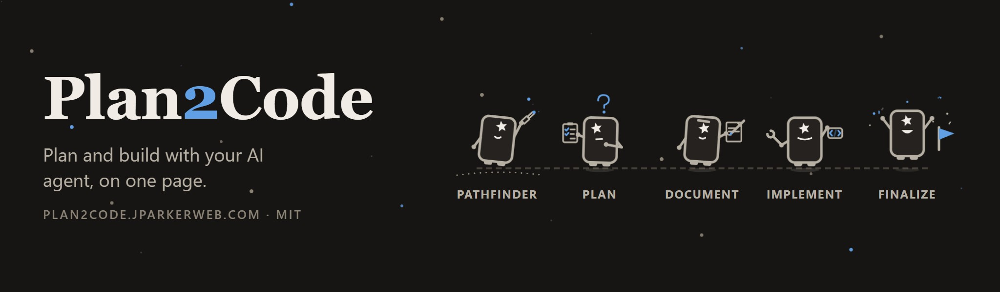
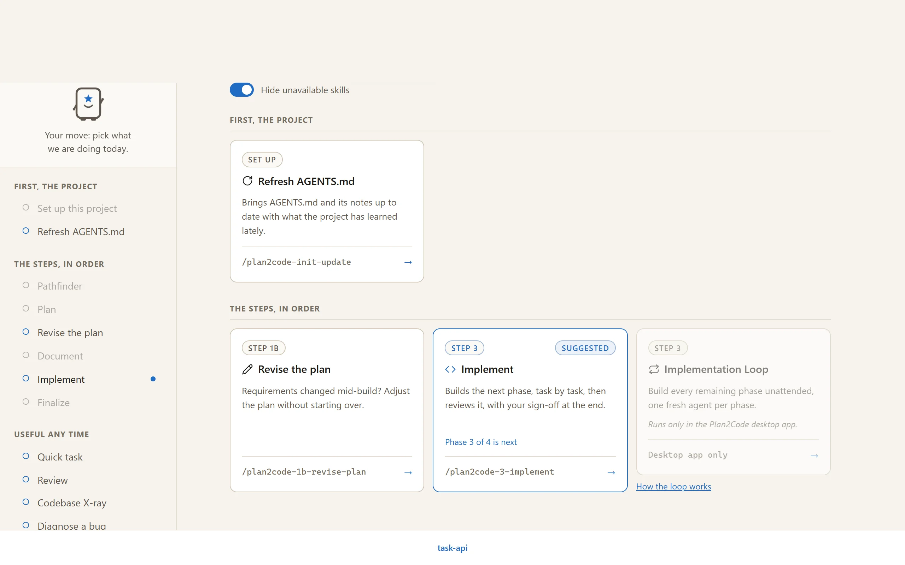
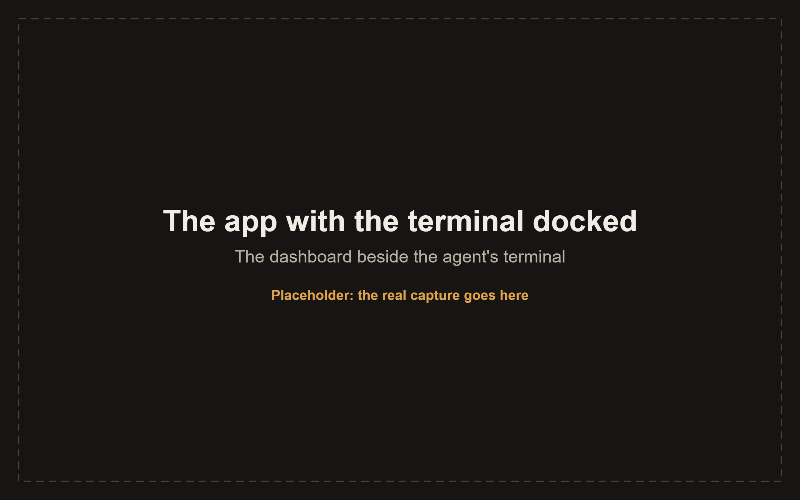
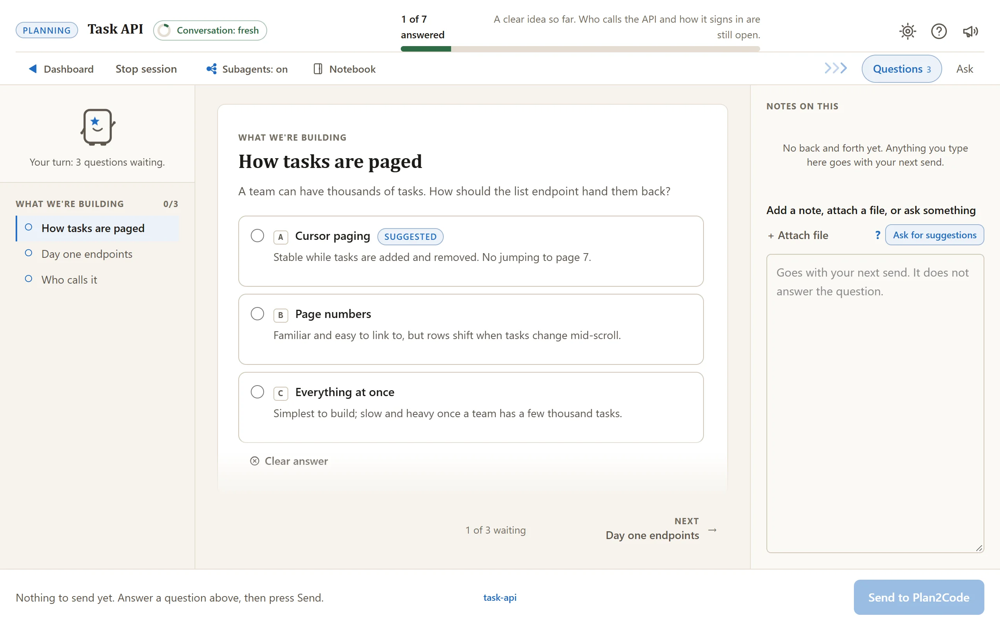
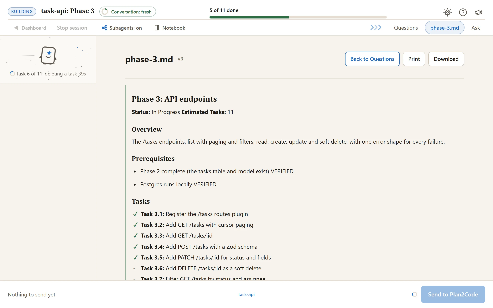
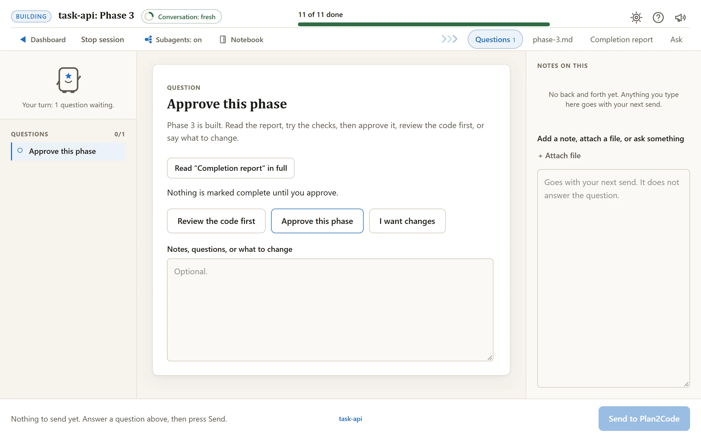
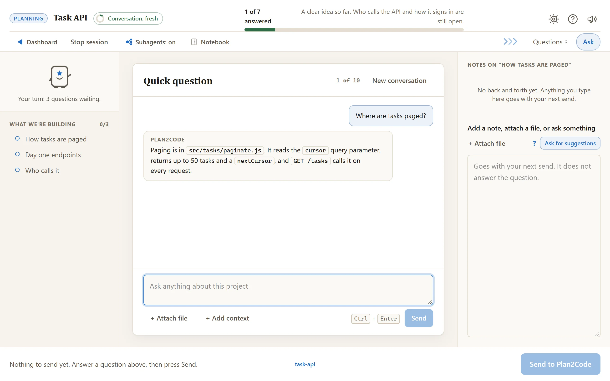

# Plan2Code

[](https://github.com/jparkerweb/plan2code/releases/latest) [](LICENSE) 

**Plan it. Approve it. Let it build.**

- **The app.** A desktop window with the dashboard and your agent's terminal side by side, for Windows, macOS and Linux.
- **The Loop.** It builds every remaining phase of a spec, one fresh agent per phase, while you do something else.
- **Plain files in your repo.** What you decide lands as specs, so the next session, agent and engineer start from the same plan.



Plan2Code is a spec-driven workflow for AI coding agents. You work through it on a page in your browser: the dashboard lists every step as a card, and each step's questions, progress and sign-offs arrive on that same page while your agent does the work. An approved plan becomes phase documents, and the agent builds to them one phase at a time.

Version 3.1.5 · Apache 2.0 · 📖 [plan2code.jparkerweb.com](https://plan2code.jparkerweb.com)

---

## Contents

- [See it](#see-it)
- [Install and start](#install-and-start)
- [A session on the page](#a-session-on-the-page)
- [The workflow](#the-workflow)
- [The skills](#the-skills)
- [The four rules](#the-four-rules-that-do-most-of-the-work)
- [What lands in your repo](#what-lands-in-your-repo)
- [Troubleshooting](#troubleshooting)
- [Dive deeper](#dive-deeper)

---

## See it

<picture>
  <source media="(prefers-color-scheme: dark)" srcset="docs/screenshots/dashboard-dark.webp">
  
</picture>

The dashboard, in a project halfway through a build. It suggests the next step for the spec you pick.

```bash
npx --allow-git=all git+https://github.com/jparkerweb/plan2code.git#release
```

Needs Node.js 18+ and Git (details under [Before you start](#before-you-start)). Then `cd` into your project and run `plan2code`.

---

## Install and start

### Before you start

- **Node.js 18 or newer** (22 or newer if you install Claude Code with npm). Check with `node --version`. No Node? Get it from [nodejs.org](https://nodejs.org/) (the LTS download), or run `winget install OpenJS.NodeJS.LTS` on Windows, `brew install node` on macOS, or use `nvm` on Linux. Then open a new terminal.
- **Git.** Check with `git --version`. The installer is fetched from GitHub with Git, and without it npm stops with `spawn git ENOENT`. No Git? Get it from [git-scm.com](https://git-scm.com/downloads), or run `winget install Git.Git` on Windows, `brew install git` on macOS, or use your package manager on Linux. Then open a new terminal.
- **Start from your project.** Open your terminal in the project you want to work on (`cd` into it) before you run anything. Plan2Code works on the folder you start it in.
- **Ways in.** `plan2code` (Claude Code, Devin or Codex), or type `/plan2code` in your agent (`$plan2code` in Codex).
- **No agent yet?** Install Claude Code, Codex or Devin first, or let the `plan2code` command's setup page walk you through it.

Installation needs network access and runs through the [skills CLI](https://skills.sh). The command installs the newest release: `#release` is a branch that moves to each release as it is published, so you never get unfinished work from `main`. To update, run `plan2code update`: it installs the newest release too, prints `Updating <old> -> <new>` (or `Already on <new>` and stops; `plan2code update --force` reinstalls anyway), and `plan2code update --main` takes the newest work on `main` instead. **Go back to a release** with `plan2code update --tag v3.0.2` (any release tag works). To remove everything, run `plan2code uninstall`: it asks first, then asks whether your own data in `~/.plan2code/` (notebooks, handoffs, settings) goes too. `--yes` skips the questions and keeps your data; add `--purge` to delete it.

```bash
npx --allow-git=all git+https://github.com/jparkerweb/plan2code.git#release
```

This fetches the installer to a temp directory, builds the workflow as Agent Skills, delegates
installation to `skills add`, and cleans up after itself. The installed skills work independently
from then on.

**Back at your prompt with no output at all?** The installer always opens the menu below, so nothing
means npm could not reach the repository and hid the reason. Run
`git ls-remote https://github.com/jparkerweb/plan2code.git` to see it: usually the network, a proxy
or the VPN.

The installer opens this menu (cloning and running `node install.js`, below, opens the same one):

```
╔═════════════════════════════════════════════════════════╗
║ INSTALL PLAN2CODE                                       ║
╠═════════════════════════════════════════════════════════╣
║  I.  INSTALL    Install skills + the plan2code command  ║
║  U.  UNINSTALL  Remove everything Plan2Code installed   ║
║  A.  ADVANCED   Project install, dev tools, and more    ║
║  Q.  QUIT       Exit                                    ║
╚═════════════════════════════════════════════════════════╝
```

### Start

1. `cd` into your project, then run `plan2code`. It starts Claude Code, Devin or Codex on the dashboard,
   and the dashboard opens in your browser.
2. In a project without an `AGENTS.md`, pick **Set up this project** first: Plan and Quick task
   need it.
3. Pick a card.

Already inside your agent? Type `/plan2code` instead (`$plan2code` in Codex).

Run `plan2code` from any project to open the dashboard in Claude Code, Devin or Codex (it asks which when more than one is installed). Flags, permission prompts, the desktop shortcut, other agent CLIs and the setup page for a missing agent are in [.readme/launcher.md](.readme/launcher.md).

### The desktop app



The installer also offers the **Plan2Code desktop app**: one window with the dashboard and your agent's terminal side by side, docked right or bottom. A launch card asks which agent, model and effort to start on, and once it is installed `plan2code` opens the app (`plan2code --classic` keeps the terminal flow). `plan2code update` updates the skills, the command and the app together.

The app is not code-signed (signing is not planned for now), so your system may ask you to allow it once. More about the app, a manual download and the Implementation Loop: [docs/desktop-app.md](docs/desktop-app.md).

**Supported tools** (the agents the skills CLI can install into): every agent it supports, including Claude Code · Cursor ·
GitHub Copilot · Windsurf · Codex · Continue · Codeium · Zed · Amp · OpenCode · Devin · Crush · Pi ·
Gemini CLI · Cline · Roo · Kilo · Goose · Trae · Qwen Code.

**Launched by `plan2code`:** the `plan2code` command and the desktop app open the dashboard directly in Claude Code, Devin and Codex (the built-ins in `src/launcher/agents.json`). GitHub Copilot CLI, OpenCode, Gemini CLI, Pi and Cursor CLI come as starter templates, and you can add any other agent CLI as a custom agent in User Preferences → Agents & models.

The installer keeps one canonical copy of each skill under `~/.agents/skills/` and links it into
agents that maintain their own directory. To update, run `plan2code update` (or re-run the install command); to remove it all, run `plan2code uninstall`.

Use the installer rather than calling `skills add` against the repository root: recursive discovery
would also find maintainer-only skills under `.claude/skills/`. The installer targets `skills/`
explicitly.

<details>
<summary>Prefer to clone?</summary>

```bash
git clone https://github.com/jparkerweb/plan2code.git
cd plan2code
node install.js

# Only if you plan to modify or contribute to Plan2Code itself
npm install && npx husky
```
</details>

---

## A session on the page

**Answer the questions.** They arrive a few at a time, each option with its trade-off written beside
it, and a progress bar says how far along you are.

<picture>
  <source media="(prefers-color-scheme: dark)" srcset="docs/screenshots/question-dark.webp">
  
</picture>

**Watch the build.** Tasks tick off as they land, and the line beside Planny says what is being
worked on right now.

<picture>
  <source media="(prefers-color-scheme: dark)" srcset="docs/screenshots/build-dark.webp">
  
</picture>

**Sign off.** Read the completion report, then approve the phase or ask for changes. In Implement,
you can also have the code reviewed first; Implement + Review has already done it.

<picture>
  <source media="(prefers-color-scheme: dark)" srcset="docs/screenshots/signoff-dark.webp">
  
</picture>

**Ask a quick question any time.** The Ask tab is a chat beside the cards, answered at the agent's
next check-in, and it never holds up your answers.

<picture>
  <source media="(prefers-color-scheme: dark)" srcset="docs/screenshots/ask-dark.webp">
  
</picture>

There is more on the page when you need it. Notes on any question can carry screenshots and
documents. The folder label in the bottom bar opens your workspace, where you add other folders
as read-only context and point at them by `@name`. The **Notebook** in the top bar is a private pad of your own for the
folder, in Markdown with pictures, that the agent reads only when you start a skill from one of its tabs on
the dashboard and send the box it fills. The **die** beside it opens **Activities**,
thirteen small games to play through a long wait, which pause the moment it is your turn. The session meter in the top bar turns from green
to red as a session grows long and suggests a fresh one. **Stop session** saves your place and gives
you the command to carry on later, and **Back to the dashboard** takes you home to pick the next
step in the same session.

---

## The workflow

```
 ┌╴╴╴╴╴╴╴╴╴╴╴╴┐
 ╎0 PATHFINDER╎ optional · for an idea too big or unclear to plan
 └╴╴╴╴╴╴┬╴╴╴╴╴┘
        ▼
 ┌────────────┐  ┌────────────┐  ┌────────────┐  ┌╴╴╴╴╴╴╴╴╴╴╴╴┐  ┌────────────┐
 │  1  PLAN   │─>│ 2 DOCUMENT │─>│3 IMPLEMENT │─>╎   REVIEW   ╎─>│ 4 FINALIZE │
 │decide what │  │ draw it as │  │build to the│  ╎  optional  ╎  │verify, sum,│
 │  to build  │  │phase specs │  │  drawing   │  ╎  any time  ╎  │  archive   │
 └────────────┘  └────────────┘  └────────────┘  └╴╴╴╴╴╴╴╴╴╴╴╴┘  └────────────┘
     short sessions: fresh when the meter turns red, and before a big step
 ├◀─────────────── one feature, start to archive ──────────────────▶┤
```

Each box is a card on the dashboard. Chaining a couple of small steps in one session is fine, but
start a fresh session before a big plan or build step: planning context leaking into implementation
is where most agent drift starts.

Every box is a card, and so is every other skill. They are all in [The skills](#the-skills), with the command for each.

Pathfinder, Plan, Revise the plan and Quick task can each offer a prototype when a decision is about how a screen looks or flows, and run it right there in the same session; nothing is drawn without your yes.

---

## The four rules that do most of the work

**1 · Keep each session short.**
Chaining a couple of small skills on the dashboard is fine. Start a fresh console session when the session meter turns red, and always before a big planning or build step. The specs on disk carry everything between sessions.

**2 · No code until the plan hits 90% confidence.**
Step 1 will not finalize below the threshold. Under it, the agent keeps asking and keeps reading your
code — and writes every assumption down where you can argue with it.

**3 · Checkboxes are the state, not the chat.**
Progress lives in the spec files. Any agent, any session, resumes cold from them.

**4 · Approve a phase to close it.**
On the sign-off card, or by replying `approved` in the terminal. Nothing advances on a guess about
what you meant.

---

## What lands in your repo

Each feature gets a folder under `specs/` (the plan, the overview and one file per phase), and Step 4
moves it to `specs--completed/`. The layout and progress marks are on the
[quick reference](QUICK-REFERENCE.md#file-structure).

Add `specs/` to your project's `.gitignore`: it's your working
drawing, not a deliverable. Share a folder deliberately with `git add -f` when you want to.

`.plan2code/` is what Plan2Code saves with the repository: the project's lessons and the Learning switch. It's shared with your team, so commit it and don't add it to `.gitignore`.

Step 2 marks which phases don't share files. Open a second agent on one of those, and the `[/]` marks
keep the two out of each other's way.

---

## The six steps in detail

Each step is its own run, and the specs on disk are the only thing carried from one to the next. What each step asks, writes and hands on is in [.readme/steps.md](.readme/steps.md).

---

## The skills

Each one is a card on the dashboard and a command in your agent. Which cards light up for the spec you pick, the inputs and outputs, and the decision tree are on the [quick reference](QUICK-REFERENCE.md).

| Command | What it does |
|---------|--------------|
| `/plan2code` | Open the dashboard: every skill below as a card, launched on the page |
| `/plan2code-init` | Set up this project: reads it and writes AGENTS.md, the guide every later step works from |
| `/plan2code-init-update` | Refresh AGENTS.md with what the project has learned lately |
| `/plan2code-0-pathfinder` | Pathfinder: turn a foggy idea into decisions, one question at a time, and hand a plan draft to Plan |
| `/plan2code-1-plan` | Plan: requirements, technical design and your approval |
| `/plan2code-2-document` | Document: turn the plan into phase files of small tasks |
| `/plan2code-3-implement` | Implement: build the next phase, with a report and your sign-off |
| `/plan2code-3-implement-review` | Implement + Review: build the phase, review it, then ask for sign-off |
| `/plan2code-4-finalize` | Finalize: check the work, summarize, archive the specs, suggest the commit |
| `/plan2code-1b-revise-plan` | Revise the plan: requirements moved mid-build, so change the specs, not the code |
| `/plan2code-quick-task` | Quick task: a small change with a quick plan, then it builds it |
| `/plan2code-review` | Review: a second opinion on your changes, problems ranked, you pick what gets fixed |
| `/plan2code-handoff` | Handoff: pack this conversation into a document a fresh session picks up cold |
| `/plan2code-xray` | Codebase X-ray: explain how and why an area works, or rank the rough spots; never edits code |
| `/plan2code-diagnose` | Diagnose a bug: find the cause and write it up without fixing it |
| `/plan2code-pr-prep` | PR Prep: run the checks your branch needs, say if it is ready, write the PR description |
| `/plan2code-test` | Write missing tests: find untested code and write tests in your project's style |
| `/plan2code-dead-code` | Clear out dead code: find what nothing uses, remove only what you pick |
| `/plan2code-deps` | Update dependencies: label each update Safe, Check first or Warning, apply what you pick in batches |
| `/plan2code-ui-prototype` | Prototype a screen: several versions on one page with live dials; never changes your code |
| `/plan2code-changelog` | Changelog: check the CHANGELOG version against the default branch, suggest entries |
| `/plan2code-git` | Git: branches, pull, push and commits on one board, asking before anything leaves your machine |

### Prefer the terminal?

Every skill also runs right in the terminal. Each one asks at the start whether you want the web
console or the terminal; add `--web` to skip the question and go straight to the web console:
`/plan2code-1-plan --web plan a REST API for tasks`.

---

## Troubleshooting

**The skills aren't recognized.** Re-run the installer and restart your AI tool. Confirm the global
install with `npx skills@1.7.6 list -g`. For a project install, check the generated directories aren't
gitignored.

**Your tool doesn't read Agent Skills.** Since v2.2.0, Plan2Code ships only as skills. If your tool
has no skill support, paste the relevant `src/plan2code-*.md` manually or point it at the installed
copy under `~/.agents/skills/`.

**The agent starts coding during planning.** The prompts forbid it, but models drift. Say: "Stay in
planning mode. Do not write code yet."

**The agent doesn't know what to implement.** Give it the path to `overview.md` — it reads the phase
file itself from there.

**You lost track between sessions.** `overview.md` has the phase status; the phase files have the
task status. That's the whole state.

**The agent isn't following the spec.** Point at the specific phase document and tell it to re-read
the requirements.

**Too many or too few phases.** Fix it in Step 2 — a phase should be a logical grouping of work, not
a fixed size.

**The agent runs on another machine, or over SSH.** The page is served on `127.0.0.1` of the machine
the agent runs on, so your browser can only reach it there. A forwarded port often works; otherwise
work in the terminal, which loses nothing.

**Web console problems** (lost contact, a closed tab, a dead link): see
[.readme/web-console.md](.readme/web-console.md#troubleshooting).

---

## Customizing

The prompts are yours to edit. Common changes: add testing requirements in Step 2, move the 90%
confidence threshold in Step 1, restructure the `specs/` layout, or add review gates to Step 3.
Source files live in `src/`; run `npm run build:skills`, then re-run `node install.js` to push your
edits out through the skills CLI.

---

## Dive deeper

Core reference:

- **[.readme/](.readme/README.md)**: the index of the long guides
- **[.readme/web-console.md](.readme/web-console.md)**: the guide to the web console, from the dashboard to the last sign-off, including the private Notebook, with [Activities](.readme/activities.md) and the [internals](.readme/web-console-internals.md) in their own files
- **[QUICK-REFERENCE.md](QUICK-REFERENCE.md)** — the one-page card: commands, inputs, outputs, decision tree
- **[.readme/walkthrough.md](.readme/walkthrough.md)** — one feature from a sentence to archived specs, session by session
- **[AGENTS.md](AGENTS.md)** — architecture and contributor guide for this repo
- **[CHANGELOG.md](CHANGELOG.md)** — what changed, and why

Optional tooling — none of it is required to use the workflow:

- **[.readme/status-line.md](.readme/status-line.md)** — three-line Claude Code status bar: model, context, quota, diff
- **[.readme/metrics.md](.readme/metrics.md)** — `plan2code-metrics`, measuring and improving the prompts themselves
- **[.readme/test-bot.md](.readme/test-bot.md)** — `plan2code-bot`, maintainer harness that runs the whole workflow unattended
